# 15/9

## 1. Cos’è un Business Process

Un **Business Process** può essere definito come:

> un insieme di passi o attività finalizzati al raggiungimento di un certo risultato.

Gli esempi possono essere molto diversi, come:

- apertura di un conto;
    
- gestione di un ordine;
    
- elaborazione di una richiesta;
    
- produzione di un prodotto o servizio.
    

L’elemento importante non è quindi una singola attività, ma **come varie attività sono organizzate e coordinate per produrre un risultato**.

---

## 2. Business Process Management — BPM

Il **Business Process Management (BPM)** riguarda la gestione sistematica dei processi aziendali.

Tra gli obiettivi principali ci sono:

- automatizzare i workflow;
    
- orchestrare processi complessi;
    
- ridurre il rischio di errori;
    
- ottenere metriche sul processo;
    
- conoscere lo stato del processo in tempo reale;
    
- imporre scadenze;
    
- validare i dati;
    
- ridurre i costi di formazione.
    

Quindi BPM non significa semplicemente “disegnare diagrammi”, ma riguarda l’intero ciclo di:

**modellazione → esecuzione → analisi → verifica → miglioramento**

dei processi.

---

## 3. Obiettivi del corso

Il corso affronta diversi aspetti del Business Process Management.

In particolare:

### Linguaggi grafici

Vengono utilizzate notazioni grafiche per rappresentare processi, come:

- **BPMN**
    
- **EPC**
    

Queste permettono di rappresentare visivamente attività, decisioni, sincronizzazioni e interazioni.

---

### Modelli formali

Dietro ai diagrammi grafici possono esserci modelli matematici rigorosi, tra cui:

- automi;
    
- **Petri Nets**;
    
- **Workflow Nets**.
    

I modelli formali consentono di ragionare matematicamente sul comportamento dei processi.

---

### Proprietà strutturali e comportamentali

È possibile verificare proprietà del processo e individuare problemi come:

- **dead tasks**;
    
- **deadlock**;
    
- comportamenti non desiderati.
    

---

### Correttezza

Vengono studiate proprietà come:

- **soundness**;
    
- **boundedness**;
    
- **liveness**;
    
- **free-choice**.
    

L’obiettivo è stabilire se il processo si comporta correttamente in tutti i casi possibili.

---

### Verification tools

Alcuni strumenti utilizzati sono:

- WoPeD;
    
- ProM;
    
- Woflan;
    
- traduttori BPMN → Petri Net.
    

Questi permettono di effettuare analisi automatiche dei modelli.

---

### Performance analysis

Un processo non deve essere soltanto corretto: deve essere anche efficiente.

Per questo vengono analizzati:

- bottleneck;
    
- simulazioni;
    
- capacità del sistema;
    
- capacity planning.
    

---

### Process Mining

Il process mining utilizza dati reali provenienti dall’esecuzione dei processi per:

- scoprire automaticamente modelli;
    
- confrontare il comportamento reale con quello previsto;
    
- migliorare i processi.
    

---

## 4. Dati e processi

Tradizionalmente i sistemi informativi venivano progettati partendo principalmente dai **dati**.

La domanda fondamentale era:

**“Che cosa dobbiamo rappresentare?”**

Da qui derivavano tecniche come:

- database;
    
- modelli ER;
    
- modelli concettuali dei dati.
    

Il PDF sottolinea però che oggi i **processi sono importanti quanto i dati** e devono essere supportati sistematicamente.

Quindi abbiamo due dimensioni:

**What → dati**

**How → processi**

Non basta sapere quali informazioni esistono; bisogna anche capire **come vengono trasformate e utilizzate nel tempo**.

---

## 5. Perché i Business Process sono importanti

Ogni prodotto o servizio è il risultato dell’esecuzione di una serie di attività.

Per un’azienda, due importanti vantaggi competitivi sono:

- riuscire a portare rapidamente nuovi prodotti sul mercato;
    
- riuscire a modificare prodotti esistenti a basso costo.
    

I business process sono fondamentali perché permettono di:

- organizzare le attività;
    
- comprendere le relazioni tra esse;
    
- coordinare persone e sistemi.
    

L’Information Technology rappresenta un supporto fondamentale per realizzare questi obiettivi.

---

## 6. Modellazione

Una definizione intuitiva proposta nelle slide è:

**Modelling = dare forma a idee, organizzazioni, processi, collaborazioni e pratiche.**

Modelliamo qualcosa principalmente per tre ragioni:

1. **analizzarlo**;
    
2. **comunicarlo ad altri**;
    
3. **modificarlo**, se necessario.
    

Quindi un modello non serve soltanto a documentare un sistema.

Serve anche come strumento di ragionamento.

Un modello permette di passare da qualcosa di complesso e poco strutturato a una rappresentazione più semplice su cui possiamo ragionare.

---

## 7. Un modello non coincide con la realtà

Una delle idee centrali dell’introduzione è:

> “All models are wrong, but some are useful.”

Un modello è necessariamente una **semplificazione della realtà**.

Non cerca di rappresentare ogni dettaglio.

Deve invece rappresentare **gli aspetti rilevanti rispetto al problema che vogliamo studiare**.

Ad esempio, una mappa stradale non rappresenta:

- ogni edificio;
    
- ogni albero;
    
- ogni dettaglio geografico.
    

Rappresenta ciò che è utile per muoversi.

Lo stesso vale per i modelli di processo.

---

## 8. Workflow Management e BPM

Negli anni '90 i **Workflow Management Systems** cercavano soprattutto di automatizzare processi strutturati.

Il loro ambito era però relativamente limitato.

Il BPM amplia questo punto di vista.

Si passa da:

**workflow management system**

principalmente interno a una singola organizzazione,

a:

**process-aware information systems**

che possono coinvolgere anche più organizzazioni.

Questo passaggio introduce una visione più ampia del processo.

---

## 9. Prima e dopo BPM

Senza un approccio sistematico ai processi:

- si conosce l’obiettivo finale;
    
- ma ogni caso può essere gestito in modo diverso.
    

Con BPM:

- il comportamento del processo viene esplicitato;
    
- sappiamo come trattare ogni occorrenza;
    
- possiamo conoscere lo stato corrente;
    
- possiamo imporre vincoli e scadenze;
    
- possiamo raccogliere metriche.
    

L’introduzione di un **BPMS — Business Process Management System** permette inoltre di automatizzare molte di queste attività.

---

## 10. Le diverse prospettive del BPM

Il BPM interessa persone con background molto differenti.

Il corso distingue tre prospettive principali.

### Business administration

Obiettivi:

- aumentare la soddisfazione del cliente;
    
- ridurre i costi;
    
- introdurre nuovi prodotti.
    

---

### Software development

Obiettivi:

- creare software robusto e scalabile;
    
- integrare software esistente;
    
- utilizzare nuove tecnologie.
    

---

### Formal methods

Obiettivi:

- analizzare proprietà formali;
    
- individuare difetti;
    
- correggere problemi;
    
- astrarre dalla complessità del mondo reale.
    

Il BPM cerca di mettere in comunicazione questi tre mondi.

Il suo obiettivo complessivo è ottenere una:

**realizzazione robusta e corretta dei business process nel software**

che contribuisca a migliorare la soddisfazione del cliente e il vantaggio competitivo dell’impresa.

---

## 11. L’astrazione

L’**astrazione** è uno dei concetti fondamentali del corso.

Persone con background differenti guardano allo stesso sistema in modi differenti.

Per esempio:

- un manager guarda agli obiettivi aziendali;
    
- uno sviluppatore guarda all’implementazione;
    
- un esperto di metodi formali guarda alle proprietà matematiche.
    

Il problema è che ciascuna prospettiva può concentrarsi troppo sul proprio livello.

L’astrazione permette quindi di creare:

**un linguaggio comune tra differenti punti di vista.**

Come affermano le slide:

> abstraction is the key to achieve some common understanding.

---

## 12. Livelli di astrazione

Lo stesso oggetto può essere rappresentato in molti modi.

L’esempio delle slide è una mappa della Terra.

Possiamo avere:

- un globo;
    
- una mappa politica;
    
- una mappa geografica;
    
- una mappa stradale.
    

L’oggetto è lo stesso, ma cambiano:

- il livello di dettaglio;
    
- il punto di vista;
    
- lo scopo.
    

Quindi:

**one object → many views**

In generale possiamo avere:

**scopi diversi → astrazioni diverse → modelli diversi**

oppure anche:

**stesso scopo → astrazioni diverse → modelli diversi**

---

## 13. Le astrazioni possono essere progettate o ricavate

Un concetto interessante introdotto attraverso l’esempio del calcio è che un modello può essere:

### Prescrittivo

Definiamo il modello prima dell’esecuzione.

Ad esempio:

> questo è il piano tattico che la squadra deve seguire.

---

### Derivato dal comportamento

Osserviamo quello che è successo e ricostruiamo il modello.

Ad esempio:

> osservando tutte le azioni della squadra, posso cercare di ricostruire la strategia adottata.

Questa seconda idea porta direttamente al **Process Mining**.

---

## 14. Process Mining

Il Process Mining studia i processi partendo dai dati generati durante la loro esecuzione.

I sistemi informatici memorizzano eventi come:

- operazioni;
    
- messaggi;
    
- transazioni;
    
- timestamp;
    
- utenti;
    
- risorse.
    

Questi dati possono essere organizzati in **event logs**.

Ogni evento dovrebbe essere associato almeno a:

- un'attività;
    
- una specifica istanza del processo, detta **case**.
    

Possono essere presenti anche informazioni aggiuntive come:

- timestamp;
    
- risorsa che ha eseguito l’attività;
    
- dati associati.
    

Il diagramma a pagina 58 mostra il rapporto fra **mondo reale, sistema software, event log e process model**.

---

## 15. I tre tipi principali di Process Mining

Esistono tre grandi categorie.

### Discovery

Si parte dagli **event log** e si costruisce automaticamente un modello.

```text
event log → process model
```

Domanda:

> Qual è il processo realmente eseguito?

---

### Conformance checking

Si confrontano:

- modello previsto;
    
- comportamento osservato.
    

```text
process model ↔ event log
```

Serve a individuare deviazioni.

Domanda:

> Il processo reale rispetta il modello?

---

### Enhancement

Si usa il comportamento osservato per migliorare un modello esistente.

```text
process model + event log → improved model
```

---

## 16. Modelli formali e importanza delle dimostrazioni

La seconda parte della lezione usa il celebre problema dei **sette ponti di Königsberg** per mostrare perché astrazione, formalizzazione e dimostrazioni sono utili.

L’obiettivo non è semplicemente insegnare teoria dei grafi.

L’esempio mostra il metodo che verrà utilizzato nel corso:

```text
problema reale
↓
astrazione
↓
modello formale
↓
proprietà matematica
↓
teorema
↓
dimostrazione
↓
algoritmo
```

Questo schema è estremamente importante.

---

## 17. Il problema dei sette ponti di Königsberg

La città di Königsberg era attraversata dal fiume Pregel.

Sette ponti collegavano:

- due isole;
    
- le due sponde del fiume.
    

Il problema era:

> è possibile attraversare tutti i ponti una e una sola volta, tornando al punto di partenza?

Nessuno riusciva a trovare un percorso.

Euler ebbe un'intuizione fondamentale:

invece di continuare a cercare percorsi, cercò di **dimostrare che il percorso non poteva esistere**.

---

## 18. Astrazione del problema

Euler eliminò tutti i dettagli irrilevanti della città.

Le zone di terra diventano:

**vertici / nodi**

I ponti diventano:

**archi / edges**

Il problema geografico diventa quindi un problema su grafi.

Questo è un perfetto esempio di modellazione:

```text
Città reale
   ↓
diagramma astratto
   ↓
grafo
```

---

## 19. Property-preserving abstraction

Una buona astrazione non può essere arbitraria.

Deve preservare le proprietà importanti del problema.

Nel caso di Königsberg:

```text
problema originale
↓
attraversare ogni ponte una sola volta
```

diventa:

```text
problema sul grafo
↓
attraversare ogni arco una sola volta
```

L’astrazione deve quindi **preservare l’insieme delle soluzioni**.

Questo concetto sarà fondamentale anche nei business process.

---

## 20. Dal problema concreto al problema generale

L’astrazione permette tre livelli.

### Problema originale

Attraversare i sette ponti di Königsberg.

### Problema sul grafo

Disegnare il grafo senza:

- staccare la penna;
    
- ripassare un arco.
    

### Problema generalizzato

Dato un grafo connesso:

> esiste un circuito che attraversa ogni arco esattamente una volta?

Questo permette di risolvere non soltanto Königsberg, ma **un’intera classe di problemi**.

---

## 21. Terminologia sui grafi

## Path

Un **path** è una sequenza finita di archi contigui.

## Circuit

Un path è un **circuito** quando termina nello stesso vertice da cui è iniziato.

## Eulerian path

Un **cammino euleriano** attraversa ogni arco del grafo esattamente una volta.

## Eulerian circuit

Un **circuito euleriano** è un cammino euleriano che ritorna al vertice iniziale.

## Degree

Il **grado** di un vertice è il numero di archi incidenti su quel vertice.

Un vertice può essere:

- **even**, se il grado è pari;
    
- **odd**, se il grado è dispari.
    

---

## 22. Intuizione fondamentale

Se attraversiamo un vertice durante un circuito:

```text
entro → esco
```

Gli archi vengono quindi usati a coppie.

Di conseguenza, ogni vertice deve avere un numero pari di archi.

Nel grafo originale di Königsberg tutti e quattro i vertici hanno grado dispari.

Quindi:

**un circuito euleriano è impossibile.**

---

## 23. Teorema del circuito euleriano

Il PDF introduce il seguente teorema:

> Un grafo connesso contiene un circuito euleriano se e solo se ogni suo vertice ha grado pari.

Formalmente:

G ha un circuito euleriano  ⟺  ∀v∈V, deg⁡(v) eˋ pariG \text{ ha un circuito euleriano} \iff \forall v \in V,\ \deg(v)\text{ è pari}

Questo è un teorema **necessario e sufficiente**.

---

## 24. Necessità

Supponiamo che il grafo abbia un circuito euleriano.

Ogni volta che il circuito entra in un vertice deve anche uscirne.

Quindi gli archi incidenti sul vertice vengono consumati a coppie:

2+2+2+…2+2+2+\dots

Perciò ogni vertice deve avere grado pari.

Quindi:

EulerianCircuit(G)⇒∀v, deg(v) pariEulerianCircuit(G) \Rightarrow \forall v,\ deg(v)\text{ pari}

---

## 25. Sufficienza

L’altra direzione è più interessante:

∀v, deg(v) pari⇒EulerianCircuit(G)\forall v,\ deg(v)\text{ pari} \Rightarrow EulerianCircuit(G)

La dimostrazione presentata nel PDF procede per **induzione sul numero di archi**.

L’idea è:

1. dato che tutti i vertici hanno grado pari, nel grafo esiste almeno un ciclo CC;
    
2. si rimuovono gli archi di CC;
    
3. rimangono una o più componenti connesse;
    
4. i vertici continuano ad avere grado pari;
    
5. per ipotesi induttiva, ogni componente ha un circuito euleriano;
    
6. questi circuiti vengono inseriti all’interno del ciclo CC.
    

Alla fine si ottiene un circuito che attraversa tutti gli archi.

---

## 26. Una dimostrazione può diventare un algoritmo

Questa è probabilmente una delle lezioni concettuali più importanti del PDF.

Il teorema dice soltanto:

> il circuito esiste.

Ma la sua dimostrazione ci dice anche **come costruirlo**.

L’algoritmo è essenzialmente:

```text
trova un ciclo
rimuovilo
risolvi ricorsivamente le componenti rimanenti
inserisci i loro circuiti nel ciclo originale
```

Quindi:

**proof → constructive procedure → algorithm**

Questo principio tornerà nel corso quando si parlerà di **correctness by construction**.

---

## 27. Cammino euleriano

Viene poi generalizzato il risultato.

Un grafo contiene un **cammino euleriano** se e solo se possiede:

0 oppure 20 \text{ oppure } 2

vertici di grado dispari.

Quindi:

### 0 vertici dispari

Esiste un circuito euleriano.

### 2 vertici dispari

Esiste un cammino euleriano aperto.

I due vertici dispari saranno:

- punto iniziale;
    
- punto finale.
    

### Più di 2 vertici dispari

Non può esistere un cammino euleriano.

---

## 28. Dimostrazione del caso con due vertici dispari

Supponiamo che i due vertici dispari siano uu e vv.

Aggiungiamo temporaneamente un arco:

(u,v)(u,v)

Ora i loro gradi diventano pari.

Quindi tutti i vertici hanno grado pari e il nuovo grafo possiede un circuito euleriano.

Rimuovendo l’arco artificiale (u,v)(u,v), il circuito si trasforma in un cammino euleriano che:

- inizia in uu;
    
- termina in vv.
    

---

## 29. Cosa vuole insegnare veramente l’esempio di Euler

Il punto della lunga digressione non è semplicemente imparare i grafi euleriani.

Il PDF conclude esplicitamente con una serie di **Lessons learned**.

Il processo metodologico è:

### 1. Partire da un problema concreto

Ad esempio:

> attraversare i ponti di Königsberg.

### 2. Astrarre

Eliminare dettagli non importanti.

### 3. Costruire un modello

Nel caso di Euler, un grafo.

### 4. Preservare le proprietà importanti

Le soluzioni del modello devono corrispondere alle soluzioni del problema reale.

### 5. Usare una notazione visuale

Utile per capire intuitivamente il problema.

### 6. Usare una notazione matematica

Necessaria per avere:

- precisione;
    
- rigore;
    
- assenza di ambiguità.
    

### 7. Formulare teoremi

I teoremi permettono di rispondere a intere classi di problemi.

### 8. Dimostrare i teoremi

Le dimostrazioni spiegano perché una proprietà è vera.

### 9. Derivare algoritmi

Una dimostrazione costruttiva può suggerire direttamente un algoritmo.

---

## 30. Visual notation vs mathematical notation

Il corso utilizzerà entrambe.

### Visual notation

Vantaggi:

- intuitiva;
    
- leggibile;
    
- facile da comunicare.
    

Esempio:

```text
○ → [Activity] → ◇ → [Activity]
```

### Mathematical notation

Vantaggi:

- precisa;
    
- rigorosa;
    
- non ambigua;
    
- utilizzabile nelle dimostrazioni.
    

L’obiettivo non è scegliere una delle due.

Bisogna utilizzare **il livello di formalità adatto allo scopo**.

---

## 31. Prescriptive modelling vs model discovery

Il PDF anticipa due modi complementari di usare i modelli.

## Prescriptive

Il modello dice **come il processo dovrebbe comportarsi**.

```text
model → execution
```

È tipico della progettazione dei processi.

---

## Descriptive / discovery

Il modello viene ricostruito osservando ciò che è realmente accaduto.

```text
execution → event logs → model
```

È tipico del Process Mining.

---

## 32. Correctness by design

Tra gli argomenti che verranno sviluppati nel corso c'è la **correctness by design**.

L’idea è preferibile a:

```text
costruisco il sistema
↓
trovo gli errori
↓
li correggo
```

L’obiettivo è invece:

```text
uso componenti/regole corrette
↓
costruisco il processo
↓
ottengo correttezza per costruzione
```

È un tema strettamente collegato ai metodi formali.

---

## 33. Separation of concerns

Un altro concetto anticipato dal PDF è la **separation of concerns**.

Un sistema complesso viene studiato separando diversi aspetti:

- comportamento;
    
- dati;
    
- organizzazione;
    
- risorse;
    
- performance;
    
- implementazione.
    

Ogni modello può concentrarsi su un aspetto specifico senza dover descrivere tutto contemporaneamente.

---

## Schema riassuntivo dell’intera lezione

```text
REAL WORLD
    │
    ▼
Business Processes
    │
    ▼
Modelling
    │
    ├── graphical models
    │      └── BPMN
    │
    └── formal models
           ├── automata
           ├── Petri Nets
           └── Workflow Nets
                    │
                    ▼
                 Analysis
        ┌───────────┼───────────┐
        ▼           ▼           ▼
 verification   performance   simulation
        │
        ▼
 correctness
        │
        ▼
 implementation
```

Parallelamente:

```text
REAL EXECUTION
      │
      ▼
  Event Logs
      │
      ▼
Process Mining
 ┌────┼──────────────┐
 ▼    ▼              ▼
Discovery   Conformance   Enhancement
```

---

# 17/9

A (connected) graph G contains an Eulerian circuit if and only if there are no odd vertices.

A (connected) graph contains an Eulerian path if and only if there are 0 or 2 odd vertices.

## Process Orientation

We need products to live our lives = food

Immaterial products (services) are also frequent = entertainment

All products are the outcome of some work

Products are supplied to people via markets (distribution in exchange of money)

There are services and products necessary to keep the organization operating (not making a direct contribution to keep us alive)

People organize specialized work units (limited range of products, highly efficient)

Relatively autonomous divisions: they know how to do some specific product or how to provide some specific service

Process orientation is based on a critical analysis of a concept to organize work units originally introduced by Frederick Taylor

![[Pasted image 20260920182237.png]]

Aim: to improve industrial efficiency 

by analysing work, the "one best way" to do it would be found (time and motion study) 

Distinction between mental (planning work) and manual labor (executing work) 

Detailed plans, specifying the job and how it was to be done, were to be formulated by management and communicated to the workers

Pitfall of Taylorism:
- Plain functional breakdown is not efficient in business organizations that process information and immaterial data
- Steps of a business process are often related to each other
- Context information on the whole case is required during the process
- The handovers of work cause a major problem because of that (workers require knowledge)


Not only process orientation serves to capture the activities a company performs, but also to study and improve the connections between activities

Process perspective:
- Not only process orientation serves to capture the activities a company performs, but also to study and improve the connections between activities
- As a consequence, workers must have broader skills and competencies (knowledge workers must have a broad understanding of the ultimate goal of their work)
- Main effect, at the organizational level, process orientation is best achieved using a matrix organizational structure


## Organizational Structures

Each resource has the ability to carry out particular tasks and each task can be performed only by certain resources (e.g., bank tellers are not allowed to grant mortgag

In a process we can indicate: which tasks need to be performed, the order in which they must be carried out, who should do them

The way in which work items are allocated to resources (people, machines) is very important to the efficiency and effectiveness of the workflow

An organizational structure establishes how the work, authorities and responsibilities are divided up amongst its staff

Classification criteria can involve: 
- functions: functional properties and skills; 
- roles: position in the organization (like groups or work units)

A single resource can fulfil several roles, at the same time or at different times

Network Structure:

Network: autonomous actors collaborate to supply products or services (non-hierarchical structure, ad-hoc clustering, outsourcing, dynamic joining of team members)

![[Pasted image 20260920183101.png]]


Hierarchical structure:

Hierarchical: tree structure,
- internal nodes are individual roles/ functions, 
- leaves are staff or departments, 
- branches are authority relationships Also called organization chart

![[Pasted image 20260920183239.png]]


Matrix Structure:

Matrix: join hierarchical and (dynamic) functional dimension: one row for each process (each person can have one or more functional bosses, known as project leaders)

![[Pasted image 20260920183318.png]]


## Actors

Most people’s work is assigned or outsourced to them by other people: their principals (they can be individuals, departments or firms)

We can divide principals in two forms: boss and customer

Assignments ordered by bosses are often related to work for customers

A person who is assigned a task is called contractor (assignments can be carried out by machines and computer applications as well as people)

A contract exists between a principal and a contractor about the case to be performed (deadline for completion, price to be paid)

A communication protocol can be established between a principal and a contractor to exchange information

![[Pasted image 20260920183510.png]]

An actor can be a principal or a contractor, or play both roles at the same time (contractors may redirect work to third parties)

![[Pasted image 20260920183530.png]]

## Cases and Procedures

Many different types of work exist (baking bread, making forniture, design a building, collect surveys to compile a statistic)

They have in common the case: often one tangible thing produced or modified (bread, forniture, house, diagram) but more abstract cases are also possible (a lawsuit, an insurance claim, digital data)

Synonyms: work, job, product, service, item

---

Working on a case is typically discrete in nature 

Every case has a beginning and an end 

Each case can be distinguished from any other case 

Each case involves a procedure being performed: the tasks to be carried out and the conditions that determine the order of the tasks 

Synonyms: process, project


A task is a logical unit of work that is carried out as a single whole

A resource is the generic name for a person, machine or group of persons or machines that is responsible for a task

Some tasks can be performed by a computer without human intervention

Executing some tasks may require human intelligence: a judgement or a decision (a bank employee decides about a loan request)

Persons need knowledge to execute tasks (their past experience, company guidelines)

An activity is the performance of a task by a resource

Various cases may share the same procedure, but each case may involve different activities to be carried out, depending on case attributes (one insurance claim may involve objections and another one may not)

The number of procedures in a company is (generally) finite and far smaller than the number of cases to be handled

Example:
it is easier to make one hundred skirts with the same pattern than one hundred skirts using different patterns (off-the-rack is cheaper than made-to-measure)

The cost per case falls as the number of cases increases

Strategy: keep the number of procedures small and make the number of cases that each can perform as high as possible

Example:
Insurance companies want to keep the number of claims as low as possible, but this is generally a factor they cannot control

They can try to keep low the number of procedures, but the risk is to make them too much complex (a unique procedure to handle all cases is possible in principle, but inefficient in practice)

Ideal situation: a small number of good procedures, with a lot of cases to be handled by each of them

Observation: task execution can be highly dependent on cases

## Process Orientation

Each product that a company provides to the market is the outcome of a number of tasks to be performed

Business processes are about activities understanding, correlation, organization and improvement

Process management systems support and encourage communication between employees and make their activities more controllable

Business process reengineering is based on the understanding that rapid, radical redesign of business processes can be the road to success

A business process is a collection of activities that take one or more kinds of input and create an output that is of value to the customer

The main innovation is the shift of focus on the business logic of the process (how work is done), instead of the product perspective (what is done)

Collection = Processes wrap up a collection of tasks

Definability = Processes must have clearly defined boundaries, input and output

A process is a specific ordering of work activities across time and space, with a beginning and an end.

Unless designers or participants can agree on the way work is and should be structured, it will be very difficult to systematically improve, or effect innovation in, that work

Following a structured process is generally a good thing, and there is nothing inherently slow or inefficient about acting along process lines

Ordered = Process tasks are ordered according to their position in time and space

A process is a set of linked activities that take an input and transform it to create an output.

Customer = The process output has a recipien

Linked = Process activities are linked along a value-added chain (order of execution)

Processes that are clearly structured are amenable to measurement in a variety of dimensions have cost, time, output quality, and customer satisfaction

When we reduce cost or increase customer satisfaction, we have bettered the process itself

Processes also need clearly defined owners to be responsible for design and execution.

Ownership must be seen as an additional or alternative dimension of the organizational structure.

During periods of radical process change, ownership takes precedence over other organizational structures. Otherwise process owners will not have the power or legitimacy needed to implement process designs that violate organizational charts and norms

Ownership = There is one responsible for the performance and continuous improvement of the process

Cross-functionality = A process can span several functions within and across the organizational structure

Other processes produce products that are invisible to the external customer but essential to the effective management of the business.

Primary process:

Produce company’s products (production processes)

Customer-oriented, even if sometimes the customer is not known in advance

Generate income for the company

Examples: raw materials purchase, service sale, design and engineering, distribution

Secondary process:

Support primary processes (support processes)

Examples: machinery purchase and maintenance, personnel management (recruitment and selection, training, work appraisal, payrolls, dismissal), financial administration, marketing

Tertiary process:

Direct and coordinate primary and secondary ones (managerial processes)

Fix objectives, allocated resources and preconditions for the managers of other processes

Examples: maintenance of contracts with financiers and other stakeholders

Diagram Notation:

Visual languages offer an important communication mean (intuitive, universal, immediate, non-technical, no / little prior knowledge required)

Natural choice: nodes and arrows (oriented graphs)

Standard:

A predefined (small) set of shapes and lines with non-ambiguous meaning

different colors, borders, symbols can be used to assign different meaning or add some information

e.g., different arrows for different dependencies

Important concept: start, end, task, link, order, ownership, responsibility


# 22/9

Definition: a business process consists of a set of activities that are performed in coordination in an organizational and technical environment. These activities jointly realize a business goal.

Orchestration = Each business process is enacted by a single organization

Collaboration/Choreography = but it may interact with business processes performed by other organizations.

Definition: business process model consists of a set of activity models and execution constraints between them

Definition: business process instance represents a concrete case in the operational business of a company, consisting of activity instances

Each activity model acts as a blueprint for a set of activity instances

Each business process model acts as a blueprint for a set of business process instances (related to cases)

If no confusion is possible, the term activity is used to refer to activity models (tasks) as well as activity instances

Analogously, the term process is used to refer to process models as well as process instances

Each business process starts and ends with a customer who requests a product and who receives the product as a result of the business process (a customer can be internal to the company)

Each business process is assigned a process owner, who is responsible for the process

the owner is in charge of making sure that process instances are conducted correctly, that business goals are met, and that process performances are measured and improved

Each business process comprises a set of activities needed to realize the business goals

tasks can be expressed at different levels of granularity (each unit of work is seen as an atomic action, possibly with a duration and a cost)

Execution constraints are used to order activities in a way that enterprise resources are used efficiently and at the same time the business goals are met

process orchestration languages are used to express execution constraints about distribution over time

Each task may need some specific abilities (roles) to be carried out

process orchestration languages are used to express execution constraints about distribution over space

From informal textual descriptions (requirements) to a particular business process modelling notation

Explicit business process models expressed in a graphical notation facilitate communication, so that different stakeholders can: communicate efficiently refine processes improve processes

Definition: business process management includes concepts, methods, and techniques to support the design, administration, configuration, enactment, and analysis of business processes.

We need explicit representation of business processes, their tasks and the execution constraints between them

Business processes can then be subject to analysis, improvement, and enactment

Business process models are the main artefact for implementing business processes

This implementation can be done by organizational rules and policies, but it can also be done by business process management (software) system

Definition: business process management system is a generic software system that is driven by explicit process representations to coordinate the enactment of business processes.

Example: insurance claim

1. recording the receipt of the claim 
2. establishing the type of the claim 
3. checking covering of client's policy 
4. checking the premium (payments up to date?) 
5. decision for rejection/admission: 
6. if 3 or 4 has negative result: producing a rejection letter, then 12 
7. if 3 & 4 have positive results: sending estimate amount to be paid, 
8. recording client's reaction 
9. assessment of objection: 
10. if 9 has negative result: decision to revise 7 
11. if 9 has positive result: payment of claim 
12. filing and closure of claim

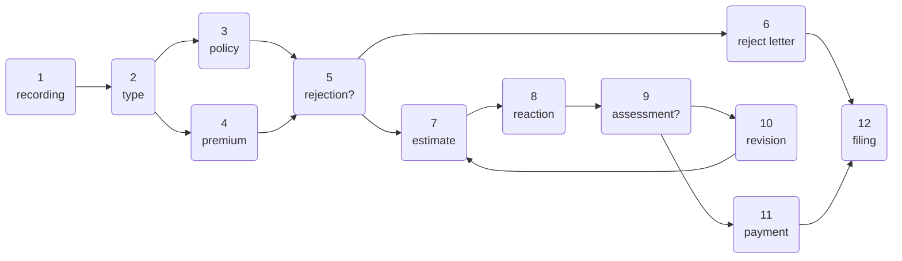

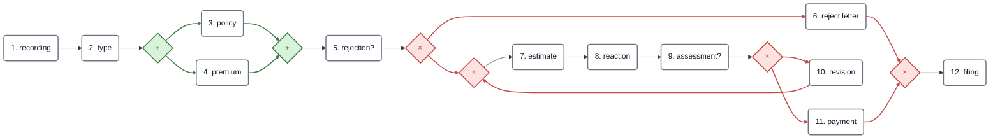

![[Pasted image 20260922094853.png]]

![[Pasted image 20260922104641.png]]

![[Pasted image 20260922104650.png]]


# 24/9

## 1. Perché introdurre le reti di Petri

I diagrammi di processo descrivono attività e percorsi possibili, ma per rispondere a domande come «qual è lo stato corrente del caso?» serve una semantica precisa dello stato e dei cambiamenti di stato. Le **reti di Petri** offrono una rappresentazione grafica semplice e una semantica formale per l'esecuzione dei processi. Qui sono impiegate come specifica **formale** (il comportamento delle istanze è definito senza ambiguità) e **astratta** (si prescinde dall'ambiente concreto di esecuzione). Le *workflow net* aggiungono vincoli strutturali adatti ai processi aziendali. (pp. 3–11, 40–46)

La notazione grafica va letta assieme alle regole sui token: due disegni simili possono ammettere esecuzioni diverse. Nei grafici Mermaid seguenti, i **cerchi** rappresentano *place*, i **rettangoli** rappresentano *transition* e `●` segnala un token iniziale. Mermaid è usato come schema didattico: la semantica è quella definita dalle formule, non dal motore di disegno.

## 2. Elementi di una rete

| Elemento | Simbolo usuale | Interpretazione possibile |
|---|---|---|
| **Place** (*posto*) | Cerchio | Stato, condizione, buffer, deposito di risorse |
| **Transition** (*transizione*) | Rettangolo | Attività, operazione, decisione, trasformazione |
| **Token** (*marca*) | Punto dentro un posto | Caso, documento, messaggio, risorsa o semplice attivazione |
| **Arc** (*arco*) | Freccia | Dipendenza tra un posto e una transizione |

Un arco ammesso va da **posto a transizione** oppure da **transizione a posto**. Nella rete trattata dalle slide non ci sono archi diretti posto–posto o transizione–transizione. Un arco $p\to t$ indica che $t$ consuma un token da $p$ quando scatta; un arco $t\to p$ indica che $t$ produce un token in $p$. (pp. 12–15)

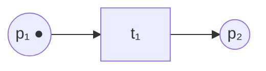

**Attenzione:** il token non è un arco né un'attività. È contenuto in un posto e rappresenta l'informazione o la risorsa necessaria per abilitare una transizione.

### Definizione formale

Una rete di Petri marcata è una tupla

$$
N=(P,T,F,M_0),
$$

dove:

- $P$ è un insieme finito di posti;
- $T$ è un insieme finito di transizioni, con $P\cap T=\varnothing$;
- $F\subseteq(P\times T)\cup(T\times P)$ è la relazione di flusso, cioè l'insieme degli archi;
- $M_0:P\to\mathbb{N}$ è la **marcatura iniziale**: $M_0(p)$ è il numero di token inizialmente presenti in $p$.

Una marcatura generica $M:P\to\mathbb{N}$ descrive invece lo **stato corrente** della rete. La struttura $P,T,F$ resta fissa durante l'esecuzione, mentre la marcatura cambia. (pp. 23, 29–30)

### Pre-set e post-set

Per qualsiasi nodo $x\in P\cup T$:

$$
{}^{\bullet}x=\{y\mid(y,x)\in F\},
\qquad
x^{\bullet}=\{y\mid(x,y)\in F\}.
$$

In particolare, ${}^{\bullet}t$ sono i posti **di ingresso** di $t$ (da cui consuma token), mentre $t^{\bullet}$ sono i posti **di uscita** (in cui produce token). Per un posto $p$, ${}^{\bullet}p$ sono le transizioni che producono token in $p$ e $p^{\bullet}$ quelle che li consumano. (pp. 24–27)

## 3. Il token game: abilitazione e scatto

Una transizione $t$ è **abilitata** nella marcatura $M$ quando ciascun posto di ingresso contiene almeno un token:

$$
M\vdash t\ \text{abilitata}
\quad\Longleftrightarrow\quad
\forall p\in{}^{\bullet}t,\;M(p)\geq 1.
$$

Quando $t$ **scatta** (*fires*), consuma un token da ciascun posto di ingresso e produce un token in ciascun posto di uscita. Indicando con $M\xrightarrow{t}M'$ lo scatto:

$$
M'(p)=M(p)-\mathbf{1}_{p\in{}^{\bullet}t}
                 +\mathbf{1}_{p\in t^{\bullet}}.
$$

Qui $\mathbf{1}_{C}$ vale $1$ se la condizione $C$ è vera e $0$ altrimenti. Se un posto è sia ingresso sia uscita della stessa transizione, il consumo e la produzione si compensano. La formula riguarda le reti ordinarie delle slide, con archi non pesati. (pp. 28–30)

Lo scatto è **atomico**. La semantica adottata nelle slide è **interleaving**: possono essere abilitate più transizioni nello stesso momento, ma si considera uno scatto per volta. Questo non esclude che la rete rappresenti attività indipendenti; semplicemente, le loro possibili esecuzioni sono descritte tramite diversi ordini di scatto. Il numero complessivo di token può aumentare o diminuire. (p. 30)

### Esempio: due input, un output

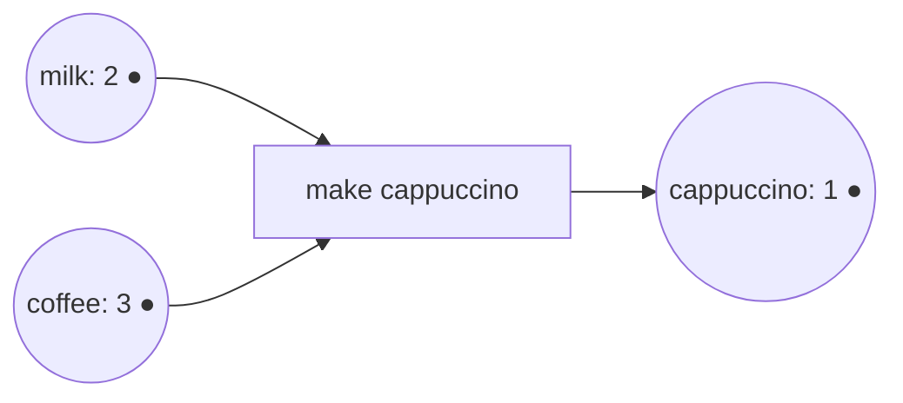

Con la marcatura mostrata nelle slide, $M(\text{milk})=2$, $M(\text{coffee})=3$ e $M(\text{cappuccino})=1$. Uno scatto di `make cappuccino` porta a $(1,2,2)$: consuma **un** token da ciascun input e aggiunge **un** token all'output. Dopo un secondo scatto la marcatura diventa $(0,1,3)$ e la transizione non è più abilitata, perché manca il latte. (p. 22)

### Esempio di evoluzione

Nell'esempio animato delle slide $t_1$ produce contemporaneamente token in $p_2$ e $p_3$; $t_2$ riporta un token da $p_3$ in $p_1$; $t_3$ usa $p_2$ e $p_3$ per produrre un token in $p_4$; $t_4$ riporta un token da $p_4$ in $p_3$. Con $M_0=\{p_1\}$, una sequenza possibile è: (pp. 31–39)

| Scatto | Marcatura dopo lo scatto | Transizioni abilitate subito dopo |
|---|---|---|
| Inizio | $\{p_1\}$ | $t_1$ |
| $t_1$ | $\{p_2,p_3\}$ | $t_2,t_3$ |
| $t_2$ | $\{p_1,p_2\}$ | $t_1$ |
| $t_1$ | $\{2p_2,p_3\}$ | $t_2,t_3$ |
| $t_3$ | $\{p_2,p_4\}$ | $t_4$ |
| $t_4$ | $\{p_2,p_3\}$ | $t_2,t_3$ |

La scrittura $2p_2$ significa **due token nello stesso posto** $p_2$. È utile controllare la marcatura dopo ogni scatto prima di decidere quale transizione può scattare.

## 4. Costrutti fondamentali

### Sequenza

Se $t_2$ richiede il token prodotto da $t_1$, $t_2$ può scattare solo dopo $t_1$. (p. 16)

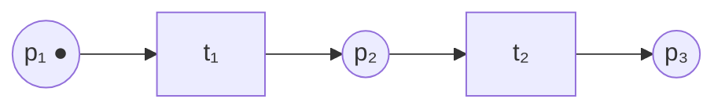

### XOR split e XOR join

Uno **XOR split** nasce quando due transizioni competono per lo **stesso token** di ingresso. Se una scatta, consuma quel token e l'altra non può più scattare per quella stessa istanza. Uno **XOR join** riunisce alternative: ciascuna transizione di ingresso può alimentare lo stesso posto successivo, senza attendere l'altra. (pp. 17–18)

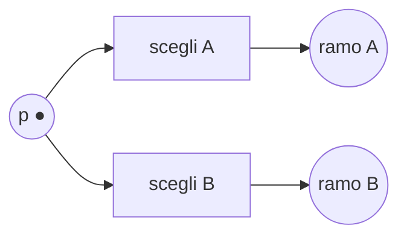

### AND split e AND join

Un **AND split** è una transizione con più posti di uscita: scattando produce un token **in ciascun ramo**. Un **AND join** è una transizione con più posti di ingresso: è abilitata solo quando **tutti** i rami richiesti hanno un token. (pp. 19–20)

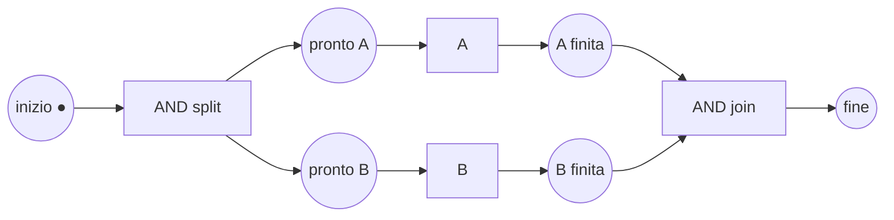

In questo esempio $A$ e $B$ possono avvenire in entrambi gli ordini, ma il join aspetta entrambe. Non basta disegnare due frecce: conta **se partono da una sola transizione** (produzione di due token) oppure **dallo stesso posto verso due transizioni** (competizione per un token).

### La figura chiamata «OR split»

Le slide mostrano una rete in cui da un posto si può scegliere una transizione che produce solo il ramo alto, solo il ramo basso, oppure entrambi. È quindi una realizzazione esplicita delle tre possibilità $\{A\}$, $\{B\}$ e $\{A,B\}$ mediante **transizioni distinte**. Non è un nuovo tipo primitivo di arco nella definizione formale della rete. (p. 21)

## 5. Workflow net (WfN)

Una **workflow net** è una rete di Petri $(P,T,F)$ che soddisfa questi vincoli **strutturali**:

1. esiste un posto iniziale distinto $i\in P$ con ${}^{\bullet}i=\varnothing$;
2. esiste un posto finale distinto $o\in P$ con $o^{\bullet}=\varnothing$;
3. ogni altro posto e ogni transizione appartengono ad **almeno un cammino** che va da $i$ a $o$.

Il token in $i$ rappresenta un caso non ancora iniziato; un token in $o$ rappresenta un caso terminato. Il terzo vincolo impedisce che parti della rete siano totalmente estranee al percorso di un caso. Per discutere l'esecuzione di un singolo caso si usa tipicamente la marcatura iniziale $M_0=[i]$: un token in $i$ e nessuno negli altri posti. (pp. 40–47)

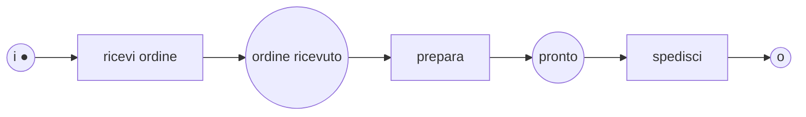

**Conseguenze strutturali:** $i$ è l'unico nodo senza archi entranti e $o$ l'unico nodo senza archi uscenti. Per esempio, se un altro nodo $v$ non avesse archi entranti, non potrebbe trovarsi lungo un cammino da $i$ a $o$, salvo coincidere con $i$. Analogamente per il nodo finale. (pp. 44–45)

Per riconoscere una WfN, controlla le **direzioni** degli archi, poi chiediti per ogni nodo: «esiste un cammino da $i$ fino a questo nodo e da qui fino a $o$?». Un ciclo può essere ammesso se i suoi nodi appartengono comunque a un cammino da $i$ a $o$. Se un arco torna in $i$, il posto scelto non ha più pre-set vuoto; se un ramo termina in un altro nodo senza poter raggiungere $o$, il terzo vincolo fallisce. (pp. 48–59)

> **Distinzione da ricordare:** appartenere a un cammino da $i$ a $o$ è una condizione sul **grafo**. Da sola non dimostra che tutti i cammini di esecuzione terminino, che non vi siano deadlock o che la marcatura finale contenga esattamente un token in $o$. Queste sono domande sul comportamento della rete.

## 6. Decorazioni grafiche e sottoprocessi

WoPeD mostra simboli decorati come **zucchero sintattico**: un'etichetta grafica compatta può essere espansa in una rete ordinaria. Per esempio, un AND split corrisponde a una transizione con più output; uno XOR split può essere espanso in transizioni alternative che condividono il posto di ingresso. Lo stesso vale per i join e per combinazioni di join e split. Le slide avvertono che alcune decorazioni si somigliano molto e che la loro posizione può cambiare il significato: per comprendere il comportamento, conviene espandere la forma abbreviata. (pp. 63–71)

La presenza di un unico ingresso e di un'unica uscita aiuta anche la **strutturazione gerarchica**: una transizione può essere raffinata da un'intera workflow net che rappresenta un sottoprocesso. (pp. 72–74)

## 7. Pattern di controllo nelle workflow net

Le slide riepilogano sequenza, parallelismo, scelta, iterazione e vincoli di capacità. (pp. 75–97)

| Pattern | Meccanismo nella rete | Proprietà da osservare |
|---|---|---|
| **Sequenza** | Token prodotto da $A$ e richiesto da $B$ | $B$ segue $A$ |
| **Parallelismo** | AND split, due rami, AND join | Si eseguono sia $A$ sia $B$, in qualunque ordine |
| **Scelta esplicita** | Transizione di scelta XOR, poi un ramo | La decisione si prende prima di abilitare $A$ o $B$ |
| **Scelta differita** | Due transizioni $A$ e $B$ competono per un token | Entrambe possono essere inizialmente abilitate; decide quella che scatta per prima |
| **Iterazione** | Arco di ritorno verso un punto precedente | Si ripete un'attività, con o senza esecuzione obbligatoria iniziale |
| **Capacità o esclusione** | Posto che rappresenta una risorsa condivisa | Una sola attivazione o attività concorrente usa la risorsa alla volta |

### Scelta esplicita e scelta differita

Nella **scelta esplicita**, una transizione decide il ramo prima che l'attività $A$ o $B$ sia abilitata. Nella **scelta differita/implicita**, $A$ e $B$ sono entrambe abilitate finché condividono il token; scattando, una consuma il token e disabilita l'altra. Il risultato «eseguo A oppure B» può apparire simile, ma **il momento della decisione cambia**. In BPMN le slide collegano questa distinzione allo XOR gateway rispetto alla scelta basata su eventi. (pp. 80–84, 105)

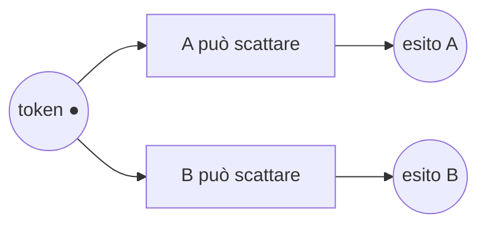

Il diagramma mostra la **scelta differita**: non esiste una transizione separata che selezioni il ramo prima di $A$ o $B$.

### Iterazione: almeno una volta oppure zero o più volte

Nel ciclo **one or more** il token deve passare per $A$ prima di arrivare al punto in cui si decide se ripeterla o uscire. Nel ciclo **zero or more** esiste una via d'uscita che evita $A$ già alla prima decisione. (pp. 85–92)

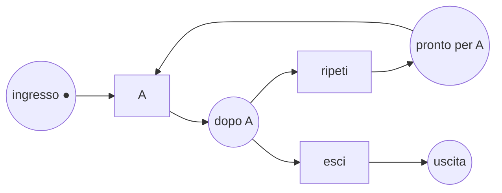

Questo schema rappresenta il caso **almeno una volta**. Per ottenere **zero o più volte**, il bivio va collocato *prima* di $A$, con un arco che arriva direttamente all'uscita.

### Posto come risorsa: capacità e mutua esclusione

Un posto con **un token di risorsa** può fungere da autorizzazione. La transizione d'ingresso in $A$ consuma quel token e quella d'uscita lo restituisce. Finché $A$ lo trattiene, un'altra attivazione che richiede la stessa risorsa deve aspettare: così si modellano «una pratica alla volta» o la mutua esclusione tra $A$ e $B$. Una diversa disposizione degli archi può imporre anche **alternanza**: $A$, poi $B$, poi di nuovo $A$. (pp. 93–95)

La mutua esclusione descrive quali attività non possono essere **contemporaneamente in corso**; non significa necessariamente che uno dei due rami venga omesso.

## 8. Trigger: chi o che cosa avvia una transizione

L'abilitazione data dai token può essere accompagnata da un **trigger**, cioè un'annotazione che specifica la causa esterna o l'iniziativa necessaria per avviare l'attività. Le slide distinguono: (pp. 98–104)

| Trigger | Significato | Esempio |
|---|---|---|
| Automatico | La transizione può partire automaticamente | Elaborazione interna |
| User | Un utente prende l'iniziativa | Invio manuale di una richiesta |
| External | Occorre un evento o messaggio esterno | Arriva una risposta |
| Time | Scade un timer | Invio di un sollecito |

Nell'esempio delle slide l'utente invia una richiesta; una risposta esterna può permettere di proseguire, mentre la scadenza di un timer può attivare un promemoria. I trigger **decorano** le transizioni e aggiungono informazione sul contesto di esecuzione; non cambiano la definizione strutturale di posto, transizione e arco.

## 9. Esercizio finale: gestione di un danno auto

La traccia delle slide descrive un'assicurazione che registra un sinistro, lo classifica come **semplice** o **complesso**, svolge i controlli, decide fra **OK** e **NOK** e invia comunque una lettera al cliente. Se l'esito è OK, effettua prima il pagamento. (pp. 106–108)

- **Sinistro semplice:** `check insurance` e `phone garage` sono indipendenti, quindi si avviano in parallelo e si attende che entrambi finiscano.
- **Sinistro complesso:** `check insurance` $\to$ `check damage history` $\to$ `phone garage`, in questo ordine.
- I due rami si riuniscono prima della decisione.
- **OK:** pagamento, poi lettera. **NOK:** lettera senza pagamento.

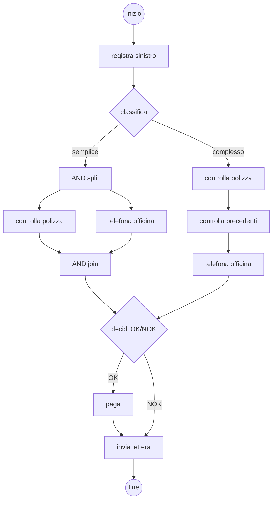

Questo diagramma riassume il **flusso del caso**. In una rete di Petri espansa si inseriscono posti tra transizioni consecutive e si realizzano i bivi XOR con transizioni alternative. Nel ramo semplice l'AND join richiede due token, uno per ciascun compito concluso. Nel ramo complesso i compiti restano in sequenza. Il pagamento appartiene soltanto al ramo OK, mentre la lettera è raggiungibile da entrambi gli esiti.

## 10. Domande utili per l'orale

1. Quali sono i quattro componenti di $(P,T,F,M_0)$ e che cosa rappresenta una marcatura?
2. Che differenza c'è tra posto, transizione e token?
3. Che cosa sono ${}^{\bullet}t$ e $t^{\bullet}$? Come si definiscono per un posto?
4. Quando una transizione è abilitata? Come si calcola la nuova marcatura dopo lo scatto?
5. Cosa significa che lo scatto è atomico e la semantica è interleaving?
6. Qual è la differenza strutturale e comportamentale tra XOR split e AND split?
7. Perché un AND join deve attendere token da tutti i suoi ingressi?
8. Quali sono le tre condizioni che definiscono una workflow net?
9. Perché una workflow net ha un unico nodo senza archi entranti e uno senza archi uscenti?
10. La sola definizione di workflow net garantisce che ogni caso finisca correttamente? Perché?
11. Come si distingue una scelta esplicita da una scelta differita?
12. Come si costruiscono cicli con una o più esecuzioni e con zero o più esecuzioni?
13. Come può un singolo token rappresentare una risorsa che impone mutua esclusione?
14. Quali trigger compaiono nelle slide e cosa aggiungono alla rete?
15. Come modelleresti i due tipi di sinistro dell'esercizio finale e perché il ramo semplice richiede un AND join?

### Schema conclusivo

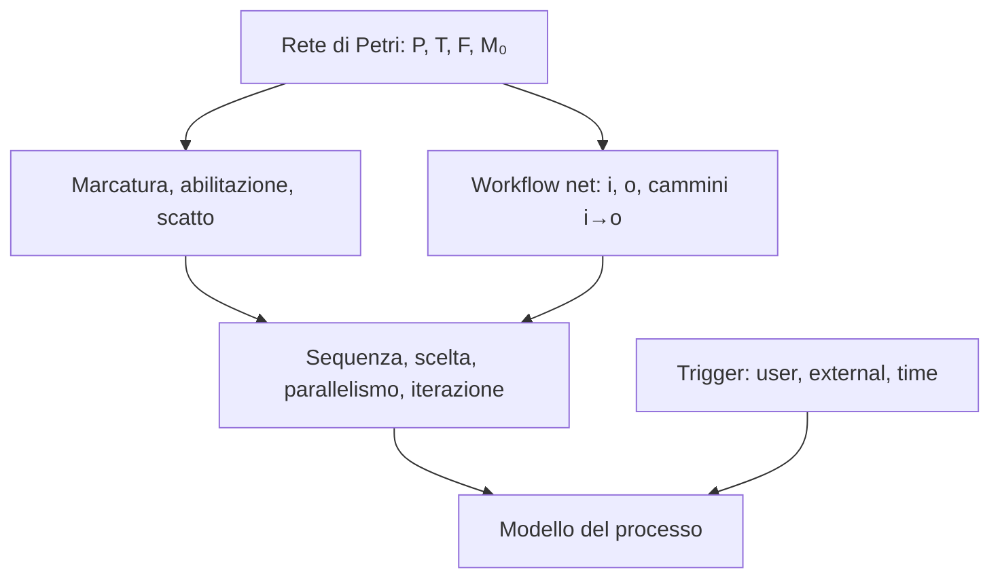

# 29/9

Appunti in italiano dalle slide **«2026-09-29 - BPM - 05-orchestration-collaboration»** di Roberto Bruni. I riferimenti `slide N` seguono la numerazione stampata nelle slide: dopo la 53 il PDF passa alla 60. I diagrammi Mermaid sono ricostruzioni schematiche per lo studio, non copie della notazione BPMN/EPC originale.

## 1. Perché servono diagrammi di processo

Un linguaggio grafico aiuta persone con competenze diverse a discutere lo stesso processo. Per essere utile, però, deve avere un **alfabeto riconoscibile**: forme, colori, frecce e significati vanno scelti con cura. Una notazione intuitiva e un numero contenuto di simboli facilitano la comunicazione. Le slide confrontano rapidamente BPMN, EPC e workflow net: usano forme diverse per inizi/fini, compiti e diramazioni. (slide 3–6)

## 2. EPC: Event-driven Process Chain

Una **EPC** rappresenta un processo come grafo ordinato di **eventi** e **funzioni**, con connettori logici per descrivere alternative e parallelismo. Nata nell'ambito del framework **ARIS**, è usata per rappresentare e riprogettare processi aziendali e per configurare sistemi ERP. Le slide citano **EPML**, un formato XML di scambio per diagrammi EPC. (slide 9–13, 23)

| Elemento | Forma EPC | Significato |
|---|---|---|
| **Evento** | Esagono | Condizione o stato, per esempio «ordine ricevuto» |
| **Funzione** | Rettangolo arrotondato | Attività che produce un cambiamento, per esempio «prepara fattura» |
| **Connettore** | Cerchio con AND, XOR o OR | Relazione fra rami in apertura (*split*) o ricongiungimento (*join*) |
| **Flusso di controllo** | Freccia tratteggiata | Dipendenza causale fra elementi |

Un diagramma EPC **inizia e termina con eventi**. Gli eventi sono elementi passivi, leggibili come precondizioni o risultati; le funzioni sono gli elementi attivi che svolgono lavoro. Una funzione può essere raffinata con un altro diagramma EPC. (slide 14–18)

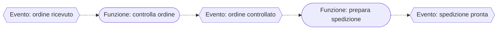

### Connettori AND, XOR e OR

I connettori possono comparire sia come **split** (un ingresso, più uscite) sia come **join** (più ingressi, un'uscita). La forma logica riassume i rami che si attivano o che devono essere ricongiunti. (slide 19–20)

| Connettore | Split | Join, a grandi linee |
|---|---|---|
| **AND** ($\land$) | Attiva tutti i rami | Attende i rami attivati |
| **XOR** | Sceglie esattamente un ramo | Ricongiunge percorsi alternativi |
| **OR** ($\lor$) | Attiva uno o più rami | Ricongiunge gli ingressi effettivamente attivati |

L'**OR join** è più delicato di un XOR join. Se è stato attivato un solo ramo, deve poter proseguire senza aspettarne uno impossibile; se sono stati attivati entrambi, deve produrre **una sola** prosecuzione comune. Quando arriva un solo ramo, potrebbe dover attendere finché l'altro arriva **oppure** finché si sa che non arriverà. Per decidere, può essere necessario conoscere lo stato del processo a monte: la semplice presenza locale di un token non basta sempre. (slide 21–22)

Esempio: un OR split può richiedere sia la verifica del pagamento sia una verifica antifrode, oppure solo una delle due. L'OR join deve aspettare precisamente le verifiche che sono state avviate per quel caso.

> Le slide introducono qui EPC in modo prevalentemente intuitivo. Il diagramma Mermaid visualizza il flusso, mentre la spiegazione del join descrive il comportamento desiderato; non attribuire automaticamente a un nodo Mermaid la semantica completa di un OR join.

## 3. Tre punti di vista sullo stesso processo

| Punto di vista | Che cosa descrive | Chi controlla le attività | Informazione principale |
|---|---|---|---|
| **Orchestrazione** | Un processo di una organizzazione | Un controllo centrale per quel processo | Ordine delle attività interne |
| **Collaborazione** | Processi autonomi di più partecipanti | Ogni partecipante governa il proprio processo | Attività interne e scambi tra partecipanti |
| **Coreografia** | Interazioni viste globalmente | Nessun controllore centrale di tutti i partecipanti | Quali scambi devono avvenire e con quale ordine |

La distinzione è di **prospettiva**: il compratore può orchestrare il proprio lavoro e il rivenditore il proprio; mettendo insieme i due processi e i messaggi otteniamo una collaborazione; isolando gli scambi tra loro otteniamo una coreografia. (slide 25–41)

### Orchestrazione: una prospettiva

Il modello mostra le attività che una singola organizzazione può ordinare e controllare tramite il proprio sistema BPM. Nell'esempio del **rivenditore $R_1$**, dopo aver ricevuto l'ordine partono due rami concorrenti: in uno si invia la fattura e si attende il pagamento; nell'altro si spediscono i prodotti. L'ordine viene archiviato dopo il completamento di entrambi. Le slide esprimono lo stesso comportamento in EPC, workflow net e BPMN. (slide 26–30, 33)

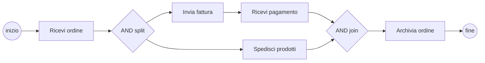

Qui la freccia interna `Invia fattura → Ricevi pagamento` esprime il vincolo del rivenditore. Il pagamento, però, deve arrivare da un altro partecipante: per capire se arriverà occorre considerare anche il processo del compratore.

### Collaborazione: più prospettive

Una **collaborazione** mette insieme i processi autonomi e mostra **come interagiscono**. Nelle slide i messaggi fra le corsie del compratore e del rivenditore sono disegnati con **archi tratteggiati**; possono rappresentare informazioni elettroniche o oggetti fisicamente trasportati. Il flusso interno a una corsia e lo scambio tra corsie hanno ruoli diversi. (slide 31–37)

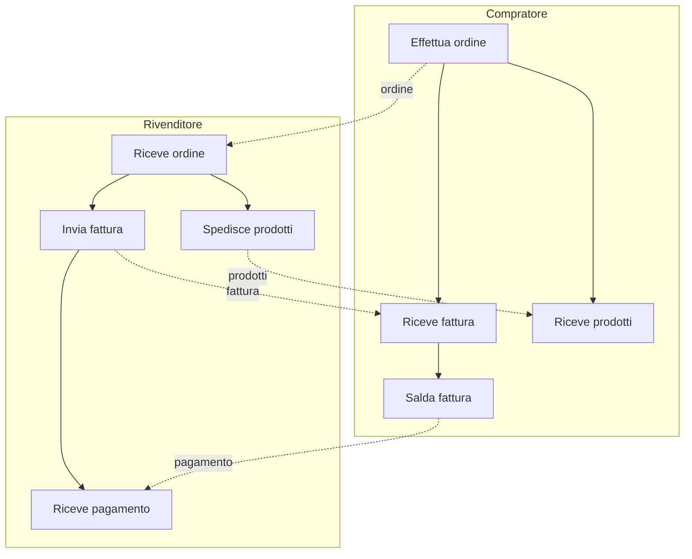

**Lettura:** le frecce continue schematizzano dipendenze all'interno dei partecipanti; le tratteggiate collegano l'invio da uno alla ricezione dell'altro. Il disegno non implica che un'organizzazione controlli direttamente le attività dell'altra.

### Coreografia: prospettiva globale sugli scambi

Una **coreografia** specifica le interazioni attese tra partecipanti come una sorta di contratto: spiega **come dovrebbero interagire**. Non rappresenta tutte le attività interne dei due processi, ma quelle legate alle interazioni. L'esempio delle slide contiene l'ordine dal compratore al rivenditore, la fattura nel verso opposto, il pagamento verso il rivenditore e la spedizione verso il compratore. Dopo l'ordine, il ramo fatturazione/pagamento e quello della spedizione possono procedere in parallelo nel modello $B_1$–$R_1$. (slide 38–41)

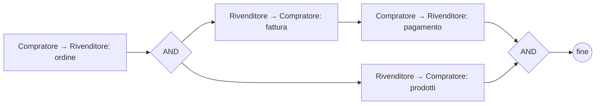

Lo schema non include, per esempio, come il rivenditore prepara il pacco o come il compratore contabilizza la fattura: sono dettagli delle rispettive orchestrazioni.

## 4. Compatibilità tra Buyer e Reseller

Un'orchestrazione sensata **presa da sola** può non funzionare in combinazione con un'altra. Se un partecipante aspetta un messaggio che l'altro invierà solo **dopo** un messaggio atteso a sua volta, si crea un'attesa circolare. La compatibilità va quindi studiata collegando i due processi. (slide 42–53)

### Le varianti nelle slide

- $R_1$: dopo l'ordine, fattura/pagamento e spedizione sono rami indipendenti; archivia quando entrambi terminano.
- $R_2$: dopo l'ordine, **invia fattura → riceve pagamento → spedisce prodotti**.
- $B_1$: dopo l'ordine, la ricezione e il saldo della fattura possono procedere parallelamente alla ricezione dei prodotti.
- $B_2$: riceve fattura e prodotti tramite rami paralleli, ma **salda dopo aver ricevuto i prodotti**.
- $B_3$: attende **sia** fattura **sia** prodotti prima di saldare.
- $B_4$: procede in sequenza **riceve fattura → riceve prodotti → salda fattura**.

La tabella seguente completa l'esercizio della slide 52 assumendo che i messaggi possano essere consegnati e conservati fino a quando la ricezione corrispondente può avvenire, senza timeout aggiuntivi. `OK` significa che l'ordine delle attività consente il completamento; `blocco` indica un'attesa circolare. Le slide mostrano esplicitamente $R_1/B_1$ e $R_2/B_1$ come funzionanti e $R_2/B_4$ come problematico; le altre caselle sono dedotte dagli ordini rappresentati. (slide 43–53)

| Rivenditore \ Compratore | $B_1$ | $B_2$ | $B_3$ | $B_4$ |
|---|---|---|---|---|
| **$R_1$** | OK | OK | OK | OK |
| **$R_2$** | OK | Blocco | Blocco | Blocco |

Per $R_2/B_4$ la dipendenza circolare è immediata. Indicando con $x\prec y$ che $x$ deve accadere prima di $y$:

$$
B_4:\quad\text{ricezione prodotti}\prec\text{pagamento},
\qquad
R_2:\quad\text{pagamento}\prec\text{spedizione prodotti}.
$$

In parole semplici: $B_4$ aspetta i prodotti per saldare, mentre $R_2$ aspetta il saldo per spedire. Lo stesso problema colpisce $B_2$ e $B_3$ con $R_2$, perché anche in quei modelli il saldo dipende dalla ricezione dei prodotti. Con $R_1$ la spedizione è indipendente dal pagamento, quindi quel ciclo di attesa non si forma.

> Se si adottano semantiche diverse per la consegna dei messaggi, per esempio una ricezione sincrona senza coda, la compatibilità richiede un'analisi ulteriore. La matrice specifica l'ipotesi utilizzata, come è opportuno fare in una consegna formale.

## 5. Esercizio dell'agenzia di viaggi

La parte finale chiede di modellare una richiesta di viaggio con prenotazione di **volo** e **hotel**, possibilità di **cambiare date**, **confermare** o **annullare**. Le slide propongono versioni EPC, BPMN e workflow net dell'orchestrazione dell'agenzia, poi chiedono di progettare anche la coreografia, l'orchestrazione del turista e la collaborazione completa. In alcune figure dell'agenzia compare inoltre un controllo opzionale sull'auto. (slide 60–70)

### Orchestrazione dell'agenzia

Il modello seguente è una sintesi del nucleo comune delle figure: l'agenzia riceve la richiesta, prenota volo e hotel in parallelo, poi attende una risposta. Il cambio date riporta il processo alla prenotazione; conferma e annullamento chiudono su esiti diversi.

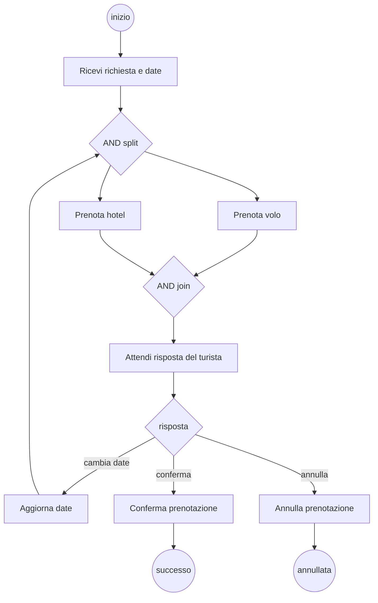

La relazione `cambia date → nuova prenotazione` è un **ciclo**. Un ritorno del flusso non garantisce da solo che la richiesta terminerà: il turista potrebbe chiedere altre modifiche. In BPMN, una risposta che dipende dall'arrivo di uno tra più messaggi può essere rappresentata con una scelta **basata su eventi**; la variante delle slide aggiunge trigger di messaggio a richiesta, cambio, conferma e annullamento. (slide 62–65)

### Come cambiano i tre elaborati richiesti

| Elaborato | Da mostrare | Da verificare |
|---|---|---|
| **Orchestrazione dell'agenzia** | Prenotazioni, attesa, cambio date, conferma/annullamento | I compiti interni sono nell'ordine previsto |
| **Orchestrazione del turista** | Invio richiesta, ricezione proposta, scelta fra cambiare, confermare, annullare | Il turista attende solo messaggi che l'agenzia può inviare |
| **Collaborazione** | Le due orchestrazioni e i messaggi che le collegano | Ogni invio ha una ricezione corrispondente e non nasce un'attesa circolare |
| **Coreografia** | Solo le interazioni osservabili fra turista e agenzia | L'ordine globale degli scambi è coerente con entrambi i processi |

Una possibile coreografia astratta è:

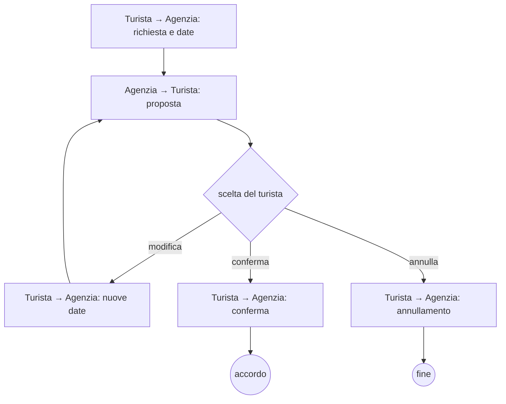

Questo schema è una **proposta di modellazione** per l'esercizio, non un diagramma già fornito dalle slide: i contenuti precisi della proposta e la gestione di prenotazioni precedenti dopo un cambio date andrebbero fissati nella specifica prima dell'implementazione.

## 6. Domande per l'orale

1. Che cosa rappresentano eventi, funzioni e connettori in un'EPC?
2. Perché un'EPC inizia e termina con eventi?
3. Qual è la differenza tra AND, XOR e OR come split e come join?
4. Perché l'OR join è più difficile da interpretare di un AND join?
5. Che cosa significa descrivere un processo da un solo punto di vista?
6. Come si distinguono orchestrazione, collaborazione e coreografia nel caso Buyer–Reseller?
7. Che differenza c'è tra il flusso di controllo interno e il flusso dei messaggi tra partecipanti?
8. Perché due processi localmente plausibili possono essere incompatibili?
9. Come si dimostra il blocco fra $B_4$ e $R_2$?
10. Quali ipotesi sulla consegna dei messaggi servono per giudicare una matrice di compatibilità?
11. Come modelleresti prenotazione parallela di volo e hotel, cambio date e annullamento?
12. Quali attività dell'agenzia spariscono nella coreografia perché sono interne?

### Schema riassuntivo

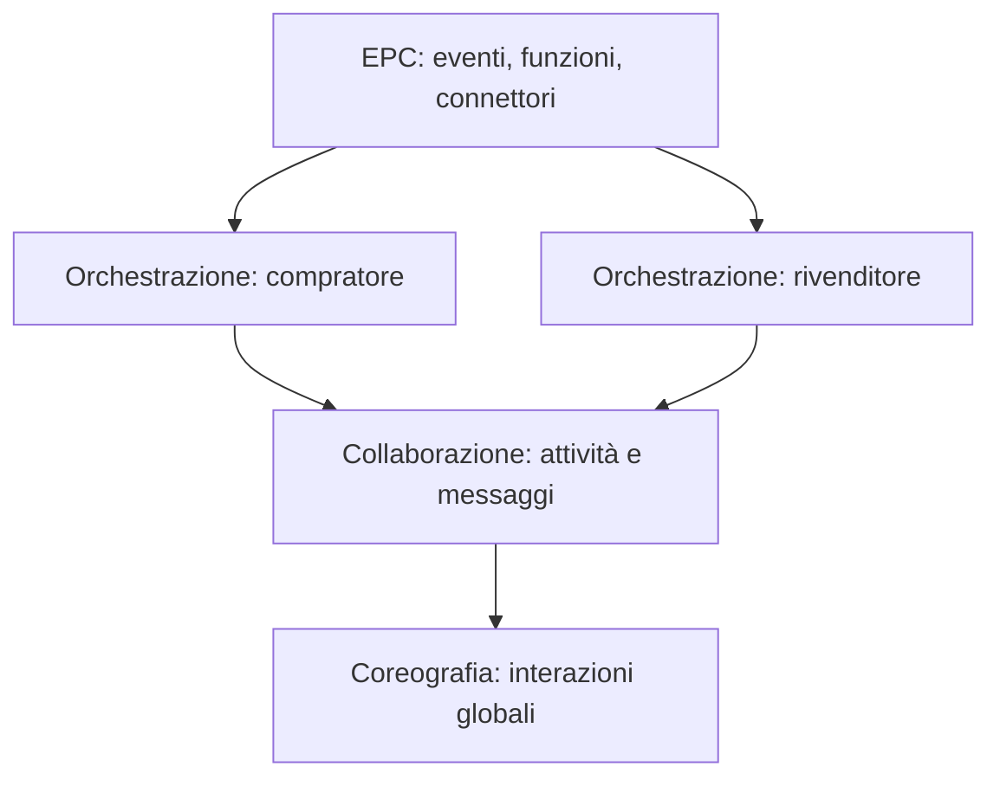

# 1/10

Appunti dal PDF **ProcessMiningTutorial.pdf** (72 pagine; la numerazione stampata arriva a 73). Il notebook allegato `PM_01IntroToProcessMining.ipynb` è usato soltanto per integrare l'esempio pratico con pandas. I riferimenti «slide N» indicano il numero stampato sulla slide.

## 1. Obiettivo del tutorial

Il **process mining** è una famiglia di tecniche che collega analisi dei dati e gestione dei processi: usa gli **event log** generati durante l'esecuzione per capire come i processi operano davvero. Lo scopo è trasformare i dati degli eventi in conoscenza utile e poi in interventi verificabili. Le slide introducono una procedura esplorativa su un processo di acquisto, analizzato con **Disco**. (slide 2–4, 14–27)

Una domanda centrale è: **il processo osservato coincide con quello progettato?** La risposta non si ricava soltanto dal diagramma prescritto; bisogna esaminare le tracce effettivamente registrate. Le tre domande operative del tutorial sono: (slide 5–6, 20)

1. **Discovery:** come si svolge davvero il processo?
2. **Conformance/compliance:** ci sono deviazioni dalle regole prescritte?
3. **Performance:** vengono rispettati gli obiettivi di tempo?

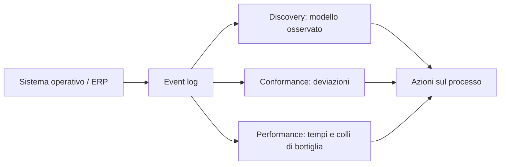

Il PDF cita applicazioni oltre agli acquisti, per esempio ambito legale, sanitario e sicurezza: cambia il dominio, ma resta la necessità di collegare gli eventi a casi concreti. (slide 8–13)

## 2. Caso di studio: processo di acquisto

Lo scenario coinvolge **richiedente**, **responsabile del richiedente**, **addetto agli acquisti**, **fornitore** e **responsabile finanziario**. Gli eventi del processo sono registrati in un sistema **ERP** ed estratti in un file CSV. I problemi iniziali sono inefficienze operative, necessità di dimostrare la conformità e reclami per la durata delle pratiche. (slide 15–16, 22)

Gli obiettivi dell'analisi sono:

- ricostruire il processo nel dettaglio;
- individuare deviazioni dalle linee guida sul pagamento;
- verificare l'obiettivo di **completare ciascun caso entro 21 giorni**. (slide 17)

Questa formulazione anticipa un principio importante: **definire le domande prima di scegliere grafici e filtri**. Senza una domanda precisa è facile produrre una mappa molto complessa ma poco utile. (slide 19–20)

## 3. Event log: dati necessari

Nel CSV esaminato nel tutorial **ogni riga rappresenta un evento**, ossia l'esecuzione registrata di un'attività per una determinata pratica. Le colonne mostrate sono: (slide 28–33)

| Colonna | Uso nell'analisi |
|---|---|
| `Case ID` | Identifica la stessa istanza del processo attraverso più eventi |
| `Activity` | Indica l'attività eseguita |
| `Start Timestamp` | Istante di inizio dell'attività |
| `Complete Timestamp` | Istante di completamento |
| `Resource` | Persona o risorsa che ha svolto l'attività |
| `Role` | Ruolo organizzativo della risorsa |

Per esempio, se tre righe hanno lo stesso `Case ID`, appartengono alla **stessa pratica**; i loro timestamp e le loro attività permettono di ricostruirne l'evoluzione. Riordinando gli eventi di ogni caso si ottiene una **traccia**:

$$
\sigma_c=\langle a_1,a_2,\ldots,a_n\rangle,
$$

dove $c$ è il caso e $a_i$ è l'attività osservata nell'evento $i$ di quel caso. Due casi con la stessa sequenza di attività condividono una **variante**; possono comunque avere tempi e risorse differenti. Se le attività si sovrappongono, ordinare per inizio o fine può produrre letture diverse: bisogna dichiarare quale timestamp si usa.

### Ispezione con pandas

Il PDF propone l'ispezione in Excel o pandas; il notebook allegato mostra il caricamento del file e la conversione dei timestamp. Il seguente codice è una traccia da usare **quando si dispone di `PurchasingExample.csv`**:

```python
import pandas as pd

logs = pd.read_csv("PurchasingExample.csv")
logs["Start Timestamp"] = pd.to_datetime(logs["Start Timestamp"])
logs["Complete Timestamp"] = pd.to_datetime(logs["Complete Timestamp"])

num_events = len(logs)
num_cases = logs["Case ID"].nunique()
one_case = logs[logs["Case ID"] == 1].sort_values("Start Timestamp")
```

`len(logs)` conta le **righe/eventi**, mentre `nunique()` conta i **casi distinti**: le due quantità non vanno confuse. Il notebook usa anche filtri per osservare singoli casi. I timestamp vanno convertiti prima di calcolare durate o ordinamenti cronologici.

## 4. Roadmap dell'analisi

Le slide organizzano il lavoro in quattro passaggi. (slide 19–25, 69)

```mermaid
flowchart LR
    q["1. Domande e perimetro"] --> extract["2. Estrazione dati"]
    extract --> analyze["3. Analisi del log"]
    analyze --> report["4. Risultati e azioni"]
    report -.->|verifica dopo gli interventi| q
```

1. **Domande:** chiarire che cosa si cerca, quali casi rientrano nel perimetro e quali sistemi registrano gli eventi.
2. **Estrazione:** ottenere dal sistema ERP un CSV o un estratto del database, mantenendo identificativi e timestamp coerenti.
3. **Analisi:** scoprire il processo *as-is*, controllare regole e performance, approfondire casi e varianti.
4. **Presentazione e azione:** discutere i risultati, modificare dove necessario il processo o il sistema e misurare nuovamente.

Il ciclo non si conclude con la scoperta di una figura: il tutorial termina con **azione e verifica dei risultati**. (slide 69)

## 5. Importazione e prima mappa del processo

Nel tutorial si importa il CSV in Disco assegnando `Case ID` come identificatore del caso, `Activity` come attività, **entrambi** i timestamp ai campi temporali appropriati, `Resource` come risorsa e `Role` come attributo aggiuntivo (*Other*). (slide 33–34)

La mappa ottenuta evidenzia:

- **frequenza dell'attività** nei rettangoli;
- **frequenza del collegamento** sugli archi fra attività;
- sequenze, diramazioni, ritorni e percorsi di terminazione. (slide 35–36)

Un arco $A\to B$ nella mappa indica un collegamento osservato tra le due attività nei casi visualizzati. Il numero riportato sull'arco conta le occorrenze di quel collegamento nella vista corrente. **Non è, da solo, una prova di causalità o una dichiarazione che $B$ debba sempre seguire $A$.**

Tutti i **608 casi** del dataset iniziano con `Create Purchase Requisition`. La mappa mostra anche molte modifiche (*amendments*) delle richieste. (slide 35)

### Il livello di dettaglio cambia ciò che si vede

I controlli `Activities` e `Paths` regolano la complessità della mappa:

- con poche attività visibili emergono i percorsi più frequenti;
- aumentando `Activities` riappaiono anche attività rare, come `Amend Purchase Requisition`;
- aumentando `Paths` riappaiono collegamenti meno frequenti fra attività già visibili. (slide 37–42)

Il tutorial segnala **11 casi in ingresso** a `Amend Purchase Requisition` ma solo **8 apparentemente in uscita**. Dopo aver mostrato anche tutti i percorsi, gli altri **3** si vedono dirigersi a `Create Request for Quotation`. I casi non sono scomparsi dal log: era il **filtro visivo dei collegamenti** a nasconderli. (slide 39–42)

```mermaid
flowchart LR
    incoming["11 casi entrano in Amend Purchase Requisition"] --> amend["Amend Purchase Requisition"]
    amend --> visible["8 casi su percorsi inizialmente visibili"]
    amend -.->|Paths al 100%| hidden["3 casi verso Create Request for Quotation"]
```

**Regola pratica:** prima di interpretare un flusso apparentemente incompleto, controllare il livello di dettaglio della mappa e i filtri applicati.

## 6. Statistiche e varianti

Nella vista `Statistics` si trovano **9.119 eventi** relativi a **608 casi** nel periodo **gennaio–ottobre 2011**. La durata della maggior parte dei casi arriva a circa **15–16 giorni**, ma alcuni superano **70–80 giorni**. Una media complessiva, da sola, nasconderebbe questa coda di casi lenti. (slide 43–44)

Una definizione utile della durata di un caso completo $c$ è:

$$
D(c)=\max_{e\in c}\bigl(\operatorname{complete}(e)\bigr)
     -\min_{e\in c}\bigl(\operatorname{start}(e)\bigr).
$$

La formula descrive il tempo fra primo inizio e ultimo completamento osservati. Quando un log contiene casi ancora aperti o timestamp mancanti, occorre definire esplicitamente come trattarli prima di confrontare le durate.

Nella vista `Cases` si esaminano **varianti** e singole tracce. La **terza variante più frequente** termina dopo `Analyze Purchase Requisition` e riguarda circa **il 10,36%** dei casi. Il tutorial propone di indagare perché così tante richieste si interrompano: l'ipotesi è che le linee guida sugli acquisti non siano abbastanza chiare, ma l'event log da solo non dimostra la causa. (slide 45–48)

| Vista | Domanda a cui risponde |
|---|---|
| **Mappa** | Quali attività e collegamenti sono osservati? |
| **Statistiche** | Quanti casi/eventi ci sono e come sono distribuiti i tempi? |
| **Varianti** | Quali sequenze si ripetono più spesso? |
| **Singolo caso** | Che cosa è successo esattamente a questa pratica? |

## 7. Verifica dell'obiettivo di 21 giorni

Il target è completare il processo in **non più di 21 giorni**. Il tutorial applica un filtro sulle durate **superiori** alla soglia e isola **92 casi**, circa il **15%** dei 608 casi: (slide 49–52)

$$
\frac{92}{608}\cdot 100\approx15{,}1\%.
$$

Nel gruppo dei casi lenti sono state registrate **302 modifiche**. Il rapporto è $302/92\approx3{,}28$ modifiche per caso lento, coerente con l'approssimazione «circa tre» nelle slide. Questo è un **rapporto aggregato**: non significa che ciascuno dei 92 casi abbia esattamente tre modifiche. (slide 52)

```mermaid
flowchart LR
    all["608 casi"] --> threshold{"Durata > 21 giorni?"}
    threshold -->|sì| slow["92 casi lenti"]
    threshold -->|no| rest["Altri casi"]
    slow --> rework["302 amendments complessivi"]
    slow --> inspect["Analisi dei tempi e dei percorsi"]
```

### Come individuare un collo di bottiglia

Passando dalla frequenza alla vista **Performance**, il tutorial usa prima `Total duration` per vedere dove si accumula più tempo e poi `Mean duration` per valutare il tempo medio dei passaggi. Nel ciclo di rilavorazione, il ritorno al flusso normale richiede **in media più di 14 giorni**. Le slide suggeriscono di esaminare anche minimo e massimo: casi estremi e media rispondono a domande diverse. (slide 54–55)

L'animazione fa scorrere i casi lungo la mappa nel tempo; i percorsi più usati diventano visivamente più spessi. È uno strumento per **esplorare e comunicare** dove si concentrano i casi, da affiancare alle statistiche delle durate. (slide 56–58)

La conclusione operativa proposta dal tutorial è che `Analyze Request for Quotation` costituisce un'importante area di ritardo e che conviene rivedere quel segmento. L'associazione fra rilavorazioni e tempi lunghi è una **osservazione**; per dimostrare la causa dei ritardi e scegliere la modifica migliore servono approfondimenti con chi gestisce il processo. (slide 58, 64)

## 8. Controllo di conformità

Dopo aver **rimosso il filtro sui casi lenti**, il tutorial torna alla mappa di frequenza e al termine del processo. Qui si osservano **10 casi** che saltano l'attività dichiarata obbligatoria `Release Supplier's Invoice`: il flusso passa da `Send invoice` a `Authorize Supplier's Invoice payment`. (slide 59–63)

```mermaid
flowchart LR
    send["Send invoice"] --> release["Release Supplier's Invoice"] --> authorize["Authorize Supplier's Invoice payment"]
    send -.->|10 casi osservati: salto| authorize
```

Per confermare la deviazione, si seleziona l'arco sospetto con `Filter this path...` e si passa alla vista `Cases` per esaminare le **10 pratiche concrete**. Se quella release è effettivamente obbligatoria per quei casi, il comportamento osservato non è conforme alla regola. Le slide propongono come possibili azioni un vincolo nel sistema operativo oppure una formazione mirata. (slide 61–64)

La quota rispetto al totale, calcolata dai numeri del tutorial, è:

$$
\frac{10}{608}\cdot100\approx1{,}64\%.
$$

Anche una deviazione relativamente rara può essere importante se riguarda un controllo di pagamento. Prima dell'intervento bisogna verificare che la regola sia davvero applicabile a tutti i dieci casi e che l'evento non manchi per un problema di registrazione.

## 9. Vista organizzativa

Nell'ultima fase le slide ricaricano i dati sostituendo la colonna interpretata come `Activity` con `Role`. La mappa mostra così il **passaggio delle pratiche tra ruoli**, anziché tra nomi di attività. Questo aiuta a cercare attese ai confini delle unità organizzative. Nel dataset analizzato gli **addetti agli acquisti** risultano associati ai maggiori ritardi nella vista mostrata. (slide 65–68)

```mermaid
flowchart LR
    requester["Richiedente"] --> manager["Responsabile"]
    manager --> purchasing["Addetto agli acquisti"]
    purchasing --> supplier["Fornitore"]
    supplier --> finance["Responsabile finanziario"]
    finance -.->|possibili ritorni / passaggi| purchasing
```

Questo è uno **schema dei ruoli dello scenario**, non la trascrizione numerica della mappa organizzativa. Un tempo elevato su un passaggio fra ruoli segnala dove approfondire; non prova da solo che una persona o un reparto sia la causa del problema.

Il bonus finale chiede di trattare sia `Activity` sia `Role` come dimensioni di attività: la granularità cambia e si può analizzare una coppia **attività–ruolo** invece della sola attività. È un esempio del principio che **gli stessi dati possono offrire più viste utili**. (slide 70–72)

## 10. Le tre risposte del caso di studio

| Domanda iniziale | Evidenza nel tutorial | Passo successivo suggerito |
|---|---|---|
| Com'è il processo reale? | Mappa osservata; molte modifiche; variante che si arresta dopo `Analyze Purchase Requisition` | Verificare se istruzioni e gestione delle richieste sono chiare |
| Si rispettano le linee guida? | 10 casi percorrono il collegamento che salta `Release Supplier's Invoice` | Esaminare i casi e poi scegliere vincolo nel sistema o formazione |
| Si termina entro 21 giorni? | 92 casi superano la soglia; il ciclo di rilavorazione e `Analyze Request for Quotation` concentrano ritardi | Analizzare la causa e riprogettare il segmento critico |

Il risultato non è un unico diagramma «giusto»: frequenza, durata, varianti e passaggi fra ruoli mettono in evidenza aspetti diversi dello stesso log. Il process mining è quindi **interattivo ed esplorativo**. Dopo un cambiamento si raccolgono nuovi eventi e si controlla se l'obiettivo è stato raggiunto. (slide 69–72)

## 11. Domande per ripassare

1. Che cosa sono un evento, un caso, una traccia e una variante?
2. Quali colonne del CSV permettono di ricostruire l'ordine e la durata delle attività?
3. Come distingui il numero di eventi dal numero di casi?
4. Qual è la differenza fra modello prescritto e mappa scoperta dal log?
5. Perché tre casi sembravano sparire dopo `Amend Purchase Requisition`?
6. Che cosa mostrano le frequenze nei nodi e sugli archi?
7. Perché guardare soltanto la variante più frequente può essere fuorviante?
8. Come è stato costruito il gruppo dei 92 casi lenti?
9. Che differenza c'è fra durata totale e durata media di un passaggio?
10. Come si indaga una presunta violazione della release della fattura?
11. Perché un collegamento osservato nel log non dimostra automaticamente causalità?
12. A cosa serve ricostruire la mappa per ruoli e come eviti di attribuire colpe dai soli tempi?
13. Perché l'analisi deve proseguire dopo che viene modificato il processo?

# 8/10

**Fonte:** notebook `PM_02pm4py.ipynb`, lezione 2 del corso BPM 2026/2027 (Università di Pisa). Gli esempi e i risultati numerici qui sotto si riferiscono al log didattico del notebook e alla sua esecuzione salvata (PM4Py `2.7.17.2`).

## 1. Idea generale

Il **process mining** ricostruisce e valuta processi a partire dalle tracce lasciate dai sistemi informativi. Nel notebook si percorrono tre passaggi:

```mermaid
flowchart TD
    A["Dati di eventi: CSV o XES"] --> B["Log formattato"]
    B --> C["Filtraggio ed esplorazione"]
    B --> D["Scoperta del modello"]
    D --> E["Rete di Petri, BPMN o process map"]
    B --> F["Conformance checking"]
    E --> F
    F --> G["Fitness e diagnosi delle deviazioni"]
```

Un **evento** è un'occorrenza di attività; un **caso** è un'istanza del processo; una **traccia** è la sequenza ordinata delle attività di un caso. Indicando con $C$ l'insieme dei casi e con $\sigma_c$ la traccia del caso $c$, un log può essere visto come una collezione di tracce:

$$L=\{\!\{\sigma_c:c\in C\}\!\}.$$

È una *multicollezione*: casi distinti possono avere la stessa sequenza. La sequenza di attività di una traccia è anche detta **variante**.

Il log dimostrativo sulla gestione dei reclami contiene **6 casi, 42 eventi e 8 attività**. Tutti i casi iniziano con `register request`; tre terminano con `reject request` e tre con `pay compensation`. Il numero di righe del dataframe è il numero di **eventi**, non di casi.

## 2. Preparare il log

### Installazione e struttura dei dati

Nel notebook si installa e importa la libreria:

```python
%pip install pm4py
import pm4py
import pandas as pd
```

Gli esempi caricano sei file didattici dal repository del corso, tra cui il log dei reclami in CSV e XES e due varianti modificate per la verifica di conformità. Il CSV usa il separatore `;` e contiene `case_id`, `activity`, `timestamp`, oltre a costo e risorsa. Un record rappresenta un evento; più record con lo stesso `case_id` formano la traccia di un caso.

```python
log = pd.read_csv("simplifiedCustomerComplaintHandling.csv", sep=";")
log["timestamp"] = pd.to_datetime(log["timestamp"])
log = pm4py.format_dataframe(
    log,
    case_id="case_id",
    activity_key="activity",
    timestamp_key="timestamp",
)
```

`format_dataframe` associa i campi del CSV ai nomi convenzionali di PM4Py: `case:concept:name` (caso), `concept:name` (attività), `time:timestamp` (tempo). Conserva anche le colonne originarie nel dataframe mostrato dall'esempio. Controllare formato, fuso orario e ordinamento temporale è essenziale: una sequenza errata cambia tracce e relazioni direttamente successive. Se il formato delle date è noto, specificarlo esplicitamente evita ambiguità di parsing.

Un file XES viene invece letto direttamente:

```python
log = pm4py.read_xes("simplifiedCustomerComplaintHandling.xes")
start = pm4py.get_start_activities(log)
end = pm4py.get_end_activities(log)
```

Nel risultato salvato, `start == {'register request': 6}` ed `end == {'reject request': 3, 'pay compensation': 3}`. Le frequenze si riferiscono ai casi che iniziano o finiscono con ciascuna attività. Il notebook esporta anche un dataframe formattato tramite `log.to_csv(...)` e `pm4py.write_xes(log, ...)`.

| Formato | Uso nel notebook | Punto da ricordare |
| --- | --- | --- |
| CSV | Importazione con pandas; esportazione con `to_csv` | Occorre indicare le colonne di caso, attività e timestamp a PM4Py. |
| XES | Importazione con `read_xes`; esportazione con `write_xes` | Convenzioni di attributi pensate per gli event log, come `concept:name`. |

### Contare correttamente

```python
n_casi = log["case:concept:name"].nunique()
n_eventi = len(log)
n_attivita = log["concept:name"].nunique()
```

Nel CSV originale i nomi delle colonne sono `case_id` e `activity`. Dopo la formattazione, o leggendo XES, si possono usare i nomi convenzionali sopra. Un filtro che restituisce `23` righe restituisce **23 eventi**: per sapere quanti casi contiene bisogna contare gli identificativi distinti.

## 3. Filtrare l'event log

I filtri permettono di isolare casi o eventi prima di analizzare o scoprire un modello. Il parametro `retain=False` seleziona il complemento rispetto al criterio indicato.

| Domanda | Funzione ed esempio | Unità del risultato |
| --- | --- | --- |
| Quali casi iniziano con un'attività? | `pm4py.filter_start_activities(log, {'register request'})` | Casi completi |
| Quali casi finiscono con un'attività? | `pm4py.filter_end_activities(log, {'reject request'})` | Casi completi |
| Quali casi contengono un valore di attributo? | `pm4py.filter_event_attribute_values(log, attribute_key='org:resource', level='case', values=['Pete'])` | Casi completi |
| In quali casi $B$ segue subito $A$? | `pm4py.filter_directly_follows_relation(log, [('check ticket', 'examine casually')])` | Casi che soddisfano la relazione |
| In quali casi $B$ compare più avanti di $A$? | `pm4py.filter_eventually_follows_relation(log, [('register request', 'reinitiate request')])` | Casi che soddisfano la relazione |

Per una traccia $\sigma=\langle a_1,\ldots,a_n\rangle$:

$$A\mathrel{>_\sigma}B\quad\Longleftrightarrow\quad\exists i<n:\ a_i=A\ \land\ a_{i+1}=B,$$

$$A\mathrel{\leadsto_\sigma}B\quad\Longleftrightarrow\quad\exists i<j:\ a_i=A\ \land\ a_j=B.$$

La prima relazione richiede **adiacenza**; la seconda ammette eventi intermedi. La direzione e l'ordine temporale contano in entrambe.

Con `level='case'`, basta che **almeno un evento** abbia il valore cercato per selezionare **tutta** la traccia. Per esempio, selezionando i casi che contengono `cost:total == 200`, il risultato del notebook contiene tutti e sei i casi e anche eventi con costi `50`, `100` e `400`. Selezionando i casi con una risorsa `Pete` si ottengono i casi `1`, `3`, `4`, `5`; con `retain=False` si ottengono `2`, `6`. Quindi non si deve interpretare la colonna dei valori nel risultato come se ogni suo elemento soddisfacesse il predicato.

Il filtro sulle attività finali restituisce **23 eventi in 3 casi** per `reject request` (`1`, `4`, `5`) e **19 eventi in 3 casi** per `pay compensation` (`2`, `3`, `6`).

### Finestra temporale

Il notebook prova `pm4py.filter_time_range(log, inizio, fine, mode=...)` con tre modalità:

| `mode` | Criterio didattico | Effetto sul log |
| --- | --- | --- |
| `events` | Timestamp dell'evento nella finestra | Seleziona singoli eventi; può troncare una traccia. |
| `traces_contained` | Traccia interamente compresa nella finestra | Mantiene i casi completi contenuti. |
| `traces_intersecting` | Traccia che interseca la finestra | Mantiene i casi completi che la toccano. |

La distinzione è tra *filtrare righe* e *filtrare casi*. Per analisi del controllo di flusso, troncare una traccia può creare falsi inizi, falsi finali o successioni fuorvianti. Nell'esempio la finestra va dal 30 al 31 dicembre 2010; il timestamp minimo del log è `2010-12-30 11:02:00+00:00`, il massimo `2011-01-24 14:56:00+00:00`.

**Varianti:** il notebook presenta `filter_variants` in celle di tipo *raw* e intitola la sezione «does not currently work». Sono esempi illustrativi, non un passaggio eseguito con risultato verificato. Una variante richiede la corrispondenza dell'intera sequenza ordinata, non solo la presenza delle sue attività.

## 4. Scoprire un modello

La **process discovery** ricava un modello a partire dal comportamento osservato. Il notebook applica metodi diversi allo stesso log; il tipo di modello stabilisce che cosa si può leggere e, soprattutto, che cosa si può *eseguire*.

### Rete di Petri con Inductive Miner

```python
pn, im, fm = pm4py.discover_petri_net_inductive(log)
pm4py.view_petri_net(pn, im, fm)
```

`pn` è la rete, `im` la marcatura iniziale e `fm` quella finale. Una rete di Petri comprende **posti** (cerchi), **transizioni** (attività visibili oppure passi silenziosi) e **archi**. I **token** nei posti descrivono lo stato. Una transizione è abilitata quando tutti i posti in ingresso hanno i token necessari; eseguendola, consuma token in ingresso e produce token nei posti in uscita. Una transizione silenziosa cambia lo stato senza generare un evento visibile.

Nel modello spiegato dal notebook, dopo `register request` sono possibili una scelta fra `examine thoroughly` e `examine casually` e, in parallelo, `check ticket`. `decide` attende il completamento dei due rami. Il caso può poi riprendere con `reinitiate request`, oppure terminare con `reject request` o `pay compensation`.

```mermaid
flowchart TD
    R["register request"] --> P["Apertura dei rami paralleli"]
    P --> T["check ticket"]
    P --> X{"Scelta dell'esame"}
    X --> E1["examine thoroughly"]
    X --> E2["examine casually"]
    T --> J["Sincronizzazione"]
    E1 --> J
    E2 --> J
    J --> D["decide"]
    D --> I["reinitiate request"]
    I --> P
    D --> F{"Esito finale"}
    F --> N["reject request"]
    F --> Y["pay compensation"]
```

*Schema concettuale del flusso narrato nel notebook, non trascrizione della rete di Petri generata.* La scelta impone un solo tipo di esame per quella iterazione; il parallelismo permette che `check ticket` avvenga prima o dopo l'esame. Un esempio di traccia ammessa riportato nel notebook è $\langle\text{register request},\text{examine thoroughly},\text{check ticket},\text{decide},\text{reject request}\rangle$.

Il notebook include una funzione didattica `draw_marking_for_transition` che costruisce una marcatura nei posti di uscita di una transizione per visualizzarla: è una **visualizzazione semplificata**, non un simulatore completo di tutte le regole di abilitazione e consumo dei token.

### Process tree e BPMN

```python
tree = pm4py.discover_process_tree_inductive(log)
bpmn = pm4py.convert_to_bpmn(tree)
pm4py.view_process_tree(tree)
pm4py.view_bpmn(bpmn)
```

L'**albero di processo** è una rappresentazione strutturata del controllo di flusso, usata qui come passaggio verso **BPMN**. Nel modello BPMN spiegato dal notebook, il gateway `X` esprime una scelta esclusiva e il gateway `+` un parallelismo: i rami paralleli si sincronizzano prima di `decide`. BPMN e reti di Petri sono **notazioni differenti**: l'espressione del notebook «a richer Petri net» aiuta l'intuizione, ma non è una definizione formale di BPMN.

### Directly Follows Graph (DFG)

```python
dfg, starts, ends = pm4py.discover_dfg(log)
pm4py.view_dfg(dfg, starts, ends)
```

Un **DFG** collega attività osservate consecutivamente e conta le occorrenze degli archi. Per attività $A,B$:

$$f_L(A,B)=\sum_{\sigma\in L}\sum_{i=1}^{|\sigma|-1}\mathbf{1}[\sigma_i=A\ \land\ \sigma_{i+1}=B].$$

Il DFG è una sintesi delle successioni nel log: da un arco $A\to B$ non segue da solo che $A$ *causi* $B$, né che il modello imponga sempre quella sequenza. Due attività parallele possono apparire in entrambi gli ordini in tracce diverse. Per questo il notebook avverte di non dedurre automaticamente la semantica esecutiva da una process map.

### Heuristics Net

```python
net = pm4py.discover_heuristics_net(log)
pm4py.view_heuristics_net(net)

net = pm4py.discover_heuristics_net(log, dependency_threshold=0.5)
```

L'**Heuristic Miner** considera frequenze e indizi di dipendenza, così può ridurre archi occasionali e riconoscere meglio il parallelismo rispetto al semplice conteggio del DFG. Il notebook mostra `dependency_threshold=0.5`, senza sviluppare la formula esatta della misura: è una soglia dell'algoritmo, **non** una probabilità generica da attribuire agli archi. Nell'esempio `check ticket` ed `examine thoroughly` possono risultare concorrenti anche se compaiono talvolta uno dopo l'altro nel log.

| Modello | Informazione principale | Limite interpretativo |
| --- | --- | --- |
| DFG | Frequenze delle successioni immediate | Un arco osservato non basta a stabilire scelta, causalità o parallelismo. |
| Heuristics Net | Dipendenze stimate con euristiche | Dipende dai dati e dalle soglie. |
| Rete di Petri | Stato e comportamento eseguibile tramite token | Le transizioni silenziose e la sincronizzazione richiedono una lettura accurata. |
| Process tree / BPMN | Scelta, parallelismo, cicli in forme strutturate o grafiche | La conversione cambia notazione e deve essere letta con la propria semantica. |

## 5. Verifica di conformità

La **conformance checking** confronta tracce osservate e comportamento ammesso dal modello. Il notebook riscopre la rete di Petri dal log originale, poi modifica **il caso 3** in due copie del CSV: in una elimina un evento `reinitiate request`; nell'altra lo duplica. Il confronto rende visibile che un modello capace di riprodurre il log originale può non riprodurre esattamente i log alterati.

```mermaid
flowchart TD
    M["Rete di Petri ricavata dal log originale"] --> C["Confronto con i log"]
    O["Originale: 6 casi"] --> C
    R["Caso 3: reinitiate rimosso"] --> C
    D["Caso 3: reinitiate duplicato"] --> C
    C --> T["Token-based replay: fitness"]
    C --> A["Alignment: fitness e mosse"]
```

### Token-based replay

```python
pm4py.fitness_token_based_replay(log, pn, im, fm)
```

Si tenta di riprodurre ciascuna traccia sulla rete. In presenza di discrepanze l'algoritmo può contare token **mancanti** e **rimasti**; una traccia perfettamente riproducibile ha fitness $1$, mentre una traccia non perfetta ha fitness inferiore a $1$ (secondo la misura restituita). `perc_fit_traces` è la percentuale di tracce perfettamente conformi; `average_trace_fitness` è la media delle fitness delle tracce. Non sono la stessa quantità.

| Log | Tracce perfette | Fitness media delle tracce | Fitness del log |
| --- | ---: | ---: | ---: |
| Originale | 100% | 1,0000 | 1,0000 |
| `reinitiate request` rimosso nel caso 3 | 83,33% | 0,9802 | 0,9785 |
| `reinitiate request` duplicato nel caso 3 | 83,33% | 0,9896 | 0,9863 |

I valori sono gli **output salvati nel notebook**. In entrambi i log modificati resta conforme $5/6$ delle tracce, ma le fitness aggregate differiscono perché le deviazioni hanno un effetto diverso sul replay.

### Alignment

```python
pm4py.fitness_alignments(log, pn, im, fm)
diagnostics = pm4py.conformance_diagnostics_alignments(log_modificato, pn, im, fm)
```

Un **alignment** mette in corrispondenza i passi della traccia con i passi di un'esecuzione ammessa dal modello. Cerca una corrispondenza di costo minimo secondo i costi delle mosse configurati. In termini concettuali, se $\Gamma(\sigma,N)$ è l'insieme degli alignment possibili tra la traccia $\sigma$ e il modello $N$:

$$\gamma^*\in\operatorname*{arg\,min}_{\gamma\in\Gamma(\sigma,N)}\operatorname{cost}(\gamma).$$

| Mossa `(log, modello)` | Significato |
| --- | --- |
| `(A, A)` | Mossa sincrona: l'evento è riproducibile nel modello. |
| `(A, >>)` | Mossa solo nel log: evento osservato senza corrispondente passo del modello. |
| `(>>, A)` | Mossa solo nel modello: il modello richiede o usa un passo non presente nella traccia. |
| `(>>, None)` | Transizione silenziosa del modello; non è di per sé un'anomalia. |

Nel caso 3 con la riapertura rimossa, l'output diagnostico include `(>>, 'reinitiate request')`: per proseguire nell'esecuzione compatibile con il modello occorre quel passo, che manca nel log modificato. L'output assegna a quella traccia `fitness: 0.9230769230769231`; il numero `cost: 10003` appartiene alla funzione di costo dell'algoritmo e non va interpretato come tre eventi o come unità di tempo.

Il notebook riporta per gli alignment del **log originale** il 100% di tracce perfette e `averageFitness: 1.0`; `log_fitness` è circa `0.999979`, dunque non è esattamente $1$ in quell'output. Per il log con evento rimosso, le tracce perfette sono `83.333...%` e `averageFitness` è circa `0.98718`. I numeri di fitness ottenuti con alignment e token-based replay non vanno confrontati come se usassero necessariamente la stessa formula.

**Come leggere la diagnosi:** leggendo la colonna del modello e scartando `>>`, si ottiene una sequenza consentita dal modello che si avvicina alla traccia osservata. La diagnosi spiega *dove* si trova la differenza; da sola non dice se sia sbagliato il dato registrato o se il modello debba essere aggiornato.

## 6. Checklist per rifare l'esercizio

1. Importare il log, identificare caso, attività e timestamp; controllare i conteggi di casi, eventi e attività.
2. Confrontare attività iniziali e finali e verificare il significato di ogni filtro, soprattutto `level='case'` e le modalità temporali.
3. Scoprire DFG, rete di Petri, process tree e BPMN; distinguere frequenze osservate da comportamento ammesso.
4. Scoprire la rete **sul log originale** e usarla come riferimento comune per tutti i log da confrontare.
5. Riportare separatamente percentuale di tracce perfette, fitness media e fitness del log; leggere le mosse dell'alignment per localizzare le deviazioni.

### In sintesi

- **Evento → caso → traccia → log** sono livelli distinti: `len(log)` conta righe/eventi.
- **Scoperta** ricava un modello dai dati; **conformità** confronta i dati con un modello già scelto.
- **DFG** riassume successioni; **Petri/BPMN** esprimono anche scelta, parallelismo e cicli.
- **Fitness** quantifica l'aderenza; gli **alignment** mostrano le mosse che spiegano le divergenze.

# 13/10

**Fonte:** *2026-10-13 - BPM - 06-Mining.pdf*, 120 pagine PDF. Le pagine con lo stesso contenuto e annotazioni progressive sono state accorpate. I riferimenti «p.» qui sotto indicano la **pagina del PDF**, che non sempre coincide con il numero stampato nella slide.

## 1. Dalla descrizione del processo ai dati osservati

Il **process mining** ricava conoscenza sui processi dalle registrazioni dei sistemi informativi. Si colloca fra analisi dei dati e modellazione dei processi: permette di **scoprire**, **controllare** e **migliorare** il comportamento effettivamente eseguito (pp. 2–7).

Un processo ha più **casi** (*process instances*). Ciascun caso genera una sequenza di **eventi**. Un evento è l'occorrenza concreta di un'**attività**: due eventi possono avere la stessa etichetta di attività, ma restano due occorrenze distinte.

| Campo dell'evento | Significato | Esempio nelle slide |
| --- | --- | --- |
| Case ID | Identifica l'istanza cui appartiene l'evento. | Caso 1, caso 2, ... |
| Event ID | Identifica l'occorrenza. | 35654423 |
| Timestamp | Colloca l'evento nel tempo e consente di ordinare la traccia. | 30-12-2010, 11:02 |
| Activity | Tipo di operazione eseguita. | Register request, Check ticket |
| Resource | Persona o risorsa associata. | Pete, Sue |
| Cost | Valore attribuito all'evento. | 50, 400 |

**Event log:** dopo aver raggruppato per Case ID e ordinato per timestamp, gli eventi di un caso diventano una **traccia**. Se $A$ è l'insieme delle attività, una traccia è una sequenza $\sigma=\langle a_1,\ldots,a_n\rangle\in A^*$; un log $L\in\mathcal{B}(A^*)$ è una **multicollezione di tracce**. La molteplicità registra quanti casi seguono la stessa variante. Per esempio $[\langle a,b,d\rangle^3,\langle a,c,d\rangle^2]$ contiene cinque casi ma solo due varianti (pp. 8–14, 59–60).

> Il log è una **osservazione finita**. Un comportamento non registrato potrebbe essere impossibile, raro o semplicemente non ancora osservato.

## 2. Le tre attività principali del process mining

```mermaid
flowchart TD
    L["Event log"] --> D["Discovery: ricava un modello"]
    L --> C["Conformance: confronta log e modello"]
    M["Modello esistente"] --> C
    L --> E["Enhancement: usa i dati per migliorare"]
    M --> E
    D --> N["Modello scoperto"]
    C --> X["Misure e diagnosi"]
    E --> R["Modello o sistema migliorato"]
```

| Attività | Input essenziale | Risultato e domanda |
| --- | --- | --- |
| **Discovery** (*play-in*) | Event log | Un modello ricavato senza un modello di processo dato a priori. «Quale processo emerge dai dati?» Può riguardare anche risorse e reti sociali. |
| **Conformance checking** (*replay*) | Event log + modello | Misure globali e diagnosi locali: il comportamento osservato si accorda con quello modellato? Dove e quanto devia? |
| **Enhancement** | Event log + modello esistente | Estensione, riparazione o miglioramento del modello/sistema con informazioni sulla realtà osservata. |

**Play-out** parte invece da un modello e ne produce/esplora comportamenti: esecuzione tramite workflow engine, simulazione, generazione di tracce e model checking. **Replay** sovrappone un log a un modello per controllarne la corrispondenza, misurare prestazioni o individuare colli di bottiglia (pp. 16–22).

Nel valutare le discrepanze bisogna chiarire **che ruolo ha il modello** (p. 21):

- **Normativo:** il modello prescrive il processo voluto. Una traccia divergente segnala un comportamento da controllare o correggere.
- **Descrittivo:** il modello tenta di rappresentare il processo reale. La stessa divergenza può suggerire che è il modello a dover cambiare.
- **Repair:** modifica il modello alla luce del log; per esempio rende concorrenti due attività che erano state modellate in sequenza, ma che nella realtà possono apparire in entrambi gli ordini.

## 3. Esempio dei reclami: dal log alla rete di Petri

Nelle pp. 24–42 si usa un log di gestione delle richieste. Le attività sono abbreviate così:

| Simbolo | Attività | Simbolo | Attività |
| --- | --- | --- | --- |
| $a$ | Register request | $e$ | Decide |
| $b$ | Examine thoroughly | $f$ | Reinitiate request |
| $c$ | Examine casually | $g$ | Pay compensation |
| $d$ | Check ticket | $h$ | Reject request |

Le sei tracce, dopo l'astrazione degli attributi, sono:

| Caso | Sequenza di attività |
| ---: | --- |
| 1 | $\langle a,b,d,e,h\rangle$ |
| 2 | $\langle a,d,c,e,g\rangle$ |
| 3 | $\langle a,c,d,e,f,b,d,e,g\rangle$ |
| 4 | $\langle a,d,b,e,h\rangle$ |
| 5 | $\langle a,c,d,e,f,d,c,e,f,c,d,e,h\rangle$ |
| 6 | $\langle a,c,d,e,g\rangle$ |

Una lettura plausibile è: la richiesta viene registrata; avvengono **un esame** ($b$ oppure $c$) e il controllo del ticket ($d$), in ordine che può variare; segue la decisione ($e$); si può **reiniziare** ($f$) o terminare con pagamento ($g$) o rifiuto ($h$). Il modello scoperto può ammettere **altre tracce** oltre alle sei presenti nel log: scoprire un modello non significa memorizzare solo gli esempi osservati (pp. 30–43).

```mermaid
flowchart TD
    A["Register request"] --> P["Attività da completare"]
    P --> D["Check ticket"]
    P --> X{"Scegli un esame"}
    X --> B["Examine thoroughly"]
    X --> C["Examine casually"]
    D --> J["Attendi controllo ed esame"]
    B --> J
    C --> J
    J --> E["Decide"]
    E --> F["Reinitiate request"]
    F --> P
    E --> G["Pay compensation"]
    E --> H["Reject request"]
```

*Schema concettuale della lettura del modello nelle slide, non riproduzione esatta degli archi e posti della rete di Petri.*

## 4. Come giudicare un modello scoperto

Un modello può rappresentare tutte le tracce del log e risultare comunque poco utile. Le pp. 43–55 introducono **quattro dimensioni di qualità**:

| Criterio | Domanda | Pericolo quando manca |
| --- | --- | --- |
| **Fitness** | Il modello può riprodurre le tracce osservate? | Comportamenti effettivi restano esclusi (*non-fitting model*). |
| **Precision** | Il modello evita comportamenti estranei a ciò che si è osservato? | **Underfitting**: permette troppo. |
| **Generalization** | Il modello ammette varianti plausibili non ancora viste? | **Overfitting**: copia coincidenze e peculiarità del campione. |
| **Simplicity** | Il modello ha una struttura comprensibile ed essenziale? | Una rete enorme può memorizzare ogni traccia ma spiegare poco. |

Le slide confrontano, in modo qualitativo, una rete strutturata, un modello troppo restrittivo, uno troppo permissivo e una costruzione che rappresenta separatamente le varianti. Un modello «una strada per ogni traccia» può essere fedele al log e preciso sui casi visti, ma generalizza poco e diventa complesso. Le quattro qualità sono **in tensione**: nessuna, isolatamente, basta a stabilire la bontà della scoperta.

### Due domande delle slide: quale rete inferire?

**Esempio A (p. 56):** $L=[\langle a,c,d\rangle^6,\langle b,c,e\rangle^3]$, con **esattamente cinque transizioni visibili** $a,b,c,d,e$. Dopo la scelta iniziale $a$/$b$, la transizione $c$ è comune; la scelta finale resta **correlata** a quella iniziale ($a$ conduce a $d$, $b$ a $e$). Un semplice XOR indipendente dopo $c$ permetterebbe anche $a,c,e$ e $b,c,d$.

Una rete che conserva il contesto usa i posti $p,p_a,p_b,q,o$: $a$ e $b$ competono per il posto iniziale $i$; $a$ produce token in $p$ e $p_a$, $b$ in $p$ e $p_b$; $c$ consuma $p$ e produce $q$; $d$ consuma $q$ e $p_a$, mentre $e$ consuma $q$ e $p_b$; entrambi producono un token in $o$. Così le sole tracce complete sono $a,c,d$ e $b,c,e$. Non servono transizioni aggiuntive.

**Esempio B (p. 57):** $L=[\langle a,b,c,d\rangle^3,\langle a,e,d\rangle,\langle a,c,b,d\rangle^2]$. Dopo $a$, o si esegue $e$, oppure $b$ e $c$ si eseguono **entrambi, in qualunque ordine**; poi $d$.

Con cinque transizioni soltanto: $a$ produce token nei posti $p_b,p_c$; $e$ consuma **entrambi** e produce token nei posti $q_b,q_c$; $b$ trasforma $p_b$ in $q_b$ e $c$ trasforma $p_c$ in $q_c$; $d$ consuma entrambi $q_b,q_c$ e porta al posto finale. Se $b$ o $c$ è già partito, $e$ non è più abilitato; se parte $e$, non si possono più eseguire $b$ o $c$.

## 5. Relazioni osservabili nel log

L'**algoritmo $\alpha$** è un esempio di *discovery play-in*: estrae relazioni d'ordine, forma una **footprint matrix** e da questa costruisce una rete di Petri. È didatticamente utile per capire il parallelismo, ma ha limiti importanti (pp. 58–61).

Per attività $x,y\in A$ si definisce la relazione di **successione immediata**:

$$x>_L y \iff \exists \sigma=\langle t_1,\ldots,t_n\rangle\in L,\ \exists i<n:\ t_i=x\land t_{i+1}=y.$$

Conta almeno **un'occorrenza**, non la frequenza. Il grafo delle successioni dirette (**DFG**) ha una transizione/nodo per ciascuna attività e un arco $x\to y$ se $x>_L y$; opzionalmente l'arco è pesato con il numero di volte che quella coppia appare (pp. 62–64).

Le altre relazioni sono derivate dalla presenza o assenza degli archi in due direzioni:

| Simbolo | Definizione | Lettura convenzionale |
| --- | --- | --- |
| $x\to_L y$ | $x>_L y$ e $y\not>_L x$ | Causalità *inferita* da successione unidirezionale. |
| $x\leftarrow_L y$ | $y\to_L x$ | Relazione causale nell'altro verso. |
| $x\parallel_L y$ | $x>_L y$ e $y>_L x$ | Indizio di parallelismo. |
| $x\#_L y$ | Né $x>_L y$ né $y>_L x$ | Nessuna successione immediata osservata. |

Le parole «causalità» e «parallelismo» indicano **interpretazioni dell'algoritmo**, non dimostrazioni ottenute dal solo log. In particolare un ciclo corto $x,y,x$ crea successioni in entrambi i versi anche se le attività **non** sono parallele (pp. 115–117).

### Footprint matrix: esempio completo

Per $L_1=[\langle a,b,c,d\rangle^3,\langle a,c,b,d\rangle^2,\langle a,e,d\rangle]$ si osserva

$$>_{L_1}=\{(a,b),(a,c),(a,e),(b,c),(c,b),(b,d),(c,d),(e,d)\}.$$

La matrice contiene la relazione fra la **riga** e la **colonna** (pp. 68–73):

| riga $\backslash$ colonna | $a$ | $b$ | $c$ | $d$ | $e$ |
| --- | :---: | :---: | :---: | :---: | :---: |
| $a$ | $\#$ | $\to$ | $\to$ | $\#$ | $\to$ |
| $b$ | $\leftarrow$ | $\#$ | $\parallel$ | $\to$ | $\#$ |
| $c$ | $\leftarrow$ | $\parallel$ | $\#$ | $\to$ | $\#$ |
| $d$ | $\#$ | $\leftarrow$ | $\leftarrow$ | $\#$ | $\leftarrow$ |
| $e$ | $\leftarrow$ | $\#$ | $\#$ | $\to$ | $\#$ |

Per esempio, $b\parallel_{L_1}c$ perché compaiono sia $b,c$ sia $c,b$ in tracce diverse; $b\#_{L_1}e$ perché non sono immediatamente adiacenti in nessuno dei due versi. Il DFG è l'elenco degli otto archi in $>_{L_1}$; **non** è già una rete di Petri eseguibile.

## 6. Dai footprint ai pattern di controllo

Le pp. 74–78 collegano le relazioni d'ordine a configurazioni tipiche:

| Pattern | Segnale nel log | Interpretazione nel modello |
| --- | --- | --- |
| Sequenza | $x\to_L y$ | $x$ precede $y$ nel frammento inferito. |
| Scelta XOR | $x\#_L y$ fra alternative dopo uno stesso punto | Si percorre una delle alternative. |
| AND-split | $a\to_L b$, $a\to_L c$, $b\parallel_L c$ | Dopo $a$, $b$ e $c$ possono avvenire in entrambi gli ordini; sono richiesti entrambi nel pattern di parallelismo. |
| AND-join | $b\to_L d$, $c\to_L d$, $b\parallel_L c$ | $d$ segue la sincronizzazione dei due rami. |

**Attenzione:** uno stesso footprint può essere compatibile con più spiegazioni. Servono ipotesi sulla completezza del log e, nei casi reali, tecniche di scoperta più robuste.

## 7. Algoritmo $\alpha$: costruzione formale

Sia $T_L$ l'insieme delle attività osservate. L'algoritmo usa **una transizione per attività distinta**, non una transizione separata per ogni occorrenza registrata nel log. Si fissano (pp. 79–100):

$$T_L=\{t\mid t\text{ appare in almeno una traccia di }L\},$$
$$T_I=\{\operatorname{first}(\sigma)\mid\sigma\in L\},\qquad
T_O=\{\operatorname{last}(\sigma)\mid\sigma\in L\}.$$

Per insiemi **non vuoti** $A,B\subseteq T_L$, la coppia $(A,B)$ appartiene a $X_L$ se

$$
\bigl(\forall a\in A,\ \forall b\in B:\ a\to_L b\bigr)
\ \land\
\bigl(\forall a_1\ne a_2\in A:\ a_1\#_L a_2\bigr)
\ \land\
\bigl(\forall b_1\ne b_2\in B:\ b_1\#_L b_2\bigr).
$$

In altre parole: ogni attività di $A$ è in relazione $\to_L$ con ogni attività di $B$; le attività **dentro** $A$ sono mutuamente in relazione $\#$, così come quelle **dentro** $B$. Una coppia identifica un candidato per un posto intermedio $p_{(A,B)}$ con archi da tutte le transizioni in $A$ e verso tutte quelle in $B$.

Fra tali coppie si mantengono soltanto le **massimali** rispetto all'inclusione componente per componente:

$$
Y_L=\left\{(A,B)\in X_L\ \middle|\
\nexists(A',B')\in X_L:
A\subseteq A',\ B\subseteq B',\
(A,B)\ne(A',B')\right\}.
$$

Questa scelta evita di introdurre anche i posti ridondanti corrispondenti a tutti i sottoinsiemi (pp. 83–107). Si costruiscono poi i posti e gli archi:

$$P_L=\{p_{(A,B)}\mid(A,B)\in Y_L\}\cup\{i_L,o_L\},$$

$$\begin{aligned}
F_L={}&\{(a,p_{(A,B)})\mid(A,B)\in Y_L,\ a\in A\}\\
&{}\cup\{(p_{(A,B)},b)\mid(A,B)\in Y_L,\ b\in B\}\\
&{}\cup\{(i_L,t)\mid t\in T_I\}
\cup\{(t,o_L)\mid t\in T_O\}.
\end{aligned}$$

Il risultato è $\alpha(L)=(P_L,T_L,F_L,i_L)$, con un token iniziale nel posto $i_L$; $o_L$ è il posto finale. Un **posto** può avere più transizioni in ingresso e più transizioni in uscita: in una rete di Petri il suo significato deriva da token, archi e abilitazione delle transizioni, non dalla sola forma del disegno.

### Esempio guidato su $L_1$

1. $T_L=\{a,b,c,d,e\}$, $T_I=\{a\}$, $T_O=\{d\}$.
2. Dalla footprint matrix: $a\to b,c,e$; $b\parallel c$; $b\# e$; $c\# e$; $b,c,e\to d$.
3. Le coppie massimali sono

   $$Y_{L_1}=\{(\{a\},\{b,e\}),(\{a\},\{c,e\}),
   (\{b,e\},\{d\}),(\{c,e\},\{d\})\}.$$

4. La transizione $a$ alimenta i primi due posti. $b$ consuma il primo, $c$ il secondo; $e$ consuma **entrambi**. Prima di $d$, $b$ e $c$ devono avere alimentato i due posti finali, oppure $e$ li deve avere alimentati entrambi. La rete riproduce $\langle a,b,c,d\rangle$, $\langle a,c,b,d\rangle$ e $\langle a,e,d\rangle$.

```mermaid
flowchart TD
    I["i_L"] --> A["a"]
    A --> X{"b e c entrambi, oppure e"}
    X --> B["b"]
    X --> C["c"]
    B --> J["Attendi b e c"]
    C --> J
    X --> E["e"]
    E --> D["d"]
    J --> D
    D --> O["o_L"]
```

*L'ultima figura è una sintesi del comportamento: l'espressione nel nodo di scelta è solo descrittiva. La costruzione esatta della rete è data da $Y_{L_1}$ e dagli archi $F_L$ sopra, senza transizioni silenziose aggiunte.*

## 8. Esercizi di verifica sulle slide

Le pp. 112–114 chiedono di controllare una footprint matrix e la rete prodotta da $\alpha$ per alcuni log; si tratta di **verifiche** della procedura, non di un'ulteriore definizione.

Per $L_4=[\langle a,c,d\rangle^{45},\langle b,c,d\rangle^{42},
\langle a,c,e\rangle^{38},\langle b,c,e\rangle^{22}]$ (p. 112):

- $T_I=\{a,b\}$, $T_O=\{d,e\}$;
- $a\# b$, $a\to c$, $b\to c$, $c\to d$, $c\to e$, $d\# e$;
- la rete ha una **scelta iniziale** fra $a$ e $b$, poi $c$, poi una **scelta finale** fra $d$ ed $e$.

```mermaid
flowchart TD
    S([Inizio]) --> X{"Scelta iniziale"}
    X --> A["a"]
    X --> B["b"]
    A --> C["c"]
    B --> C
    C --> Y{"Scelta finale"}
    Y --> D["d"]
    Y --> E["e"]
    D --> F([Fine])
    E --> F
```

Le molteplicità $45,42,38,22$ **non cambiano** la footprint qualitativa dell'algoritmo $\alpha$, finché tutte le varianti restano presenti: la relazione $>_L$ chiede se una coppia appare, non quante volte. Questo è uno dei motivi per cui la tecnica tratta male il rumore.

## 9. Limiti dell'algoritmo $\alpha$

| Limite | Che cosa accade nelle slide | Conseguenza |
| --- | --- | --- |
| **Dipendenze implicite / posti ridondanti** | Per il log $L_6$, due posti $p_1,p_2$ possono essere rimossi senza modificare i comportamenti (p. 115). | La rete scoperta non è necessariamente la più semplice. |
| **Ciclo di lunghezza 1** | Nel log $L_7$, l'attività $b$ può ripetersi. La versione base scollega $b$ dalla rete principale (p. 116). | Il modello scoperto non rappresenta correttamente il ciclo e può non essere una WfN. |
| **Ciclo di lunghezza 2** | Nel log $L_8$ compaiono $b,c,b$ e $c,b,c$: si osservano entrambi i versi $b>_L c$ e $c>_L b$ (p. 117). | $\alpha$ interpreta erroneamente il ciclo come parallelismo; anche qui si può ottenere una rete scorretta. |
| **Rumore e frequenze** | Un comportamento raro è trattato qualitativamente come uno frequente; per le slide «noise» significa soprattutto comportamento raro/infrequente, non necessariamente errore di registrazione (pp. 118–120). | Un arco occasionale può alterare relazioni, posti e struttura scoperta. |

Per questo l'algoritmo è soprattutto uno **strumento didattico** per le relazioni d'ordine e la ricostruzione di pattern. Il fatto che $\alpha(L)$ abbia un posto iniziale e uno finale non garantisce da solo che la rete sia **sound**, minimale o adeguata a un log incompleto e rumoroso.

## 10. Ripasso rapido

1. **Case ID** raggruppa eventi; il **timestamp** ne stabilisce l'ordine nella traccia; il log è una multicollezione di tracce.
2. **Discovery**: log $\to$ modello. **Conformance**: log + modello $\to$ confronto. **Enhancement**: log + modello $\to$ miglioramento. **Play-out**: modello $\to$ comportamenti possibili.
3. Il DFG rappresenta $>_L$; la footprint classifica ogni coppia come $\to,\leftarrow,\parallel,\#$.
4. $\alpha$ prende le coppie $(A,B)$ che rispettano la footprint, conserva le massimali, introduce un posto per ognuna e collega attività iniziali e finali.
5. **Fitness, precision, generalization, simplicity** devono essere valutate insieme.
6. Dalla sola osservazione $x>_L y$ non si deduce una necessità causale universale; i cicli corti e il rumore sono controesempi importanti.
