# 16/9

## Obiettivi della lezione

La lezione introduce il lessico e gli strumenti quantitativi necessari per ragionare sulla scalabilità. Il punto centrale del corso non è memorizzare tecnologie o architetture specifiche, ma comprendere **perché** determinate scelte progettuali funzionano o falliscono quando crescono carico, dati e risorse.

Il metodo seguito nel corso è:

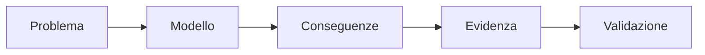

Un sistema deve quindi essere descritto attraverso ipotesi esplicite, misurato e infine validato. Le tecnologie servono a rendere concreto il modello, non a sostituirlo.

## 1. Sistemi distribuiti

### 1.1 Definizione operativa

Un **sistema distribuito** è formato da elementi di calcolo autonomi che cooperano attraverso la comunicazione, offrendo a utenti o applicazioni l'esperienza di un sistema coerente.

Le tre proprietà essenziali sono:

- **autonomia**: ciascun nodo possiede risorse e stato di esecuzione propri;
- **comunicazione**: i nodi scambiano informazioni per cooperare;
- **coerenza percepita**: l'insieme deve presentarsi come un servizio unitario.

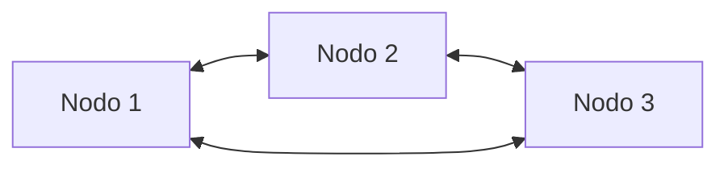

La distribuzione non rende automaticamente un sistema scalabile: introduce anche comunicazione, coordinamento, stato condiviso e possibilità di guasti parziali.

## 2. La domanda di scalabilità

Un sistema che funziona per mille utenti non è necessariamente lo stesso problema di un sistema destinato a un milione di utenti. Cambiando scala possono crescere:

- tasso di arrivo delle richieste;
- concorrenza;
- volume dei dati;
- domanda di risorse;
- pressione sui requisiti di latenza;
- rischio operativo.

I requisiti di correttezza, disponibilità e tempo di risposta non scompaiono mentre il carico cresce. La scalabilità riguarda proprio la capacità di conservare un comportamento accettabile durante questa crescita.

### 2.1 Il numero di utenti non descrive il workload

Dire “un milione di utenti” non basta. Occorre precisare almeno:

- il processo di arrivo, indicato per esempio con $\lambda(t)$;
- il costo medio di una richiesta;
- il mix di operazioni;
- la distribuzione temporale delle richieste;
- la quantità di stato letta o modificata.

Due workload possono contenere lo stesso numero totale di richieste ma produrre pressioni istantanee molto diverse.

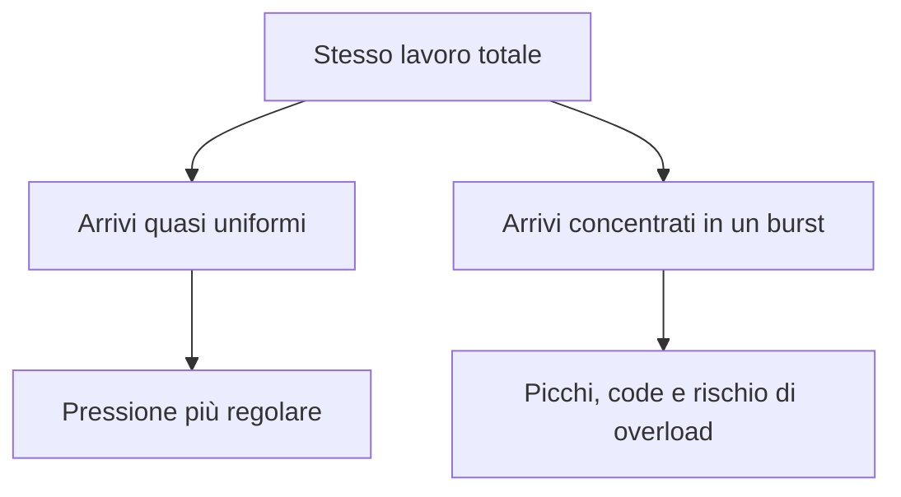

Un workload **bursty** solleva inoltre una decisione di capacity planning: dimensionare il sistema per il picco, per il carico medio oppure accettare una degradazione controllata della qualità durante i picchi.

### 2.2 Dimensioni della scalabilità

La scalabilità è multidimensionale. Una dichiarazione di scalabilità deve specificare quale dimensione cresce:

| Dimensione | Domanda principale |
|---|---|
| Carico | Il sistema conserva prestazioni accettabili con più richieste o lavoro? |
| Dati/dimensione | Riesce a gestire dataset e stato più grandi? |
| Geografia | Funziona su distanze e regioni più ampie? |
| Amministrazione | Rimane gestibile con più organizzazioni, team o domini? |

Secondo la prospettiva di Bondi, la **load scalability** riguarda la capacità di operare in modo graduale sotto carichi maggiori o minori, evitando ritardi eccessivi, spreco di risorse e contesa improduttiva.

Quando la capacità aggiuntiva viene ottenuta mediante più nodi cooperanti, il problema di scalabilità diventa anche un problema di sistemi distribuiti.

## 3. Due regimi sperimentali

Prima di misurare la scalabilità bisogna distinguere tra un lavoro finito e un servizio continuo.

| Caso | Domanda |
|---|---|
| Computazione finita | Quanto diminuisce il tempo di completamento aggiungendo risorse? |
| Servizio continuo | Come si legano throughput, latenza, capacità e concorrenza? |

### 3.1 Strong scaling

Nello **strong scaling** il workload totale rimane costante mentre cresce il numero $p$ di risorse:

$$
W_{\text{tot}} = \text{costante}, \qquad p \uparrow
$$

La domanda è: **quanto più velocemente posso completare lo stesso lavoro?**

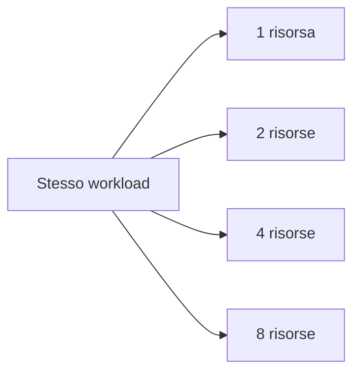

È utile per elaborazioni con una quantità di lavoro fissata e una scadenza, per esempio una simulazione o un job batch che deve terminare il prima possibile.

### 3.2 Weak scaling

Nel **weak scaling** il lavoro per risorsa rimane costante: aumentando le risorse cresce proporzionalmente anche il workload.

$$
\frac{W(p)}{p} = \text{costante}, \qquad p \uparrow
$$

La domanda è: **quanto lavoro in più posso gestire mantenendo comparabile la pressione su ciascuna risorsa?**

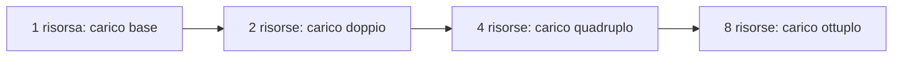

Questa prospettiva è particolarmente importante per servizi web, motori di ricerca e sistemi nei quali il numero di utenti o la quantità di dati continua a crescere.

> [!important]
> Strong e weak scaling sono **regimi sperimentali**: descrivono come varia il workload durante una misura. Non sono sinonimi delle leggi di Amdahl e Gustafson, che sono invece modelli analitici.

## 4. Speedup ed efficienza

Sia $T(1)$ il tempo necessario a completare un workload con una risorsa e $T(p)$ il tempo con $p$ risorse.

### 4.1 Speedup

Lo **speedup** è:

$$
S(p) = \frac{T(1)}{T(p)}
$$

Nel caso ideale:

$$
S(p) = p
$$

Questo significa che raddoppiando le risorse il tempo si dimezza. Nei sistemi reali lo speedup è normalmente sublineare a causa di parti seriali, comunicazione, sincronizzazione, sbilanciamento e overhead di scheduling.

### 4.2 Efficienza

L'**efficienza** misura la frazione dello speedup lineare ideale effettivamente ottenuta:

$$
E(p) = \frac{S(p)}{p}
$$

- $E(p)=1$: uso ideale delle risorse;
- $0<E(p)<1$: una parte della capacità aggiunta non si traduce in speedup;
- una forte diminuzione di $E(p)$ indica rendimenti decrescenti.

### 4.3 Esempio

| $p$ | $T(p)$ in secondi | $S(p)=T(1)/T(p)$ | $E(p)=S(p)/p$ |
|---:|---:|---:|---:|
| $1$ | $100$ | $1.00$ | $1.00$ |
| $2$ | $54$ | $1.85$ | $0.93$ |
| $4$ | $31$ | $3.23$ | $0.81$ |
| $8$ | $21$ | $4.76$ | $0.60$ |
| $16$ | $17$ | $5.88$ | $0.37$ |

Con $16$ risorse il sistema è più veloce, ma conserva solo il $37\%$ dell'efficienza ideale. Aggiungere risorse aiuta, ma non linearmente.

## 5. Legge di Amdahl

### 5.1 Ipotesi

Per un workload fisso, sia:

- $s$ la frazione del **tempo di esecuzione** non parallelizzabile;
- $1-s$ la frazione perfettamente parallelizzabile;
- $p$ il numero di risorse.

La legge di Amdahl fornisce lo speedup teorico:

$$
S_A(p) = \frac{1}{s + \frac{1-s}{p}}
$$

> [!warning]
> $s$ è una frazione del **tempo**, non una percentuale di righe di codice. Una piccola parte del programma può occupare una parte significativa del tempo totale.

### 5.2 Esempio con $s=0.05$

Con quattro risorse:

$$
S_A(4) = \frac{1}{0.05 + \frac{0.95}{4}} \approx 3.48
$$

Con sedici risorse:

$$
S_A(16) = \frac{1}{0.05 + \frac{0.95}{16}} \approx 9.14
$$

Le risorse aggiuntive continuano ad aiutare, ma il guadagno marginale diminuisce.

### 5.3 Limite asintotico

Quando $p$ tende all'infinito, la parte parallelizzabile tende idealmente a zero, ma la parte seriale rimane:

$$
\lim_{p\to\infty} S_A(p) = \frac{1}{s}
$$

Con $s=0.05$:

$$
\lim_{p\to\infty} S_A(p) = 20
$$

Neppure un numero infinito di risorse permetterebbe di superare uno speedup di $20$ nel modello.

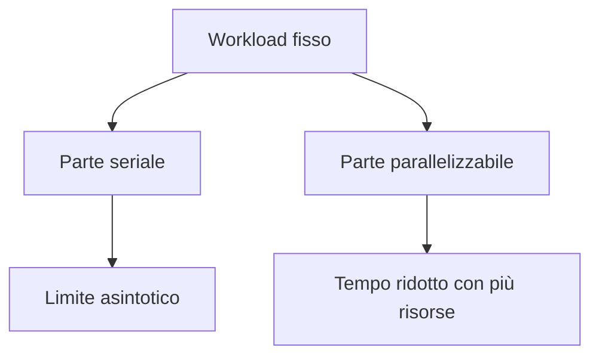

### 5.4 Cosa include e cosa trascura

Il modello include un workload fisso, una parte seriale e una parte idealmente parallelizzabile. Non rende espliciti:

- overhead di comunicazione;
- costi di sincronizzazione;
- load imbalance;
- effetti di cache;
- overhead di scheduling.

La lezione pratica è che, per migliorare lo strong scaling, non basta aggiungere risorse: bisogna ridurre o eliminare la parte non scalabile.

## 6. Legge di Gustafson

Amdahl mantiene fisso il problema. Gustafson cambia domanda: se sono disponibili più risorse, perché non usarle per risolvere un problema più grande?

Nel modello di **scaled-size computing**, $s$ è la frazione seriale misurata rispetto al tempo di esecuzione parallelo. Lo speedup scalato è:

$$
S_G(p) = p - s(p-1)
$$

### 6.1 Esempio

Per $p=64$ e $s=0.05$:

$$
S_G(64) = 64 - 0.05(64-1) = 60.85
$$

Il risultato non contraddice Amdahl: i due modelli rispondono a domande diverse.

| Amdahl | Gustafson |
|---|---|
| Workload fisso | Workload scalato |
| Quanto più velocemente completo lo stesso lavoro? | Quanto più grande può essere il problema mantenendo comparabile l'esecuzione? |
| Evidenzia il limite della parte seriale | Evidenzia il lavoro aggiuntivo assorbibile con più risorse |

## 7. Dai job finiti ai servizi continui: legge di Little

Per un servizio continuo non esiste un unico job da completare: il lavoro continua ad arrivare. Diventano centrali throughput, latenza e numero di richieste contemporaneamente presenti nel sistema.

### 7.1 Definire il confine

Prima di applicare la legge bisogna scegliere il **system boundary**. Solo ciò che si trova dentro quel confine viene contato nel numero di elementi e nel tempo di permanenza.

Siano:

- $\lambda$: tasso medio di arrivo o throughput, espresso per esempio in richieste al secondo;
- $W$: tempo medio trascorso da una richiesta nel sistema;
- $L$: numero medio di richieste presenti nel sistema, cioè lavoro *in flight*.

In condizioni appropriate di stazionarietà e finitezza:

$$
L = \lambda W
$$

Le unità sono coerenti:

$$
\frac{\text{richieste}}{\text{secondo}} \cdot \text{secondi} = \text{richieste}
$$

### 7.2 Esempio

Se:

$$
\lambda = 1000\ \text{richieste/s}, \qquad W=0.2\ \text{s}
$$

allora:

$$
L = 1000 \cdot 0.2 = 200
$$

In media ci sono $200$ richieste all'interno del confine scelto.

Se il tempo medio raddoppia mentre il throughput resta invariato:

$$
W=0.4\ \text{s} \quad \Longrightarrow \quad L=400
$$

Raddoppia quindi il lavoro contemporaneamente presente nel sistema, con maggiori necessità di memoria, thread, connessioni o altre risorse.

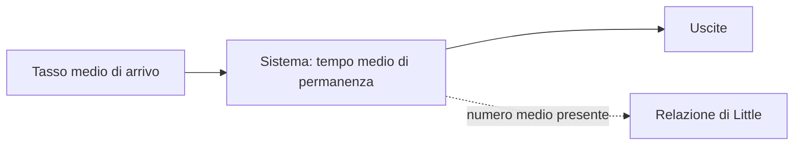

### 7.3 Cosa non dice la legge di Little

La legge mette in relazione medie di lungo periodo, ma non determina:

- il valore del tempo di risposta $W$;
- la capacità massima;
- l'effetto della burstiness;
- la distribuzione delle latenze;
- il comportamento durante overload o transitori.

Serve quindi come identità utile per il dimensionamento e per riconoscere accumuli di lavoro, non come modello completo di coda.

## 8. Scale-up e scale-out

### 8.1 Scale-up

Lo **scale-up** aumenta la capacità di una singola istanza: più CPU, memoria, storage o hardware più veloce. Non crea necessariamente un sistema distribuito.

### 8.2 Scale-out

Lo **scale-out** aggiunge nodi o istanze cooperanti. Permette di superare i limiti fisici ed economici di una singola macchina, ma introduce problemi distribuiti.

| Scale-up | Scale-out |
|---|---|
| Una singola istanza più potente | Più istanze cooperanti |
| Semplicità architetturale relativa | Comunicazione e coordinamento |
| Limiti fisici ed economici del nodo | Capacità potenzialmente più elastica |
| Non implica distribuzione | Implica normalmente problemi distribuiti |

### 8.3 Quando basta un load balancer

La replica orizzontale è più semplice quando:

- le richieste sono indipendenti;
- i worker sono intercambiabili;
- non esiste stato mutabile condiviso.

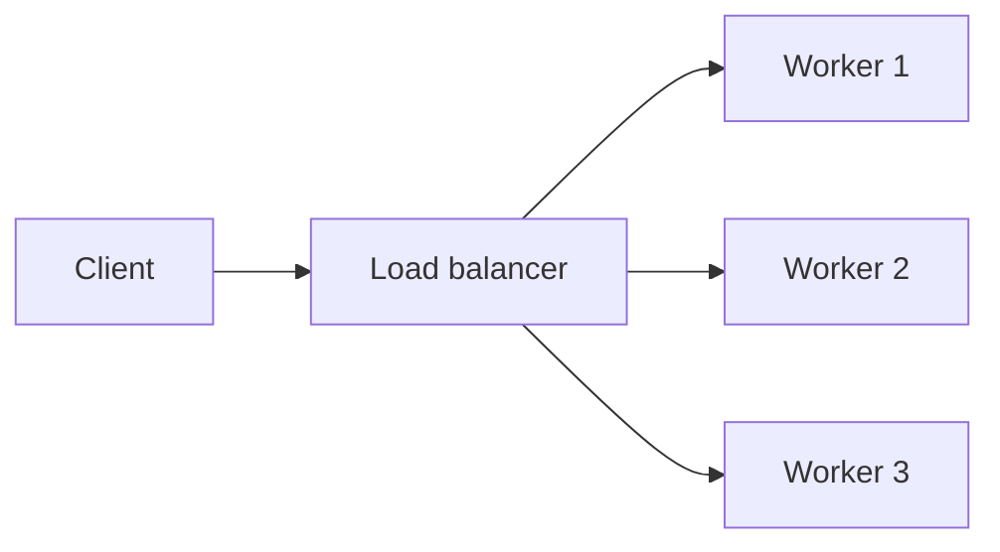

Questa architettura aumenta la capacità solo finché non emerge un nuovo collo di bottiglia.

Se si aggiungono stato condiviso, interazioni remote, invarianti distribuiti o guasti parziali, i worker cessano di essere realmente indipendenti.

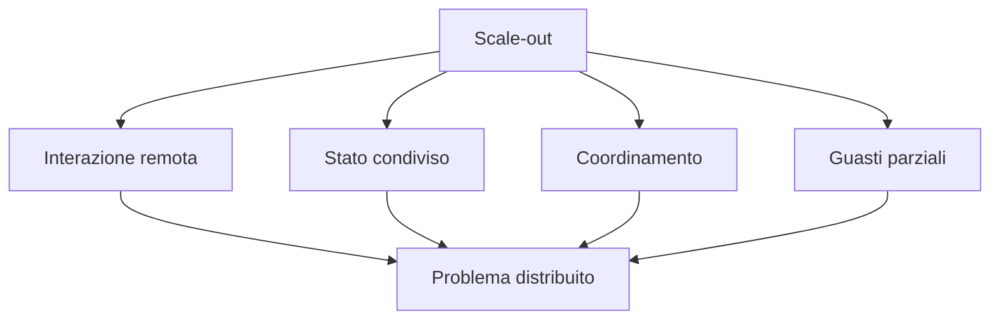

## 9. Errori concettuali da evitare

1. **Dire che un sistema scala senza specificare rispetto a cosa.** Bisogna dichiarare workload, risorse e proprietà richieste.
2. **Usare il numero di utenti come descrizione completa del carico.** Mancano frequenza, mix, costo e distribuzione temporale delle richieste.
3. **Confondere strong scaling con Amdahl e weak scaling con Gustafson.** I primi sono regimi sperimentali, i secondi modelli analitici.
4. **Interpretare $s$ come frazione del codice.** È la frazione del tempo di esecuzione che rimane seriale nel modello.
5. **Pensare che Little determini la latenza.** La legge lega tre medie, ma non spiega da sola da dove derivi $W$.
6. **Pensare che più nodi eliminino automaticamente i limiti.** I colli di bottiglia possono spostarsi verso stato, rete, coordinamento o load balancer.

## 10. Formulario essenziale

| Concetto | Formula |
|---|---|
| Speedup | $S(p)=\dfrac{T(1)}{T(p)}$ |
| Efficienza | $E(p)=\dfrac{S(p)}{p}$ |
| Amdahl | $S_A(p)=\dfrac{1}{s+\frac{1-s}{p}}$ |
| Limite di Amdahl | $\displaystyle\lim_{p\to\infty}S_A(p)=\dfrac{1}{s}$ |
| Gustafson | $S_G(p)=p-s(p-1)$ |
| Little | $L=\lambda W$ |

## 11. Possibili domande d'esame

### Che cosa deve contenere una dichiarazione di scalabilità?

Deve indicare la dimensione che cresce, il modello del workload, le risorse disponibili e le proprietà che devono rimanere accettabili. “Supporta un milione di utenti” è insufficiente perché non specifica arrivi, costo e mix delle richieste.

### Qual è la differenza tra strong e weak scaling?

Nello strong scaling il workload rimane fisso e si misura la riduzione del tempo aggiungendo risorse. Nel weak scaling cresce sia il workload sia il numero di risorse, mantenendo circa costante il lavoro per risorsa.

### Perché Amdahl limita lo speedup?

La frazione seriale $s$ non beneficia delle risorse aggiuntive. Quando la parte parallelizzabile diventa trascurabile, il tempo seriale domina e lo speedup tende a $1/s$.

### Amdahl e Gustafson si contraddicono?

No. Amdahl considera un problema di dimensione fissa; Gustafson considera un problema che cresce con le risorse. Cambia la domanda sperimentale, quindi cambia l'interpretazione dello speedup.

### Come si interpreta $L=\lambda W$?

Se arrivano in media $\lambda$ richieste al secondo e ciascuna resta nel sistema per $W$ secondi, allora nel sistema sono presenti mediamente $L$ richieste. Il confine del sistema deve essere scelto esplicitamente.

## 12. Sintesi finale

- La scalabilità richiede un modello esplicito di carico e risorse.
- Strong e weak scaling misurano scenari diversi.
- Speedup ed efficienza permettono di quantificare il beneficio delle risorse aggiunte.
- Amdahl mostra il limite imposto dalla parte seriale di un workload fisso.
- Gustafson mostra quanto lavoro aggiuntivo possa essere trattato facendo crescere il problema.
- Little collega throughput, tempo nel sistema e lavoro in corso.
- Lo scale-out introduce distribuzione e, con essa, comunicazione, stato, coordinamento e guasti parziali.

## 13. Indicazioni organizzative emerse durante la lezione

La trascrizione presenta due modalità principali per il lavoro d'esame:

1. una relazione ragionata con analisi critica di un tema concordato;
2. un piccolo progetto, preferibilmente svolto in due persone, centrato su distribuzione e scalabilità.

In entrambi i casi è previsto un orale: la parte principale riguarda il progetto o la relazione, mentre la parte rimanente riguarda gli argomenti del corso. Le indicazioni definitive vanno comunque verificate nelle comunicazioni ufficiali del docente.

## Riferimenti principali

- G. M. Amdahl, *Validity of the Single Processor Approach to Achieving Large Scale Computing Capabilities*, 1967.
- J. L. Gustafson, *Reevaluating Amdahl's Law*, 1988.
- J. D. C. Little, *A Proof for the Queuing Formula: $L=\lambda W$*, 1961.
- A. B. Bondi, *Characteristics of Scalability and Their Impact on Performance*, 2000.
- M. van Steen e A. S. Tanenbaum, *A Brief Introduction to Distributed Systems*, 2016.


# 18/9

## Obiettivo della lezione

La replica orizzontale è semplice quando le richieste sono indipendenti e i worker sono intercambiabili. Quando queste ipotesi vengono rimosse, stato, decisioni e dipendenze devono essere collocati da qualche parte.

L'architettura deve quindi rispondere a quattro domande ricorrenti:

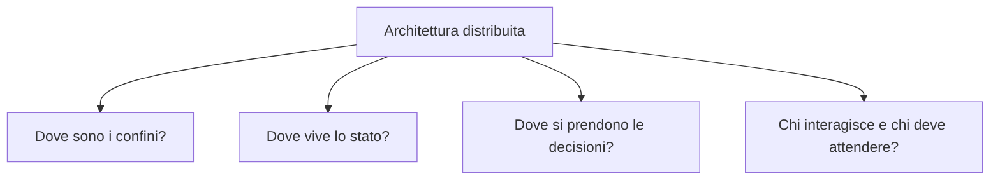

L'idea fondamentale è che i vincoli di scalabilità non vengono semplicemente eliminati: quando l'architettura cambia, essi spesso **si spostano**.

## 1. Decomposizione e confini

### 1.1 Prima della decomposizione

In un sistema monolitico, computazione, stato e decisioni si trovano nello stesso confine. Chiamate di funzione e accessi in memoria sono locali.

Decomporre il sistema significa scegliere parti separate. Dopo la decomposizione:

- una chiamata locale può diventare un'interazione di protocollo;
- un accesso in memoria può diventare un accesso remoto allo stato;
- errori e ritardi di rete entrano nel cammino di esecuzione;
- diventano espliciti i problemi di ownership e coordinamento.

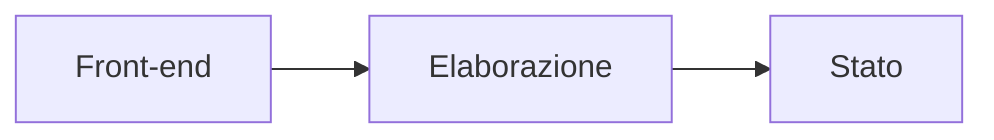

I confini migliorano separazione e distribuzione del lavoro, ma trasformano alcune dipendenze locali in comunicazione remota.

### 1.2 Il criterio di Parnas

Secondo Parnas, un sistema può essere decomposto in modi diversi. La decomposizione va scelta in base alle decisioni progettuali che ogni modulo deve **nascondere e localizzare**.

Nel caso distribuito questo principio ha un'ulteriore conseguenza: la decomposizione determina quali dipendenze potranno attraversare i confini delle macchine.

Esempio concettuale: la crescita di un'organizzazione o di un prodotto non aumenta soltanto il carico, ma può rendere la struttura del software troppo accoppiata, difficile da separare e lenta da distribuire.

## 2. Architettura come grafo di dipendenze

### 2.1 Modello

Un'architettura può essere rappresentata come un grafo:

$$
G=(V,E)
$$

dove:

- $V$ è l'insieme dei componenti;
- $E$ è l'insieme delle dipendenze che richiedono scambio di informazioni.

La decomposizione sceglie i componenti. Il **placement** sceglie dove eseguirli. Se $H$ è l'insieme degli host:

$$
\pi:V\to H
$$

e $\pi(v)$ indica l'host sul quale è collocato il componente $v$.

### 2.2 Dipendenze locali e remote

Una dipendenza $(u,v)$ è remota quando i due componenti sono collocati su host diversi. L'insieme degli archi tagliati dal placement è:

$$
E_{\text{cut}}(\pi)=\{(u,v)\in E:\pi(u)\neq\pi(v)\}
$$

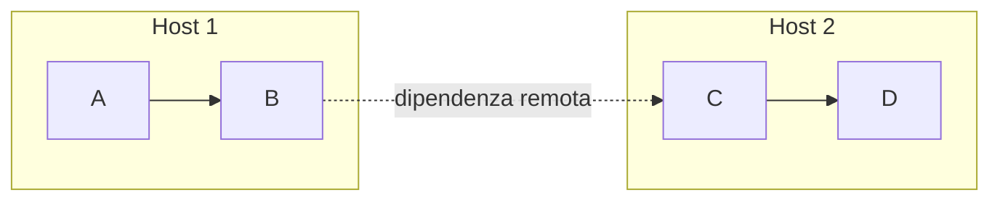

Se ogni dipendenza $e$ trasferisce $w_e$ byte per unità di lavoro, un primo modello del volume di comunicazione è:

$$
C_{\text{edge}}(\pi)=\sum_{e\in E_{\text{cut}}(\pi)}w_e
$$

Lo stesso grafo, le stesse macchine e la stessa computazione possono produrre volumi di comunicazione differenti a seconda del placement.

### 2.3 Limite del modello a grafo

Il taglio degli archi è una semplificazione. Tre archi potrebbero rappresentare tre messaggi distinti, oppure la distribuzione dello stesso dato a tre consumatori. Contare ogni arco separatamente può quindi sovrastimare o rappresentare male la comunicazione reale.

## 3. Ipergrafi e dipendenze condivise

### 3.1 Definizione

Un **ipergrafo** è:

$$
\mathcal{H}=(V,N)
$$

dove ciascun iperarco, o *net*, $n\in N$ può collegare un sottoinsieme arbitrario di vertici.

Un unico iperarco può rappresentare un dato prodotto da un componente e richiesto da più consumatori.

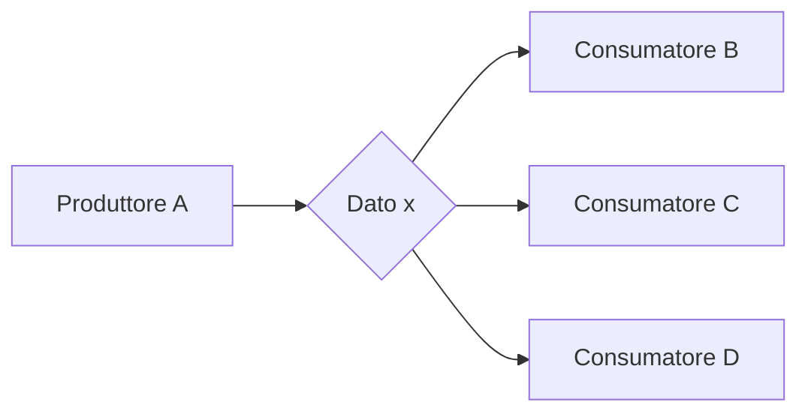

Il nodo centrale nel diagramma è solo una resa grafica: nel modello $x$ è un iperarco che collega $A$, $B$, $C$ e $D$.

### 3.2 Connettività di un iperarco

Data una partizione:

$$
\Pi=\{V_1,\ldots,V_p\}
$$

la connettività dell'iperarco $n$ è:

$$
\lambda_n(\Pi)=\left|\{i:n\cap V_i\neq\varnothing\}\right|
$$

$\lambda_n$ indica quante partizioni sono toccate dall'iperarco.

- Se il dato tocca due partizioni, $\lambda_n-1=1$.
- Se ne tocca tre, $\lambda_n-1=2$.

Il termine $\lambda_n-1$ ha un significato fisico: se una partizione possiede il dato e il dato è richiesto complessivamente in $\lambda_n$ partizioni, deve essere inviato alle altre $\lambda_n-1$.

### 3.3 Metrica connectivity-1

Se l'iperarco $n$ rappresenta $c_n$ unità di dati, il volume di comunicazione è modellato da:

$$
C(\Pi)=\sum_{n\in N}c_n\bigl(\lambda_n(\Pi)-1\bigr)
$$

### 3.4 Esempio pesato

Consideriamo:

$$
n_x=\{A,B,C\}, \qquad c_x=10\ \text{MB}
$$

$$
n_y=\{C,D\}, \qquad c_y=1\ \text{MB}
$$

Per il placement $\Pi_A$ si ha $\lambda_x=2$ e $\lambda_y=1$:

$$
C(\Pi_A)=10(2-1)+1(1-1)=10\ \text{MB}
$$

Per il placement $\Pi_B$ si ha $\lambda_x=2$ e $\lambda_y=2$:

$$
C(\Pi_B)=10(2-1)+1(2-1)=11\ \text{MB}
$$

Non sono cambiati computazione, numero di nodi o bilanciamento; è cambiato soltanto il placement dei componenti dipendenti.

## 4. Località contro bilanciamento

Se l'unico obiettivo fosse minimizzare la comunicazione, la soluzione sarebbe collocare tutto in una sola partizione:

$$
V_1=V, \qquad V_2=\cdots=V_p=\varnothing
$$

ottenendo:

$$
C(\Pi)=0
$$

Questa soluzione ha località perfetta ma non distribuisce il lavoro. Bisogna quindi ottimizzare insieme comunicazione e bilanciamento.

Sia $W(V)$ il lavoro computazionale totale. Il carico ideale per $p$ partizioni è:

$$
\frac{W(V)}{p}
$$

Poiché un bilanciamento perfetto può essere impossibile o troppo costoso, si introduce una tolleranza relativa $\varepsilon$:

$$
W(V_i)\leq(1+\varepsilon)\frac{W(V)}{p}
$$

Il problema diventa:

$$
\min_{\Pi}\sum_{n\in N}c_n(\lambda_n-1)
$$

soggetto al vincolo:

$$
W(V_i)\leq(1+\varepsilon)\frac{W(V)}{p}
$$

Per esempio, con $W(V)=100$, $p=4$ e $\varepsilon=0.1$:

$$
W(V_i)\leq1.1\cdot\frac{100}{4}=27.5
$$


> [!important]
> Se ogni placement bilanciato di una decomposizione produce molta comunicazione tra confini, potrebbe essere sbagliata la decomposizione stessa, non soltanto il placement.

## 5. Volume di comunicazione e tempo

Due placement con lo stesso $C(\Pi)$ possono avere prestazioni diverse. Il solo volume non cattura:

- numero di messaggi e batching;
- topologia e congestione;
- concentrazione del traffico su un singolo nodo;
- costi di latenza rispetto a quelli di banda;
- struttura delle sincronizzazioni;
- sovrapposizione tra comunicazione e computazione.

Una prima approssimazione del tempo necessario a un messaggio di $m$ byte è:

$$
T_{\text{msg}}\approx\alpha+\beta m
$$

dove:

- $\alpha$ è il costo fisso di startup o latenza;
- $\beta$ è il costo marginale per byte.

Un modello schematico del costo del placement diventa:

$$
T_{\text{comm}}(\Pi)\approx
\sum_{e\in E_{\text{cut}}(\Pi)}(\alpha+\beta w_e)
$$

Molti messaggi piccoli possono costare più di pochi messaggi grandi a parità di byte, perché pagano $\alpha$ più volte.

## 6. Placement dello stato

### 6.1 Stato privato

Il caso più semplice si verifica quando ogni worker possiede stato privato e computazione e stato sono co-locati.

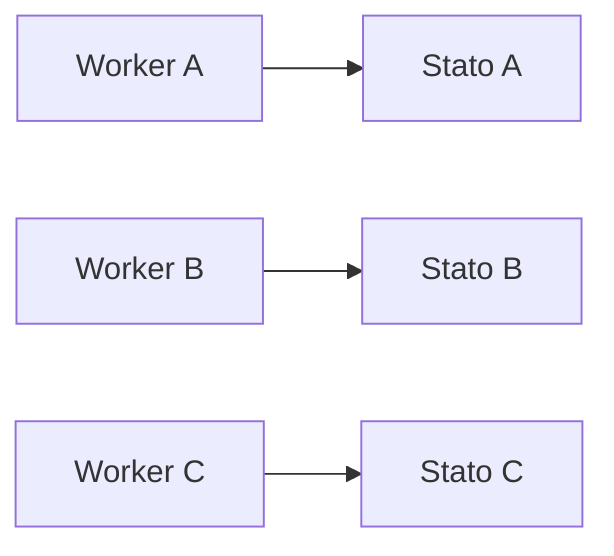

Gli accessi rimangono locali, evitando una dipendenza comune.

### 6.2 Stato mutabile condiviso

Con più worker che accedono allo stesso stato mutabile, scalare i worker non scala automaticamente il servizio di stato.

Se arrivano richieste al tasso $\lambda$ e ciascuna esegue in media $r$ accessi allo stato, il carico offerto al livello di stato è:

$$
\lambda_s=r\lambda
$$

Il valore dipende dal workload e dall'intensità degli accessi, non dal numero di worker. Aumentare i worker può quindi aumentare la pressione su un collo di bottiglia invariato.

### 6.3 Ownership e località

Partizionare lo stato e collocare la computazione vicino alla porzione che possiede migliora la località. Tuttavia sostituisce una dipendenza con un'altra:

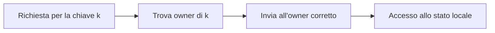

Diventano responsabilità esplicite:

- mappatura chiave-owner;
- routing;
- movimento dei dati;
- gestione dei cambi di ownership;
- riequilibrio delle partizioni.

### 6.4 Replicazione

Se esistono più copie modificabili dello stesso stato, nasce una nuova domanda: come vengono mantenute coerenti? La replicazione può aumentare disponibilità e capacità di lettura, ma introduce coordinamento e modelli di consistenza.

## 7. Shared-nothing

Nell'architettura **shared-nothing**, ciascun processore possiede memoria e dischi privati; la cooperazione avviene tramite rete, senza memoria o disco globalmente condivisi.

L'intuizione è:

- partizionare ownership di dati ed elaborazione;
- ridurre le risorse globalmente condivise;
- comunicare esplicitamente mediante messaggi.

Il principio rimane visibile nei servizi moderni basati su shard, anche se computazione e storage non sono sempre fisicamente co-locati. Bisogna distinguere il principio architetturale dalla sua specifica implementazione fisica.

## 8. Dove vengono prese le decisioni?

Il luogo in cui il lavoro viene eseguito non deve coincidere con il luogo in cui si prendono decisioni di placement o scheduling.

### 8.1 Controllo centralizzato

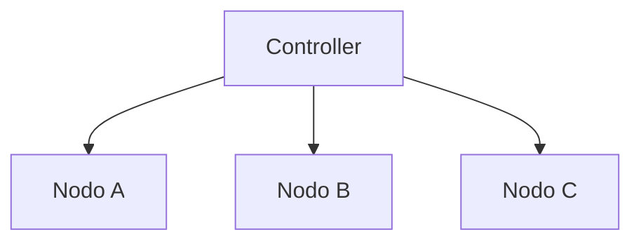

Vantaggi:

- punto decisionale globale più semplice;
- informazioni e autorità localizzate;
- maggiore facilità nel perseguire un obiettivo globale.

Svantaggi:

- le informazioni devono fluire verso il controller;
- il controller diventa una dipendenza per le decisioni;
- può diventare collo di bottiglia o single point of failure;
- in caso di partizione di rete alcuni nodi possono non ricevere decisioni.

### 8.2 Controllo distribuito

Vantaggi:

- evita un unico punto globale di decisione;
- permette decisioni vicine ai dati e agli eventi;
- può continuare a funzionare in alcuni scenari di partizione;
- può ridurre latenza e proteggere dati locali, come nell'edge computing.

Svantaggi:

- le informazioni sono disperse, incomplete o ritardate;
- la coerenza delle decisioni richiede coordinamento;
- ottenere una visione globale diventa più difficile.

Non esiste una gerarchia assoluta: la scelta dipende dalla decisione, dalla sua portata e dalla freschezza delle informazioni necessarie.

## 9. Struttura delle interazioni

### 9.1 Dipendenza sincrona diretta

In una chiamata sincrona $A$ non può completare il passo finché $B$ non partecipa e risponde.

In una catena sequenziale semplificata:

$$
T_{\text{e2e}}\approx T_A+L_{A,B}+T_B+L_{B,A}
$$

dove $L_{A,B}$ e $L_{B,A}$ sono i ritardi di comunicazione, non necessariamente simmetrici.

Spostare $B$ oltre un confine di rete modifica il cammino critico anche se la computazione logica non cambia.

### 9.2 Dipendenze parallele

In un fork/join idealizzato, se $B$ e $C$ procedono in parallelo:

$$
T_{\text{join}}\approx T_A+\max(T_B,T_C)
$$

La latenza dipende dal ramo più lento, non dalla somma dei due. In pratica bisogna aggiungere comunicazione, scheduling e costo del join.

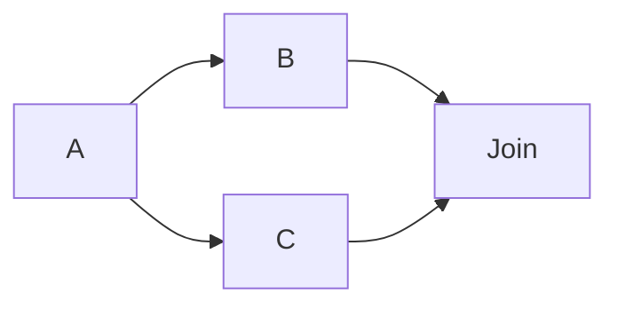

### 9.3 Intermediari e asincronia

Un broker, una coda o un buffer durevole modifica l'accoppiamento temporale:

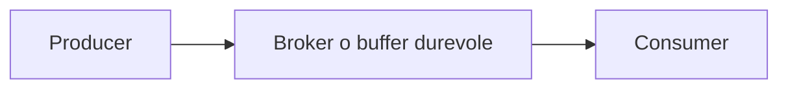

Il producer può progredire senza attendere che il consumer completi immediatamente il lavoro. La dipendenza non scompare: cambiano il suo tempo e i requisiti di stato.

Nuove responsabilità possono includere:

- durabilità dei messaggi;
- retry e gestione dei duplicati;
- ordering;
- backpressure;
- scalabilità e replica del broker.

L'intermediario può semplificare una topologia molti-a-molti, ma può anche diventare un nuovo collo di bottiglia o single point of failure se non è progettato per scalare.

La domanda guida è sempre: **chi deve aspettare chi?**

## 10. Due architetture a confronto

### Architettura A: computazione replicata, stato condiviso

- distribuzione semplice delle richieste;
- worker intercambiabili;
- la dipendenza dallo stato comune rimane;
- il tier di stato può diventare il limite principale.

### Architettura B: ownership e stato localizzato

- migliore località;
- capacità dello stato distribuita tra shard;
- routing e mappa del placement diventano espliciti;
- movimento e riequilibrio dello stato diventano operazioni architetturali.

| Vincolo | Stato condiviso | Stato partizionato |
|---|---|---|
| Routing | Semplice | Deve trovare l'owner |
| Località | Potenzialmente bassa | Alta se computazione e stato coincidono |
| Collo di bottiglia | Servizio di stato comune | Hot shard, router o mappa |
| Ribilanciamento | Meno visibile | Responsabilità esplicita |
| Coordinamento | Sugli accessi condivisi | Su ownership, movimento e copie |

La seconda architettura non elimina i vincoli: li sposta dallo stato condiviso verso routing, ownership e movimento dei dati.

## 11. Esempio: servizio di elaborazione fotografica

Un servizio online può includere:

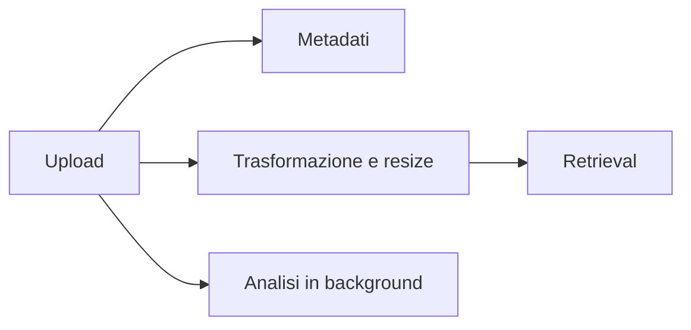

Domande architetturali:

- Dove risiedono i byte delle immagini?
- Dove vengono eseguite trasformazioni e resize?
- Quali passaggi devono essere sincroni per rispondere all'utente?
- Quali attività possono essere demandate a una coda?
- Chi decide il placement?
- Come si localizza lo shard corretto?
- Cosa accade se un componente è lento o irraggiungibile?

Lo stesso sistema può comporre front-end stateless, processamento partizionato, stato replicato e analisi asincrona. Non serve imporre un'unica struttura a tutti i sottosistemi.

## 12. Errori concettuali da evitare

1. **Pensare che la decomposizione rimuova le dipendenze.** Le rende esplicite e può trasformarle in comunicazione remota.
2. **Confondere decomposizione e placement.** La prima sceglie le parti; il secondo sceglie dove collocarle.
3. **Ottimizzare soltanto il volume di comunicazione.** Collocare tutto su una macchina minimizza il traffico ma annulla la distribuzione del lavoro.
4. **Trattare $C(\Pi)$ come tempo di comunicazione.** Il tempo dipende anche da latenza, numero di messaggi, topologia e congestione.
5. **Credere che più worker scalino lo stato condiviso.** Il carico sullo stato è $\lambda_s=r\lambda$ e può restare il collo di bottiglia.
6. **Pensare che l'asincronia elimini una dipendenza.** La sposta nel tempo e richiede buffering, durabilità e gestione degli errori.
7. **Considerare sempre superiore il controllo distribuito.** Centralizzazione e distribuzione hanno costi diversi e dipendono dalla portata della decisione.

## 13. Formulario essenziale

| Concetto                    | Formula                                                                              |
| --------------------------- | ------------------------------------------------------------------------------------ |
| Placement                   | $\pi:V\to H$                                                                         |
| Archi remoti                | $E_{\text{cut}}(\pi)=\{(u,v)\in E:\pi(u)\neq\pi(v)\}$                                |
| Edge-cut pesato             | $C_{\text{edge}}(\pi)=\sum_{e\in E_{\text{cut}}(\pi)}w_e$                            |
| Connettività di un iperarco | $\lambda_n(\Pi)=\left\| \left\{i \mid n \cap V_i \neq \varnothing \right\} \right\|$ |
| Connectivity-1              | $C(\Pi)=\sum_{n\in N}c_n(\lambda_n-1)$                                               |
| Vincolo di bilanciamento    | $W(V_i)\leq(1+\varepsilon)\dfrac{W(V)}{p}$                                           |
| Costo di un messaggio       | $T_{\text{msg}}\approx\alpha+\beta m$                                                |
| Carico sullo stato          | $\lambda_s=r\lambda$                                                                 |
| Catena sincrona             | $T_{\text{e2e}}\approx T_A+L_{A,B}+T_B+L_{B,A}$                                      |
| Fork/join                   | $T_{\text{join}}\approx T_A+\max(T_B,T_C)$                                           |

## 14. Possibili domande d'esame

### Qual è la differenza tra decomposizione e placement?

La decomposizione definisce i componenti e i loro confini; il placement assegna tali componenti agli host. Una stessa decomposizione può avere costi di comunicazione molto diversi con placement differenti.

### Perché un ipergrafo può modellare meglio una dipendenza condivisa?

Un singolo iperarco può rappresentare uno stesso dato usato da più componenti. In un grafo ordinario sarebbero necessari più archi, che potrebbero essere erroneamente interpretati come trasferimenti indipendenti.

### Perché non basta minimizzare $C(\Pi)$?

La soluzione minima assoluta colloca tutto in una sola partizione, ottenendo zero comunicazione ma nessuna distribuzione del carico. Serve un problema vincolato che minimizzi la comunicazione rispettando il bilanciamento.

### Qual è la differenza tra volume e tempo di comunicazione?

Il volume conta i byte trasferiti, mentre il tempo dipende anche da startup, latenza, numero dei messaggi, rete, congestione e possibilità di sovrapporre comunicazione e calcolo.

### Perché partizionare lo stato non elimina i problemi architetturali?

Migliora località e capacità, ma richiede di trovare l'owner corretto, instradare le richieste, muovere i dati e riequilibrare le partizioni. Con la replica si aggiungono consistenza e coordinamento.

### Che cosa cambia introducendo un broker asincrono?

Il producer non deve più attendere direttamente il consumer. L'accoppiamento temporale si riduce, ma emergono requisiti di durabilità, retry, deduplicazione, ordering, backpressure e scalabilità del broker.

## 15. Sintesi finale

- La decomposizione crea confini e rende alcune dipendenze remote.
- Il placement determina quali dipendenze attraversano la rete.
- Grafi e ipergrafi permettono di ragionare formalmente sulla comunicazione.
- La minimizzazione della comunicazione deve rispettare il bilanciamento del carico.
- Il volume trasferito non coincide con il tempo di comunicazione.
- Stato privato, condiviso, partizionato o replicato produce vincoli differenti.
- Esecuzione e decisione possono essere centralizzate o distribuite in modi diversi.
- Sincronia, parallelismo e asincronia cambiano il cammino critico e il modo in cui i componenti attendono.
- Un'architettura non elimina magicamente i vincoli di scalabilità: li rende visibili e li sposta.

## Riferimenti principali

- D. L. Parnas, *On the Criteria To Be Used in Decomposing Systems into Modules*, 1972.
- M. Stonebraker, *The Case for Shared Nothing*, 1986.
- Ü. V. Çatalyürek e C. Aykanat, *Hypergraph-Partitioning-Based Decomposition for Parallel Sparse-Matrix Vector Multiplication*, 1999.
- B. Hendrickson e T. G. Kolda, *Graph Partitioning Models for Parallel Computing*, 2000.
- G. Karypis e V. Kumar, *A Fast and High Quality Multilevel Scheme for Partitioning Irregular Graphs*, 1998.

# 23/9

---
title: "Lezione 3 - Sorgenti e limiti della scalabilità I"
course: "Scalable Distributed Computing"
academic_year: "2026/2027"
tags:
  - distributed-systems
  - scalability
  - performance-modeling
  - bottlenecks
---
## Obiettivo della lezione

Una curva di scalabilità scadente è un'**osservazione**, non una diagnosi. Curve esteriormente simili possono essere prodotte da meccanismi interni diversi; di conseguenza richiedono interventi differenti.

Il metodo seguito nella lezione è:

```mermaid
flowchart LR
    O["Osservazione"] --> H["Ipotesi sul meccanismo"]
    H --> M["Modello quantitativo minimo"]
    M --> P["Predizione verificabile"]
    P --> V["Misura e validazione"]
    V --> D["Conferma o rifiuto dell'ipotesi"]
```

Il vero lavoro non consiste quindi nel dare un nome alla forma della curva, ma nello spiegare **perché** il sistema potrebbe produrla.

## 1. Sistema di riferimento

La lezione usa ripetutamente una piccola architettura astratta:

```mermaid
flowchart LR
    I["Ingress"] --> Q["Coda delle richieste"]
    Q --> W["Worker del servizio"]
    W --> S["Servizio di stato condiviso"]
    S --> D["Servizio downstream"]
    D --> R["Risposte"]
    C["Controllo"] -.-> W
    C -.-> S
```

Non rappresenta un prodotto specifico. Serve a isolare diversi possibili limiti dello stesso percorso end-to-end:

- lavoro non scalabile;
- capacità fissa condivisa;
- attesa e contesa;
- lavoro aggiuntivo creato dalla scala;
- coordinamento.

La variabile di controllo principale è il numero $N$ di worker; gli osservabili principali sono throughput e latenza.

## 2. Dal modello ideale al gap di scalabilità

Per un lavoro fisso $W$, il modello ideale prevede:

$$
T_{\text{ideal}}(N)=\frac{W}{N}
$$

e quindi:

$$
S_{\text{ideal}}(N)=N
$$

Raddoppiando le risorse, il tempo dovrebbe dimezzarsi oppure la capacità utile dovrebbe raddoppiare. Un sistema reale può invece mostrare rendimenti decrescenti, un plateau o persino un calo delle prestazioni.

Definiamo il **gap di scalabilità**:

$$
G(N)=T_{\text{real}}(N)-T_{\text{ideal}}(N)
$$

con:

$$
T_{\text{real}}(N)>T_{\text{ideal}}(N)
$$

La domanda diagnostica è: da quale meccanismo deriva $G(N)$?

### 2.1 Forme qualitative da spiegare

| Forma osservata | Possibile spiegazione iniziale |
|---|---|
| Crescita con rendimenti decrescenti | Lavoro non scalabile |
| Plateau | Capacità fissa condivisa |
| Picco seguito da declino | Contesa o overhead dipendente dalla scala |
| Completamento dominato dalla coda | Il partecipante più lento determina il tempo |

Queste associazioni sono ipotesi di partenza, non conclusioni automatiche.

## 3. Amdahl come baseline diagnostica

Benché un servizio online non sia normalmente un job batch, si può congelare analiticamente il workload per isolare l'effetto della sola parte non parallelizzabile.

Siano:

$$
s=\frac{T_{\text{serial}}}{T(1)}
$$

e:

$$
1-s=\frac{T_{\text{parallel}}}{T(1)}
$$

La legge di Amdahl fornisce:

$$
S(N)=\frac{1}{s+\frac{1-s}{N}}
$$

Moltiplicando numeratore e denominatore per $N$:

$$
S(N)=\frac{N}{sN+1-s}
$$

Questa forma è utile per studiare marginalità e curvatura.

> [!note]
> Amdahl e Gustafson rispondono a domande diverse. Amdahl considera lavoro fisso e viene usata qui come baseline diagnostica; Gustafson considera lavoro utile scalato. La vicinanza tra Gustafson e weak scaling non li rende sinonimi.

## 4. Rendimento marginale delle risorse

### 4.1 Rilassamento continuo

Le macchine sono discrete, quindi realmente $N\in\mathbb{N}$. Per studiare la forma della curva si estende temporaneamente il modello a $N\in\mathbb{R}^{+}$.

Questo rilassamento permette di usare le derivate, ma non implica l'esistenza di frazioni di macchina. Le decisioni reali dovranno essere ricondotte a valori interi.

### 4.2 Prima derivata

Partendo da:

$$
S(N)=\frac{N}{sN+1-s}
$$

si ottiene:

$$
S'(N)=\frac{1-s}{(sN+1-s)^2}
$$

Per $0<s<1$:

$$
S'(N)>0
$$

ma:

$$
\lim_{N\to\infty}S'(N)=0
$$

Il beneficio marginale di ulteriori risorse rimane positivo, ma tende a zero.

### 4.3 Seconda derivata e concavità

Derivando ancora:

$$
S''(N)=-\frac{2s(1-s)}{(sN+1-s)^3}
$$

Per $0<s<1$:

$$
S''(N)<0
$$

La curva è concava: ogni risorsa aggiuntiva contribuisce meno della precedente.

```mermaid
flowchart TD
    A["Più risorse"] --> B["Speedup ancora crescente"]
    B --> C["Guadagno marginale più piccolo"]
    C --> D["Rendimenti decrescenti"]
```

### 4.4 Guadagno discreto

Per una decisione reale, il guadagno di un nodo aggiuntivo è:

$$
\Delta S(N)=S(N+1)-S(N)
$$

Le derivate descrivono la struttura della curva; la differenza finita risponde direttamente alla domanda “quanto guadagno aggiungendo un nodo?”.

### 4.5 Esempio con $s=0.05$

| $N$ | $S(N)$ | Efficienza $S(N)/N$ | $\Delta S(N)$ |
|---:|---:|---:|---:|
| $4$ | $3.48$ | $0.87$ | $0.63$ |
| $16$ | $9.14$ | $0.57$ | $0.31$ |
| $64$ | $15.42$ | $0.24$ | $0.06$ |

Il sistema continua a migliorare, ma il valore economico di “un nodo in più” crolla molto prima di raggiungere il limite teorico.

## 5. Quanto costa avvicinarsi al limite di Amdahl?

Il limite massimo è:

$$
S_{\max}=\frac{1}{s}
$$

Supponiamo di volere almeno una frazione $\rho$ del limite:

$$
S(N)\geq\rho S_{\max}
$$

Sostituendo le formule:

$$
\frac{N}{sN+1-s}\geq\frac{\rho}{s}
$$

Poiché i denominatori sono positivi per $0<s<1$ e $N>0$:

$$
sN\geq\rho(sN+1-s)
$$

$$
sN(1-\rho)\geq\rho(1-s)
$$

e quindi:

$$
N\geq\frac{\rho(1-s)}{s(1-\rho)}
$$

Con $s=0.05$, si ha $S_{\max}=20$:

| Frazione $\rho$ | Speedup desiderato | $N$ continuo minimo |
|---:|---:|---:|
| $0.80$ | $16$ | $76$ |
| $0.90$ | $18$ | $171$ |
| $0.95$ | $19$ | $361$ |

Gli ultimi punti percentuali sono molto costosi. Per il deployment si arrotonda verso l'alto a un numero intero ammissibile.

## 6. Limite diagnostico di Amdahl

Poiché $S'(N)>0$, Amdahl può descrivere una curva che cresce sempre più lentamente e si appiattisce verso un asintoto. Non può però descrivere una capacità che, superato un picco, **diminuisce**.

```mermaid
flowchart LR
    A["Parte seriale"] --> B["Rendimenti decrescenti"]
    B --> C["Appiattimento asintotico"]
    C --> D["Nessun calo previsto"]
```

Se le prestazioni peggiorano aggiungendo risorse, è necessario introdurre un altro meccanismo nel modello.

## 7. Capacità condivisa fissa

Consideriamo ora worker scalabili seguiti da un servizio di stato con capacità fissa.

Sia $x$ la capacità di un singolo worker. La capacità totale del tier dei worker è:

$$
X_{\text{workers}}(N)=Nx
$$

Sia $C$ la capacità massima della risorsa condivisa. Poiché ogni richiesta deve attraversare entrambi gli stadi:

$$
X(N)=\min\{Nx,C\}
$$

Il limite end-to-end è la capacità più piccola.

### 7.1 Due regimi

$$
Nx<C\quad\Longrightarrow\quad X(N)=Nx
$$

$$
Nx\geq C\quad\Longrightarrow\quad X(N)=C
$$

Il punto di attraversamento continuo è:

$$
N^{*}=\frac{C}{x}
$$

Il primo numero intero di worker capace di saturare la risorsa condivisa è:

$$
N_{\text{sat}}=\left\lceil\frac{C}{x}\right\rceil
$$

```mermaid
flowchart LR
    W["Capacità dei worker"] --> M{"Capacità minima"}
    S["Capacità dello stato condiviso"] --> M
    M --> X["Throughput end-to-end"]
```

### 7.2 Esempio

Supponiamo:

$$
x=700\ \text{richieste/s per worker}
$$

e:

$$
C_{\text{state}}=10\,000\ \text{richieste/s}
$$

Allora:

$$
\frac{C_{\text{state}}}{x}=\frac{10\,000}{700}\approx14.29
$$

e quindi:

$$
N_{\text{sat}}=15
$$

Oltre circa $15$ worker, aggiungere capacità al solo tier dei worker non sposta il plateau.

Con $20$ worker:

$$
20\cdot700=14\,000\ \text{richieste/s}
$$

ma il throughput end-to-end resta vicino a $10\,000$ richieste al secondo. Portando invece lo stato condiviso a $20\,000$ richieste al secondo, il tier dei worker torna a essere il limite attivo, vicino a $14\,000$ richieste al secondo.

## 8. Migrazione del collo di bottiglia

Rimuovere un collo di bottiglia non rende illimitato il sistema: può soltanto esporre il limite successivo.

Se:

$$
C_{\text{state}}=10\,000,\qquad C_{\text{down}}=14\,000
$$

allora inizialmente:

$$
X(N)=\min\{700N,10\,000,14\,000\}
$$

Dopo aver portato lo stato a $20\,000$ richieste al secondo:

$$
X(N)=\min\{700N,20\,000,14\,000\}
$$

Il plateau dello stato scompare, ma compare quello del servizio downstream.

```mermaid
flowchart LR
    B1["Bottleneck sullo stato"] --> I["Intervento sullo stato"]
    I --> B2["Bottleneck downstream"]
    B2 --> N["Nuova diagnosi"]
```

Un modello di capacità è utile perché permette di confrontare gli interventi **prima** del deployment.

### 8.1 Predizioni verificabili

Se la capacità condivisa fissa è la spiegazione corretta, aumentando $N$ oltre $N_{\text{sat}}$ dovremmo osservare:

- throughput vicino a $C$;
- risorsa condivisa prossima alla saturazione;
- worker aggiuntivi sempre meno utilizzati;
- spostamento del plateau quando aumenta $C$.

Un modello utile non si limita ad adattarsi alla curva: suggerisce che cosa misurare dopo.

## 9. Contesa e attesa

Il bottleneck indica **dove** la capacità smette di crescere. La contesa descrive invece che cosa fanno i partecipanti in eccesso: attendono, si bloccano, ritentano oppure competono per punti di serializzazione interni.

```mermaid
flowchart LR
    W1["Worker"] --> Q["Coda o attesa"]
    W2["Worker"] --> Q
    W3["Worker"] --> Q
    W4["Worker"] --> Q
    Q --> S["Stato condiviso"]
```

Supponiamo che il servizio di stato ammetta al massimo $8$ operazioni concorrenti e sia già sempre occupato:

| Worker | Operazioni attive | Potenzialmente in attesa | Throughput utile |
|---:|---:|---:|---:|
| $8$ | $8$ | $0$ | $\approx C$ |
| $16$ | $8$ | $8$ | $\approx C$ |
| $32$ | $8$ | $24$ | $\approx C$ |

Il throughput resta piatto, ma cresce la quantità di lavoro bloccato. Una curva piatta può quindi nascondere una contesa in rapido aumento.

### 9.1 Modello minimo

Un modello intenzionalmente semplice è:

$$
T(N)=T_{\text{useful}}(N)+T_{\text{wait}}(N)
$$

In un regime nel quale la contesa aumenta con il numero di worker:

$$
T'_{\text{wait}}(N)>0
$$

Predizione: se la contesa domina, aumentando $N$ devono crescere lunghezza delle code, tempo bloccato, lock-wait o retry, anche quando il throughput utile non cresce più.

## 10. Contesa e overhead non sono la stessa cosa

| Contesa | Overhead creato dalla scala |
|---|---|
| Gli attori non possono progredire perché una risorsa è occupata | Il sistema più grande esegue effettivamente più lavoro |
| Crescono tempo in coda, blocchi e stalli | Crescono messaggi, byte, metadata, retry o sincronizzazioni |
| Si misura il tempo di attesa | Si misura il volume totale di lavoro aggiuntivo |

Le due cause possono coesistere e produrre curve simili, ma richiedono osservabili diversi per essere distinte.

## 11. Osservabilità e diagnosi

Per verificare i modelli servono metriche, ma anche l'osservabilità ha un costo: raccolta, trasferimento e analisi dei dati generano traffico e overhead. Occorre quindi raccogliere misure capaci di discriminare tra ipotesi senza perturbare eccessivamente il sistema.

Esempio pratico discusso a lezione: se il database è il collo di bottiglia, non è detto che vada sostituito. Un indice o un miglioramento locale può rimuovere quel limite e far migrare il bottleneck altrove.

## 12. Formulario essenziale

| Concetto | Formula |
|---|---|
| Tempo ideale | $T_{\text{ideal}}(N)=W/N$ |
| Gap di scalabilità | $G(N)=T_{\text{real}}(N)-T_{\text{ideal}}(N)$ |
| Amdahl | $S(N)=\dfrac{N}{sN+1-s}$ |
| Guadagno marginale continuo | $S'(N)=\dfrac{1-s}{(sN+1-s)^2}$ |
| Curvatura | $S''(N)=-\dfrac{2s(1-s)}{(sN+1-s)^3}$ |
| Guadagno discreto | $\Delta S(N)=S(N+1)-S(N)$ |
| Risorse per una frazione del limite | $N\geq\dfrac{\rho(1-s)}{s(1-\rho)}$ |
| Capacità end-to-end | $X(N)=\min\{Nx,C\}$ |
| Primo punto di saturazione | $N_{\text{sat}}=\left\lceil C/x\right\rceil$ |
| Tempo con contesa | $T(N)=T_{\text{useful}}(N)+T_{\text{wait}}(N)$ |

## 13. Possibili domande d'esame

### Perché una scarsa scalabilità non è già una diagnosi?

Perché rendimenti decrescenti, plateau e declino possono derivare da parti seriali, capacità fisse, contesa o overhead. Bisogna formulare un meccanismo, derivarne una predizione e misurare osservabili capaci di distinguerlo dalle alternative.

### Che cosa aggiungono le derivate alla legge di Amdahl?

La prima derivata quantifica il rendimento marginale delle risorse; la seconda mostra che il rendimento è decrescente. L'asintoto indica il limite, mentre le derivate descrivono come ci si avvicina a esso.

### Perché Amdahl non descrive il retrograde scaling?

Per $0<s<1$, $S'(N)>0$ per ogni $N>0$. Lo speedup cresce sempre, anche se sempre più lentamente; non può diminuire senza introdurre un costo aggiuntivo dipendente dalla scala.

### Come si determina il plateau causato da una capacità condivisa?

Si modella il throughput come $X(N)=\min\{Nx,C\}$. Il primo numero di worker capace di saturare la risorsa è $N_{\text{sat}}=\lceil C/x\rceil$.

### Qual è la differenza tra bottleneck e contesa?

Il bottleneck determina la capacità massima attiva; la contesa determina quanto lavoro resta in attesa o compete quando troppi partecipanti raggiungono quella risorsa.

## 14. Sintesi finale

- Una curva anomala deve essere spiegata attraverso meccanismi verificabili.
- Amdahl descrive rendimenti decrescenti e appiattimento, ma non un declino.
- Avvicinarsi agli ultimi punti percentuali del limite può richiedere moltissime risorse.
- Una capacità condivisa fissa produce un plateau modellabile mediante un minimo tra capacità.
- Rimuovendo un bottleneck, il vincolo può migrare lungo il percorso end-to-end.
- Throughput piatto e attesa crescente possono coesistere.
- Contesa e overhead creato dalla scala sono fenomeni distinti e richiedono misure differenti.

## Riferimenti principali

- G. M. Amdahl, *Validity of the Single Processor Approach to Achieving Large Scale Computing Capabilities*, 1967.
- N. J. Gunther, *A General Theory of Computational Scalability Based on Rational Functions*, 2008.
- B. Schwartz, *Forecasting MySQL Scalability with the Universal Scalability Law*, 2011.
- A. B. Bondi, *Characteristics of Scalability and Their Impact on Performance*, 2000.

# 25/9

---
title: "Lezione 4 - Sorgenti e limiti della scalabilità II"
course: "Scalable Distributed Computing"
academic_year: "2026/2027"
tags:
  - distributed-systems
  - scalability
  - overhead
  - stragglers
  - universal-scalability-law
---
## Obiettivo della lezione

La lezione completa l'analisi dei principali meccanismi che piegano una curva di scalabilità:

- lavoro aggiuntivo creato dalla scala;
- picco e successivo declino delle prestazioni;
- straggler, code di latenza e sincronizzazione;
- sbilanciamento del lavoro o delle velocità;
- sintesi descrittiva mediante Universal Scalability Law.

```mermaid
flowchart TD
    A["Aumento delle risorse"] --> O["Overhead dipendente dalla scala"]
    A --> F["Maggiore fan-out"]
    A --> C["Più coordinamento"]
    O --> R["Picco e declino"]
    F --> T["Dominio delle code di latenza"]
    C --> R
```

## 1. La scala può creare nuovo lavoro

Consideriamo un intervallo di osservazione fisso. Se ogni worker genera mediamente $h$ operazioni di controllo, il volume delle operazioni di controllo è:

$$
M_{\text{control}}(N)=hN
$$

Aggiungere worker non redistribuisce soltanto il lavoro utile: può creare heartbeat, rinnovi di lease, registrazioni di routing, bookkeeping dello scheduler, aggiornamenti di metadata e traffico di monitoraggio.

La relazione precedente descrive il **volume di lavoro**, non ancora il tempo trascorso. Per modellare il tempo occorre un'ipotesi aggiuntiva. Nel regime operativo considerato, supponiamo che la penalità temporale sia approssimativamente lineare:

$$
H(N)=cN
$$

$c$ riassume il modo in cui il lavoro aggiuntivo si traduce in tempo.

> [!warning]
> Da $M_{\text{control}}(N)=hN$ non segue automaticamente $H(N)=cN$. La seconda formula è un'ulteriore ipotesi di modellazione.

## 2. Modello con overhead lineare

Per un lavoro utile fisso $W$:

$$
T(N)=\frac{W}{N}+H(N)=\frac{W}{N}+cN
$$

Il primo termine diminuisce aumentando le risorse; il secondo cresce.

```mermaid
flowchart LR
    U["Riduzione del tempo utile"] --> B["Punto di bilanciamento"]
    O["Crescita dell'overhead"] --> B
    B --> M["Tempo totale minimo"]
```

Per valori piccoli di $N$ domina la riduzione del lavoro utile. Per valori grandi domina il costo creato dalla scala. Tra i due regimi esiste un minimo.

## 3. Derivazione del numero ottimale di risorse

### 3.1 Prima derivata

$$
T'(N)=-\frac{W}{N^2}+c
$$

Nel rilassamento continuo, un punto stazionario $N^{*}$ soddisfa:

$$
T'(N^{*})=0
$$

quindi:

$$
-\frac{W}{(N^{*})^2}+c=0
$$

$$
\frac{W}{(N^{*})^2}=c
$$

e infine:

$$
N^{*}=\sqrt{\frac{W}{c}}
$$

In questo punto il beneficio marginale della divisione ulteriore del lavoro uguaglia il costo marginale introdotto dalla scala.

### 3.2 Verifica del minimo

La seconda derivata è:

$$
T''(N)=\frac{2W}{N^3}
$$

Per $W>0$ e $N>0$:

$$
T''(N)>0
$$

La funzione è strettamente convessa e $N^{*}$ è un minimo.

### 3.3 Interpretazione dei due regimi

Per $N<N^{*}$:

$$
T'(N)<0
$$

e aggiungere risorse riduce il tempo.

Per $N>N^{*}$:

$$
T'(N)>0
$$

e l'overhead domina: aggiungere risorse rende il sistema più lento.

Questa è una spiegazione quantitativa del **retrograde scaling**.

## 4. Esempio numerico

Siano:

$$
W=3600\ \text{node-seconds},\qquad c=1\ \text{s/node}
$$

Il modello prevede:

$$
N^{*}=\sqrt{\frac{3600}{1}}=60
$$

Con $N=30$:

$$
T(30)=\frac{3600}{30}+30=120+30=150\ \text{s}
$$

Con $N=60$:

$$
T(60)=\frac{3600}{60}+60=60+60=120\ \text{s}
$$

Con $N=120$:

$$
T(120)=\frac{3600}{120}+120=30+120=150\ \text{s}
$$

| $N$ | Termine utile | Overhead | Tempo totale |
|---:|---:|---:|---:|
| $30$ | $120$ s | $30$ s | $150$ s |
| $60$ | $60$ s | $60$ s | $120$ s |
| $120$ | $30$ s | $120$ s | $150$ s |

Raddoppiare le risorse oltre l'ottimo peggiora le prestazioni.

L'uguaglianza dei due contributi in $N^{*}$ è una conseguenza specifica della forma $W/N+cN$. Il criterio generale rimane:

$$
T'(N^{*})=0
$$

### 4.1 Deployment intero

Poiché il numero di risorse è intero e $T(N)$ è convessa, si confrontano i due interi adiacenti al minimo continuo:

$$
N_{\mathbb{N}}^{*}
=
\operatorname*{arg\,min}_{n\in\{\lfloor N^{*}\rfloor,\lceil N^{*}\rceil\}}T(n)
$$

$N^{*}$ non è una dimensione universale del cluster: vale solo sotto le ipotesi del modello e cambia se cambia la forma dell'overhead.

## 5. Workload scalato

Supponiamo ora che il lavoro utile cresca linearmente con le risorse:

$$
W(N)=wN
$$

Con parallelismo ideale:

$$
T_{\text{useful}}(N)=\frac{W(N)}{N}=w
$$

Includendo il costo dipendente dalla scala:

$$
T(N)=w+H(N)
$$

e quindi:

$$
T'(N)=H'(N)
$$

Il termine di lavoro utile non cresce più con $N$; il comportamento dipende interamente dall'overhead:

$$
H'(N)\approx0\quad\Longrightarrow\quad T(N)\approx\text{costante}
$$

$$
H'(N)>0\quad\Longrightarrow\quad T(N)\ \text{cresce con la scala}
$$

Anche quando il lavoro per risorsa resta costante, l'efficienza complessiva può peggiorare se l'overhead cresce con il numero di partecipanti.

## 6. Strutture di coordinamento

In un'architettura master-worker, il numero di relazioni worker-controller cresce come:

$$
O(N)
$$

Se ogni coppia di partecipanti può interagire, il numero di coppie non ordinate è:

$$
\frac{N(N-1)}{2}
$$

mentre il numero di relazioni ordinate è:

$$
N(N-1)
$$

| $N$ | Relazioni worker-controller | Coppie non ordinate |
|---:|---:|---:|
| $10$ | $10$ | $45$ |
| $100$ | $100$ | $4950$ |

Questa non è l'affermazione che ogni sistema esegua un all-to-all. È un motivo strutturale che mostra come alcune opportunità di coordinamento possano crescere molto più rapidamente della capacità utile.

## 7. Code di latenza e completamento sincronizzato

Consideriamo ora un job distribuito con barriera. La fase può terminare soltanto quando tutti i worker hanno completato.

```mermaid
flowchart TD
    M["Master"] --> W1["Worker 1"]
    M --> W2["Worker 2"]
    M --> W3["Worker lento"]
    W1 --> B["Completamento della fase"]
    W2 --> B
    W3 --> B
```

Il tempo medio dei worker non è il modello di completamento corretto:

$$
T_{\text{phase}}=\max_i T_i
$$

Con un costo di sincronizzazione:

$$
T_{\text{phase}}=\max_i T_i+T_{\text{sync}}
$$

La dipendenza strutturale impone il massimo: non è una scelta fatta solo per comodità matematica.

### 7.1 Media sana, fase lenta

Supponiamo che, su $100$ worker:

- $99$ terminino in $10$ secondi;
- $1$ termini in $40$ secondi.

La media è:

$$
\frac{99\cdot10+40}{100}=10.3\ \text{s}
$$

ma la fase termina in:

$$
40\ \text{s}
$$

La media descrive il worker tipico; la barriera attende il massimo.

## 8. Fan-out e latenza end-to-end

Una richiesta può essere suddivisa in più rami paralleli, tutti necessari per il join finale.

```mermaid
flowchart LR
    R["Richiesta"] --> A["Ramo A"]
    R --> B["Ramo B"]
    R --> C["Ramo lento"]
    A --> J["Join"]
    B --> J
    C --> J
```

Se tutti i rami sono necessari:

$$
T_{\text{request}}=\max_i T_i
$$

Aumentando il fan-out aumenta la probabilità che almeno un ramo cada nella coda della distribuzione delle latenze. Una coda rara a livello del singolo servizio può quindi diventare frequente a livello end-to-end.

## 9. Straggler in MapReduce

Nel benchmark di sort del MapReduce originale, disabilitando i backup task si osservò una lunga coda finale:

| Osservazione | Valore riportato |
|---|---:|
| Istante in cui mancavano solo $5$ reduce task | $960$ s |
| Tempo aggiuntivo per gli ultimi straggler | circa $300$ s |
| Tempo totale senza backup task | $1283$ s |
| Aumento del tempo totale | $44\%$ |

Pochi task lenti possono dominare il tempo di un job altrimenti massicciamente parallelo.

## 10. Origine dello straggler

Per il worker $i$, siano:

- $W_i$ il lavoro assegnato;
- $r_i$ la velocità di elaborazione.

Il suo tempo è:

$$
T_i=\frac{W_i}{r_i}
$$

Se la fase attende tutti:

$$
T_{\text{completion}}=\max_i\frac{W_i}{r_i}
$$

Uno straggler può quindi derivare da due cause strutturalmente diverse:

| Sbilanciamento del lavoro | Eterogeneità delle velocità |
|---|---|
| $W_i$ insolitamente grande | $r_i$ insolitamente piccolo |
| Un worker riceve più lavoro | Un worker esegue più lentamente |
| Problema di partizionamento o skew | Problema di hardware, runtime, rete o contesa |

## 11. Esempi di sbilanciamento

Con quattro worker identici di velocità $r$:

$$
[10,10,10,10]\quad\Longrightarrow\quad T_A=\frac{10}{r}
$$

$$
[5,5,5,25]\quad\Longrightarrow\quad T_B=\frac{25}{r}
$$

Il lavoro totale è sempre $40$, ma la seconda fase dura $2.5$ volte la prima.

Con $100$ unità su $10$ worker:

- distribuzione bilanciata: ogni worker riceve $10$;
- distribuzione skewed: nove worker ricevono $6$ e uno riceve $46$.

Entrambe hanno:

$$
\sum_i W_i=100
$$

ma nel secondo caso il massimo è $46$ invece di $10$, quindi la fase sincronizzata può durare circa $4.6$ volte di più.

## 12. Efficienza del bilanciamento

Con worker aventi la stessa velocità $r$, confrontiamo tempo ideale e reale:

$$
E_{\text{balance}}=\frac{T_{\text{ideal}}}{T_{\text{completion}}}
$$

Sostituendo:

$$
E_{\text{balance}}=
\frac{\operatorname{avg}(W_i)/r}{\max_i(W_i)/r}
$$

La velocità comune si semplifica:

$$
E_{\text{balance}}
=
\frac{\operatorname{avg}(W_i)}{\max_i(W_i)}
\leq 1
$$

Per $[5,5,5,25]$:

$$
\operatorname{avg}(W_i)=10,\qquad\max_i(W_i)=25
$$

quindi:

$$
E_{\text{balance}}=\frac{10}{25}=0.4
$$

Rimane soltanto il $40\%$ dell'efficienza ideale di bilanciamento, anche se lavoro totale, hardware e numero di worker sono invariati.

## 13. Sintesi dei meccanismi

| Forma della curva o del tempo | Meccanismo principale |
|---|---|
| Appiattimento graduale | Lavoro non scalabile |
| Plateau netto | Capacità condivisa fissa |
| Picco e declino | Contesa oppure overhead creato dalla scala |
| Completamento dominato dalla coda | Massimo, straggler o sbilanciamento |

Il modello del massimo per job sincronizzati non deve essere sostituito da un modello di capacità media: descrivono oggetti differenti.

## 14. Universal Scalability Law

La **Universal Scalability Law** offre una famiglia descrittiva compatta a due parametri:

$$
C(N)=\frac{N}{1+\sigma(N-1)+\kappa N(N-1)}
$$

dove:

- $\sigma$ rappresenta una penalità con crescita lineare, collegata alla componente seriale o alla contesa coerente con la forma di Amdahl;
- $\kappa$ rappresenta una penalità dipendente dalla scala con crescita quadratica, associabile fenomenologicamente a coordinamento o interazioni tra partecipanti.

> [!important]
> In questa lezione la USL non viene derivata causalmente dai meccanismi del sistema di riferimento. $\sigma$ e $\kappa$ vanno trattati come coefficienti fenomenologici stimati dai dati, a meno che un modello specifico giustifichi un'interpretazione causale.

### 14.1 Collegamento con Amdahl

La forma classica è:

$$
S_A(N)=\frac{1}{\sigma+\frac{1-\sigma}{N}}
$$

Moltiplicando numeratore e denominatore per $N$:

$$
C_A(N)=\frac{N}{1+\sigma(N-1)}
$$

La derivata è:

$$
C_A'(N)=\frac{1-\sigma}{[1+\sigma(N-1)]^2}
$$

Per $0\leq\sigma<1$:

$$
C_A'(N)>0
$$

e, per $\sigma>0$:

$$
\lim_{N\to\infty}C_A(N)=\frac{1}{\sigma}
$$

La forma di Amdahl può piegarsi e saturare, ma non può produrre retrograde scaling.

### 14.2 Ruolo del termine quadratico

La USL aggiunge:

$$
\kappa N(N-1)
$$

Il numero di opportunità di interazione può crescere quadraticamente, mentre la capacità utile ideale cresce linearmente. Anche un costo molto piccolo per interazione può quindi diventare dominante.

| $N$ | Relazioni ordinate $N(N-1)$ |
|---:|---:|
| $8$ | $56$ |
| $32$ | $992$ |
| $64$ | $4032$ |

### 14.3 Casi notevoli

- Se $\sigma=0$ e $\kappa=0$, allora $C(N)=N$: scalabilità lineare ideale.
- Se $\kappa=0$ e $\sigma>0$, si ottiene la forma di Amdahl: crescita con saturazione asintotica.
- Se $\kappa>0$, il termine quadratico può produrre un massimo seguito da declino.

```mermaid
flowchart TD
    U["Modello USL"] --> I["Crescita lineare ideale"]
    U --> A["Appiattimento tipo Amdahl"]
    U --> P["Picco e declino"]
    A --> S["Termine lineare"]
    P --> K["Termine quadratico"]
```

La parola “Universal” non significa che la formula possa essere applicata senza validazione a qualunque sistema. È un modello compatto da adattare ai dati e interpretare con cautela.

## 15. Formulario essenziale

| Concetto | Formula |
|---|---|
| Volume di controllo | $M_{\text{control}}(N)=hN$ |
| Tempo con overhead lineare | $T(N)=W/N+cN$ |
| Derivata | $T'(N)=-W/N^2+c$ |
| Ottimo continuo | $N^{*}=\sqrt{W/c}$ |
| Convessità | $T''(N)=2W/N^3>0$ |
| Workload scalato | $W(N)=wN$ |
| Tempo con workload scalato | $T(N)=w+H(N)$ |
| Fase sincronizzata | $T_{\text{phase}}=\max_i T_i+T_{\text{sync}}$ |
| Tempo di un worker | $T_i=W_i/r_i$ |
| Completamento | $T_{\text{completion}}=\max_i(W_i/r_i)$ |
| Efficienza di bilanciamento | $E_{\text{balance}}=\operatorname{avg}(W_i)/\max_i(W_i)$ |
| USL | $C(N)=\dfrac{N}{1+\sigma(N-1)+\kappa N(N-1)}$ |

## 16. Possibili domande d'esame

### Come può l'aumento delle risorse creare lavoro?

Ogni nuovo partecipante può produrre heartbeat, lease, registrazioni, metadata, sincronizzazioni e traffico di monitoraggio. Il volume di queste operazioni dipende dalla scala e non esisterebbe nella stessa quantità in un sistema più piccolo.

### Come si deriva $N^{*}$ nel modello $T(N)=W/N+cN$?

Si pone a zero la derivata $T'(N)=-W/N^2+c$. Ne segue $W/(N^{*})^2=c$ e quindi $N^{*}=\sqrt{W/c}$. La seconda derivata positiva dimostra che è un minimo.

### Perché la media non descrive una fase con barriera?

La fase termina soltanto quando arriva l'ultimo partecipante. Il tempo è quindi determinato da $\max_i T_i$, non dalla media. Pochi straggler possono dominare il completamento.

### Da quali cause può derivare uno straggler?

Da un lavoro assegnato $W_i$ molto grande oppure da una velocità $r_i$ molto bassa. I due casi richiedono diagnosi e rimedi diversi.

### Che cosa rappresentano $\sigma$ e $\kappa$ nella USL?

$\sigma$ descrive una penalità lineare coerente con serializzazione o contesa; $\kappa$ descrive una penalità che cresce quadraticamente con la scala. Sono coefficienti descrittivi finché non viene giustificata una lettura causale.

### Perché il termine quadratico può causare retrograde scaling?

La capacità utile ideale cresce come $N$, mentre la penalità può crescere come $N(N-1)$. Per $N$ sufficientemente grande, la penalità domina il numeratore lineare e la capacità normalizzata diminuisce.

## 17. Sintesi finale

- La scala può generare lavoro aggiuntivo oltre a redistribuire quello utile.
- Nel modello $W/N+cN$ esiste un numero ottimale di risorse; oltre quel punto il sistema rallenta.
- Con workload scalato, il comportamento è determinato dalla crescita dell'overhead.
- Nei job sincronizzati conta il partecipante più lento, non il partecipante medio.
- Fan-out, skew ed eterogeneità amplificano le code di latenza.
- La USL ricompone in una formula descrittiva crescita ideale, appiattimento e declino.
- L'adattamento di una curva non sostituisce una diagnosi causale e deve essere validato con misure appropriate.

## Riferimenti principali

- G. M. Amdahl, *Validity of the Single Processor Approach to Achieving Large Scale Computing Capabilities*, 1967.
- J. Dean e S. Ghemawat, *MapReduce: Simplified Data Processing on Large Clusters*, 2004.
- N. J. Gunther, *A General Theory of Computational Scalability Based on Rational Functions*, 2008.
- B. Schwartz, *Forecasting MySQL Scalability with the Universal Scalability Law*, 2011.
- A. B. Bondi, *Characteristics of Scalability and Their Impact on Performance*, 2000.

# 30/9

---
title: "Lezione 5 - Sorgenti e limiti della scalabilità III"
course: "Scalable Distributed Computing"
academic_year: "2026/2027"
tags:
  - distributed-systems
  - scalability
  - universal-scalability-law
  - performance-modeling
  - model-fitting
---


## Obiettivi della lezione

La lezione conclude il blocco dedicato alle sorgenti e ai limiti della scalabilità. L'obiettivo è passare:

1. dall'intuizione sulle interazioni tra nodi a una penalità dipendente dalla scala;
2. dalla Universal Scalability Law alla posizione del picco di capacità;
3. dalle misure sperimentali alla stima dei parametri;
4. dal fitting descrittivo a ipotesi causali verificabili.

```mermaid
flowchart LR
    A["Misure di throughput"] --> B["Capacità normalizzata"]
    B --> C["Fit del modello USL"]
    C --> D["Forma e picco previsti"]
    D --> E["Ipotesi sul meccanismo"]
    E --> F["Esperimento mirato"]
```

Il messaggio metodologico rimane quello delle lezioni precedenti:

> Una curva di scalabilità è un sintomo da spiegare, non una diagnosi già completa.

## 1. Sistema di riferimento

Il sistema astratto comprende una coda in ingresso, $N$ worker, uno stato condiviso, un servizio downstream e un livello di controllo.

```mermaid
flowchart LR
    I["Ingress"] --> Q["Coda"]
    Q --> W["Worker del servizio"]
    W --> S["Stato condiviso"]
    S --> D["Servizio downstream"]
    D --> R["Risposte"]
    C["Controllo"] -.-> W
    C -.-> S
```

Aumentando $N$, possono diventare dominanti:

- una parte non parallelizzabile;
- una capacità condivisa fissa;
- attesa e contesa;
- comunicazione e coordinamento creati dalla scala;
- sincronizzazione e sbilanciamento.

La stessa curva esterna può derivare da meccanismi diversi.

## 2. Dalle interazioni alla penalità quadratica

Se ogni partecipante può interagire con gli altri, il numero di relazioni ordinate possibili cresce come:

$$
N(N-1)
$$

Per le coppie non ordinate si avrebbe invece:

$$
\frac{N(N-1)}{2}
$$

La USL usa il primo andamento come motivo strutturale per una penalità dipendente dalla scala:

$$
P_{\text{pair}}(N)=\kappa N(N-1)
$$

dove $\kappa$ è un coefficiente stimato dai dati.

### 2.1 Interpretazione corretta

- $N(N-1)$ descrive un **pattern di crescita**;
- non è necessariamente il numero letterale di messaggi scambiati;
- $\kappa$ non è automaticamente il costo di un singolo messaggio o di una singola coppia;
- topologie e protocolli differenti possono richiedere leggi di crescita diverse.

Per esempio:

- master-worker: comunicazioni complessive spesso dell'ordine di $O(N)$;
- all-to-all: opportunità dell'ordine di $O(N^2)$;
- strutture indicizzate o gerarchiche: possono produrre andamenti come $O(N\log N)$;
- gossip limitato a pochi peer per round: può ridurre fortemente la crescita rispetto all'all-to-all.

> [!important]
> L'argomento delle interazioni pairwise motiva la forma quadratica, ma non costituisce una derivazione causale universale della USL.

## 3. Costruzione del denominatore della USL

Si parte dal denominatore in forma Amdahl-like:

$$
1+\sigma(N-1)
$$

Il termine $\sigma(N-1)$ rappresenta una penalità che cresce approssimativamente in modo lineare:

$$
\sigma(N-1)\sim\sigma N
$$

Si aggiunge poi la penalità più fortemente dipendente dalla scala:

$$
\kappa N(N-1)\sim\kappa N^2
$$

Il denominatore completo è:

$$
D(N)=1+\sigma(N-1)+\kappa N(N-1)
$$

La capacità normalizzata diventa:

$$
C(N)=\frac{N}{1+\sigma(N-1)+\kappa N(N-1)}
$$

Il numeratore $N$ è il guadagno ideale offerto da $N$ risorse; il denominatore lo riduce attraverso due classi di penalità.

| Parametro | Effetto qualitativo |
|---|---|
| $\sigma$ | Rafforza l'appiattimento verso un comportamento simile ad Amdahl |
| $\kappa$ | Introduce una penalità superlineare che può causare picco e declino |

```mermaid
flowchart TD
    I["Capacità ideale"] --> U["Capacità USL"]
    L["Penalità circa lineare"] --> U
    Q["Penalità circa quadratica"] --> U
    U --> F["Appiattimento"]
    U --> P["Possibile picco e declino"]
```

## 4. Controlli di coerenza

### 4.1 Scalabilità lineare ideale

Se entrambe le penalità scompaiono:

$$
\sigma=0,\qquad\kappa=0
$$

allora:

$$
C(N)=N
$$

### 4.2 Caso Amdahl-like

Se:

$$
\kappa=0
$$

si ottiene:

$$
C(N)=\frac{N}{1+\sigma(N-1)}
$$

Questa forma può appiattirsi ma non produrre un vero declino. È $\kappa$ che permette alla USL di rappresentare una capacità retrograda.

## 5. Perché un piccolo $\kappa$ può diventare importante

Il fattore pairwise cresce rapidamente:

$$
8\cdot7=56
$$

$$
64\cdot63=4032
$$

Passando da $8$ a $64$ risorse, $N$ cresce di un fattore $8$, ma $N(N-1)$ cresce di un fattore:

$$
\frac{4032}{56}=72
$$

Con:

$$
\kappa=5\cdot10^{-4}
$$

il contributo quadratico al denominatore vale:

$$
\kappa N(N-1)\approx0.028
\qquad\text{per }N=8
$$

e:

$$
\kappa N(N-1)\approx2.016
\qquad\text{per }N=64
$$

Un coefficiente numericamente piccolo può quindi diventare dominante quando moltiplica una quantità che cresce rapidamente.

## 6. Sensibilità rispetto ai parametri

Definiamo:

$$
D(N)=1+\sigma(N-1)+\kappa N(N-1)
$$

e:

$$
C(N)=\frac{N}{D(N)}
$$

Le sensibilità locali sono:

$$
\frac{\partial C}{\partial\sigma}
=
-\frac{N(N-1)}{D(N)^2}
$$

$$
\frac{\partial C}{\partial\kappa}
=
-\frac{N^2(N-1)}{D(N)^2}
$$

Il rapporto tra le due sensibilità è:

$$
\frac{\partial C/\partial\kappa}
     {\partial C/\partial\sigma}
=N
$$

A parità di piccola variazione del parametro, la sensibilità a $\kappa$ è $N$ volte quella a $\sigma$. Questo mostra perché il termine quadratico emerge soprattutto alle scale più grandi.

## 7. Derivazione del picco della USL

Scriviamo:

$$
C(N)=\frac{N}{D(N)}
$$

Applicando la regola del quoziente:

$$
C'(N)=
\frac{D(N)-ND'(N)}{D(N)^2}
$$

Poiché:

$$
D(N)^2>0
$$

il segno della derivata dipende soltanto da:

$$
D(N)-ND'(N)
$$

La derivata del denominatore è:

$$
D'(N)=\sigma+\kappa(2N-1)
$$

Semplificando:

$$
D(N)-ND'(N)=1-\sigma-\kappa N^2
$$

Pertanto:

$$
\operatorname{sign}\bigl(C'(N)\bigr)
=
\operatorname{sign}\bigl(1-\sigma-\kappa N^2\bigr)
$$

### 7.1 Punto stazionario

Per $\kappa>0$ e $0\leq\sigma<1$:

$$
1-\sigma-\kappa N^2=0
$$

da cui:

$$
\kappa N^2=1-\sigma
$$

e infine:

$$
N^{*}=\sqrt{\frac{1-\sigma}{\kappa}}
$$

Il cambio di segno è:

$$
N<N^{*}
\quad\Longrightarrow\quad
C'(N)>0
$$

$$
N>N^{*}
\quad\Longrightarrow\quad
C'(N)<0
$$

```mermaid
flowchart LR
    A["Risorse sotto il picco"] --> B["Capacità crescente"]
    B --> C["Picco continuo"]
    C --> D["Regione retrograda"]
    D --> E["Capacità decrescente"]
```

$N^{*}$ è il picco continuo previsto dal modello, non un obbligo di deployment. Il numero operativo può essere inferiore per ragioni di costo, domanda o affidabilità.

## 8. Effetto di $\kappa$ sulla scala utile

Manteniamo:

$$
\sigma=0.03
$$

| $\kappa$ | Picco continuo $N^{*}$ |
|---:|---:|
| $5\cdot10^{-4}$ | $\approx44.0$ |
| $10^{-3}$ | $\approx31.1$ |
| $2\cdot10^{-3}$ | $\approx22.0$ |

Poiché:

$$
N^{*}\propto\kappa^{-1/2}
$$

raddoppiare $\kappa$ sposta il picco verso sinistra di un fattore:

$$
\frac{1}{\sqrt{2}}
$$

Ridurre il costo delle interazioni allarga quindi il range nel quale aggiungere risorse rimane utile.

### 8.1 Esempio

Per:

$$
\sigma=0.03,\qquad\kappa=0.001
$$

si ha:

$$
N^{*}
=
\sqrt{\frac{0.97}{0.001}}
\approx31.1
$$

Il modello prevede:

$$
C(16)\approx9.47
$$

$$
C(31)\approx10.95
$$

$$
C(64)\approx9.25
$$

Passare da circa $31$ a $64$ risorse ridurrebbe la capacità normalizzata.

## 9. Implicazioni progettuali

I parametri non sono soltanto numeri da osservare: suggeriscono dove intervenire.

- Ridurre $\sigma$: eliminare lavoro seriale, migliorare il percorso critico, evitare risorse centralizzate.
- Ridurre $\kappa$: diminuire fan-out, coordinamento, sincronizzazione e traffico tra nodi.
- Migliorare la rete: ridurre latenza o costo delle comunicazioni può diminuire la penalità effettiva senza cambiare il numero di nodi.
- Cambiare il modello computazionale o il livello di consistenza: può ridurre la necessità di coordinamento.

Durante la lezione viene discusso un esempio nel quale un cluster di GPU migliora sensibilmente sostituendo soltanto l'interconnessione con una rete più veloce. L'ordine di crescita delle comunicazioni non cambia, ma si riduce il coefficiente che ne esprime il costo.

Un altro caso favorevole è la replica di elaborazioni read-only indipendenti, come la risoluzione di query su un indice di ricerca: separando gli aggiornamenti dal percorso di lettura si possono creare più repliche senza coordinare scritture durante ogni query.

## 10. Dalle misure ai parametri

Il flusso di fitting è:

```mermaid
flowchart LR
    X["Throughput misurato"] --> N["Normalizzazione"]
    N --> F["Fit non lineare USL"]
    F --> P["Parametri stimati"]
    P --> S["Forma e picco previsti"]
```

Il fit seleziona la curva della famiglia USL che descrive meglio i punti misurati. Non identifica automaticamente il sottosistema responsabile.

## 11. Dataset Clustrix

Il dataset riportato da Percona contiene:

| Nodi $N$ | Throughput $X(N)$ in TPS |
|---:|---:|
| $3$ | $58\,344$ |
| $6$ | $115\,193$ |
| $9$ | $167\,831$ |
| $12$ | $218\,004$ |
| $15$ | $266\,178$ |
| $18$ | $315\,842$ |
| $20$ | $343\,838$ |

Con scalabilità perfettamente lineare rispetto alla misura a $3$ nodi, a $18$ nodi ci si aspetterebbe:

$$
6\cdot58\,344=350\,064\ \text{TPS}
$$

Il valore misurato è:

$$
315\,842\ \text{TPS}
$$

cioè circa:

$$
\frac{315\,842}{350\,064}\approx0.90
$$

Il sistema appare molto scalabile, ma il divario dall'ideale è già misurabile.

Una singola efficienza non indica se la perdita:

- rimarrà quasi costante;
- tenderà a un plateau;
- accelererà per effetto dell'overhead creato dalla scala.

Per studiare la forma serve l'intera curva.

## 12. Normalizzazione della capacità

Se è nota la capacità con una sola risorsa:

$$
C(N)=\frac{X(N)}{X(1)}
$$

$C(N)$ è adimensionale e:

$$
C(1)=1
$$

$$
C(N)=N
\quad\Longleftrightarrow\quad
\text{scalabilità lineare ideale}
$$

La normalizzazione separa la forma della scalabilità dalla velocità assoluta: un sistema può essere molto veloce ma scalare male, oppure lento ma quasi lineare.

## 13. Fitting come problema di ottimizzazione

La USL è una famiglia di curve:

$$
C(N;\sigma,\kappa)
=
\frac{N}{1+\sigma(N-1)+\kappa N(N-1)}
$$

Per misure effettuate nei punti $N_1,\ldots,N_m$, il residuo è:

$$
e_i=C_{\text{meas}}(N_i)-C(N_i;\sigma,\kappa)
$$

Non si sommano semplicemente i residui, perché errori positivi e negativi potrebbero cancellarsi. Si usa per esempio la somma dei quadrati:

$$
E(\sigma,\kappa)
=
\sum_{i=1}^{m}e_i^2
$$

I parametri stimati sono:

$$
(\hat{\sigma},\hat{\kappa})
=
\operatorname*{arg\,min}_{\sigma,\kappa}
E(\sigma,\kappa)
$$

Il software modifica i parametri di una curva non lineare; non trasforma la curva delle prestazioni in una retta.

### 13.1 Esempio costruito

Supponiamo di misurare:

| $N$ | $C_{\text{meas}}(N)$ |
|---:|---:|
| $2$ | $1.90$ |
| $4$ | $3.35$ |
| $8$ | $5.55$ |
| $16$ | $7.10$ |
| $32$ | $7.00$ |

Un primo candidato:

$$
\sigma=0.08,\qquad\kappa=0
$$

predice per $N=32$:

$$
C_{\text{pred}}(32)
=
\frac{32}{1+0.08\cdot31}
\approx9.20
$$

Il residuo è:

$$
e_{32}
=
7.00-9.20
\approx-2.20
$$

Per l'intera curva:

$$
E(0.08,0)\approx5.05
$$

Un candidato migliore:

$$
\sigma=0.05,\qquad\kappa=0.002
$$

produce:

$$
E(0.05,0.002)\approx0.018
$$

e un picco continuo:

$$
N^{*}
=
\sqrt{\frac{0.95}{0.002}}
\approx21.8
$$

Il risultato suggerisce di misurare più densamente la zona intorno al picco, non di installare automaticamente $22$ nodi.

## 14. Estrarre la penalità implicita

La USL ha la forma:

$$
C(N)=\frac{N}{1+\text{penalità}}
$$

Da una capacità misurata o stimata si ricava:

$$
P(N)=\frac{N}{C(N)}-1
$$

Il comportamento di riferimento è:

$$
C(N)=N
\quad\Longrightarrow\quad
P(N)=0
$$

Se:

$$
C(N)<N
$$

allora:

$$
P(N)>0
$$

Per la USL:

$$
P(N)=\sigma(N-1)+\kappa N(N-1)
$$

### 14.1 Esempio

Con:

$$
\sigma=0.05,\qquad\kappa=0.002
$$

| $N$ | $C(N)$ | $P(N)=N/C(N)-1$ |
|---:|---:|---:|
| $4$ | $3.41$ | $0.174$ |
| $16$ | $7.17$ | $1.230$ |
| $32$ | $7.06$ | $3.534$ |

La penalità totale cresce di oltre un fattore $20$ tra $N=4$ e $N=32$.

## 15. Separare molteplicità e intensità della penalità

Fattorizzando:

$$
P(N)=(N-1)(\sigma+\kappa N)
$$

si distinguono:

- $N-1$: quanti partecipanti ci sono oltre il baseline;
- $\sigma+\kappa N$: quanto vale il fattore di penalità alla scala corrente.

Per rimuovere la semplice molteplicità, per $N>1$ si definisce:

$$
Q(N)=\frac{P(N)}{N-1}
$$

Sostituendo:

$$
Q(N)
=
\frac{(N-1)(\sigma+\kappa N)}{N-1}
=
\sigma+\kappa N
$$

Quindi:

$$
\kappa=0
\quad\Longrightarrow\quad
Q(N)=\sigma
$$

mentre:

$$
\kappa>0
\quad\Longrightarrow\quad
Q(N)\ \text{cresce con }N
$$

Inoltre:

$$
Q(N+1)-Q(N)=\kappa
$$

$\kappa$ è la pendenza della penalità normalizzata nel modello; non è un costo letterale per messaggio.

### 15.1 Esempio numerico

| $N$ | $P(N)$ | $Q(N)=P(N)/(N-1)$ | $\sigma+\kappa N$ |
|---:|---:|---:|---:|
| $4$ | $0.174$ | $0.058$ | $0.058$ |
| $16$ | $1.230$ | $0.082$ | $0.082$ |
| $32$ | $3.534$ | $0.114$ | $0.114$ |

Anche dopo aver rimosso il fattore $N-1$, la penalità residua cresce:

$$
0.058\longrightarrow0.082\longrightarrow0.114
$$

La perdita non aumenta soltanto perché ci sono più partecipanti: aumenta anche l'intensità modellata della penalità.

## 16. Trasformazione lineare

Dalla capacità normalizzata:

$$
C(N)=\frac{N}{1+\sigma(N-1)+\kappa N(N-1)}
$$

si ricava:

$$
Q(N)
=
\frac{N/C(N)-1}{N-1}
=
\sigma+\kappa N
$$

La curva $C(N)$ è non lineare, mentre $Q(N)$ è lineare in $N$ sotto il modello USL.

| Coordinate originali | Coordinate trasformate |
|---|---|
| Si rappresenta $C(N)$ rispetto a $N$ | Si rappresenta $Q(N)$ rispetto a $N$ |
| Mostrano quanta capacità si ottiene | Mostrano come cresce la penalità normalizzata |
| Curva non lineare | Retta con intercetta $\sigma$ e pendenza $\kappa$ |

```mermaid
flowchart LR
    C["Curva di capacità"] --> F["Fit USL non lineare"]
    F --> T["Trasformazione della penalità"]
    T --> L["Retta diagnostica"]
    L --> I["Intercetta e pendenza"]
```

La trasformazione è una vista diagnostica successiva al fitting; non significa che la curva delle prestazioni sia lineare.

## 17. Baseline a una risorsa non disponibile

Se $X(1)$ non è stato misurato, non deve essere inventato. Si può adattare direttamente il throughput:

$$
X(N)
=
\lambda
\frac{N}{1+\sigma(N-1)+\kappa N(N-1)}
$$

Nel modello:

$$
X(1)=\lambda
$$

L'ottimizzatore stima contemporaneamente:

$$
\lambda,\qquad\sigma,\qquad\kappa
$$

## 18. Fit sul dataset reale

Il refit riportato per il dataset Clustrix stima:

$$
X(1)=19\,448\ \text{TPS}
$$

$$
\sigma\approx0.00509
$$

$$
\kappa\approx8.79\cdot10^{-5}
$$

con:

$$
R^2\approx0.99998
$$

Nel range misurato:

$$
3\leq N\leq20
$$

la curva USL è molto vicina ai punti e i parametri sono piccoli. I dati sono quindi compatibili con una scalabilità quasi lineare nell'intervallo osservato.

### 18.1 Limite dell'estrapolazione

Il picco previsto è:

$$
N^{*}
=
\sqrt{\frac{1-\sigma}{\kappa}}
\approx106
$$

ma il massimo valore misurato è:

$$
N=20
$$

Il picco è quindi un'estrapolazione di oltre cinque volte il numero massimo di risorse osservato. È una predizione condizionata all'ipotesi che lo stesso regime continui, non un fatto sperimentale già verificato.

## 19. Fit descrittivo, estrapolazione e causalità

Questi tre livelli devono rimanere separati:

| Livello | Domanda |
|---|---|
| Fit descrittivo | La curva segue i punti nel range misurato? |
| Estrapolazione | Che cosa prevede fuori dal range osservato? |
| Causalità | Quale meccanismo fisico produce la perdita? |

Un valore elevato di $R^2$ dimostra un buon accordo descrittivo sui dati osservati. Non prova che $\sigma$ o $\kappa$ abbiano identificato un'unica causa fisica.

## 20. Dalla curva alla diagnosi

Possibili meccanismi diversi possono produrre capacità marginale ridotta o declino:

| Ipotesi | Conseguenza osservabile aggiuntiva |
|---|---|
| Lavoro seriale | Rimane un percorso critico non accelerato |
| Bottleneck fisso | Utilizzazione concentrata sulla risorsa condivisa |
| Contesa | Crescono code, blocchi o lock-wait |
| Comunicazione | Crescono traffico o movimento dati rispetto al lavoro utile |
| Sincronizzazione | I partecipanti completati attendono lo straggler |
| Sbilanciamento | $\max_i W_i$ cresce rispetto al lavoro medio |
| Coerenza o coordinamento | Cresce il lavoro di coordinamento per operazione utile |

```mermaid
flowchart TD
    C["Curva che declina"] --> B["Bottleneck fisso"]
    C --> Q["Contesa"]
    C --> O["Comunicazione creata dalla scala"]
    B --> EB["Aumentare la capacità condivisa"]
    Q --> EQ["Ridurre gli accessi concorrenti"]
    O --> EO["Ridurre fan-out e coordinamento"]
```

Se il throughput cala dopo $N=32$:

| Ipotesi | Intervento | Risposta attesa |
|---|---|---|
| Bottleneck fisso | Aumentare la capacità del tier sospetto | Plateau o picco si spostano a destra |
| Contesa | Ridurre gli ingressi concorrenti al percorso condiviso | Diminuisce l'attesa; il throughput può recuperare |
| Comunicazione creata dalla scala | Ridurre fan-out o coordinamento per operazione | Si attenua il degrado ad alto $N$ |

La spiegazione più forte non è quella con il fit esteticamente migliore, ma quella le cui predizioni sopravvivono a un intervento mirato.

## 21. Errori concettuali da evitare

1. **Interpretare $N(N-1)$ come conteggio esatto dei messaggi.** È un pattern di crescita.
2. **Interpretare $\kappa$ come costo letterale per messaggio.** È la forza stimata della penalità quadratica nel modello.
3. **Pensare che “Universal” significhi applicabile senza validazione.** La USL deve essere adattata e verificata sui dati.
4. **Usare un solo valore di efficienza per dedurre la forma della curva.** Un punto non distingue plateau e futura regressione.
5. **Trasformare i dati e dimenticare che la capacità originale è non lineare.** La retta riguarda $Q(N)$, non $C(N)$.
6. **Inventare $X(1)$ quando manca.** Si stima una scala $\lambda$ insieme agli altri parametri.
7. **Confondere un ottimo continuo con una configurazione obbligatoria.** $N^{*}$ indica il picco del modello.
8. **Confondere buon fitting e diagnosi causale.** Meccanismi differenti possono produrre la stessa legge di crescita.
9. **Estrapolare molto oltre il range senza dichiararlo.** La confidenza fuori dall'intervallo misurato è più debole.

## 22. Formulario essenziale

| Concetto | Formula |
|---|---|
| USL | $C(N)=\dfrac{N}{1+\sigma(N-1)+\kappa N(N-1)}$ |
| Denominatore | $D(N)=1+\sigma(N-1)+\kappa N(N-1)$ |
| Penalità pairwise | $P_{\text{pair}}(N)=\kappa N(N-1)$ |
| Sensibilità a $\sigma$ | $\dfrac{\partial C}{\partial\sigma}=-\dfrac{N(N-1)}{D(N)^2}$ |
| Sensibilità a $\kappa$ | $\dfrac{\partial C}{\partial\kappa}=-\dfrac{N^2(N-1)}{D(N)^2}$ |
| Segno della derivata | $\operatorname{sign}(C'(N))=\operatorname{sign}(1-\sigma-\kappa N^2)$ |
| Picco continuo | $N^{*}=\sqrt{\dfrac{1-\sigma}{\kappa}}$ |
| Capacità normalizzata | $C(N)=X(N)/X(1)$ |
| Residuo | $e_i=C_{\text{meas}}(N_i)-C(N_i;\sigma,\kappa)$ |
| Errore quadratico | $E(\sigma,\kappa)=\sum_{i=1}^{m}e_i^2$ |
| Penalità implicita | $P(N)=N/C(N)-1$ |
| Penalità normalizzata | $Q(N)=P(N)/(N-1)=\sigma+\kappa N$ |
| Throughput senza baseline | $X(N)=\lambda\dfrac{N}{1+\sigma(N-1)+\kappa N(N-1)}$ |

## 23. Possibili domande d'esame

### Perché nella USL compare il termine $N(N-1)$?

Rappresenta un pattern di crescita compatibile con opportunità di interazione pairwise. Motiva una penalità approssimativamente quadratica, ma non afferma che ogni sistema esegua tutte le comunicazioni possibili.

### Qual è la differenza fra $\sigma$ e $\kappa$?

$\sigma$ controlla una penalità approssimativamente lineare che produce appiattimento Amdahl-like. $\kappa$ controlla una penalità quadratica capace di produrre un picco e una regione retrograda.

### Come si calcola il picco della USL?

Si deriva $C(N)$ e si osserva che il segno di $C'(N)$ dipende da $1-\sigma-\kappa N^2$. Ponendo questo termine a zero si ottiene:

$$
N^{*}=\sqrt{\frac{1-\sigma}{\kappa}}
$$

### Che cosa significa fare il fit della USL?

Significa trovare i valori di $\sigma$ e $\kappa$ che minimizzano la discrepanza tra capacità misurate e curva prevista, per esempio tramite la somma dei residui quadratici.

### Perché si introduce $Q(N)$?

$P(N)$ cresce anche solo perché aumentano i partecipanti. Dividendo per $N-1$, $Q(N)=\sigma+\kappa N$ mostra se la penalità rimanente è costante oppure cresce con la scala.

### Un valore di $R^2$ quasi uguale a $1$ identifica la causa fisica?

No. Indica che il modello descrive bene i punti osservati. Bottleneck, contesa, comunicazione, sincronizzazione e imbalance possono ancora essere spiegazioni alternative.

### Come si verifica una diagnosi?

Si deriva una conseguenza aggiuntiva osservabile e si esegue un intervento mirato. Se l'ipotesi è corretta, deve cambiare anche l'osservabile previsto, non soltanto la forma della curva.

## 24. Sintesi finale

- La USL combina una penalità approssimativamente lineare e una approssimativamente quadratica.
- Un $\kappa$ piccolo può dominare a scale elevate.
- Per $\kappa>0$ il picco continuo è $N^{*}=\sqrt{(1-\sigma)/\kappa}$.
- Il fitting usa l'intera curva e fornisce parametri descrittivi.
- $P(N)$ esprime la penalità totale implicita; $Q(N)$ ne rimuove il semplice fattore di molteplicità.
- La trasformazione $Q(N)=\sigma+\kappa N$ è lineare, ma la capacità $C(N)$ non lo è.
- Un buon fit non autorizza automaticamente forti estrapolazioni.
- I parametri stimati non identificano da soli la causa fisica.
- La diagnosi richiede predizioni aggiuntive, metriche e interventi mirati.

## Riferimenti principali

- G. M. Amdahl, *Validity of the Single Processor Approach to Achieving Large Scale Computing Capabilities*, 1967.
- J. Dean e S. Ghemawat, *MapReduce: Simplified Data Processing on Large Clusters*, 2004.
- N. J. Gunther, *A General Theory of Computational Scalability Based on Rational Functions*, 2008.
- B. Schwartz, *Forecasting MySQL Scalability with the Universal Scalability Law*, 2011.
- A. B. Bondi, *Characteristics of Scalability and Their Impact on Performance*, 2000.


# 2/10

**Corso:** Scalable Distributed Computing  
**Docente:** Patrizio Dazzi  
**Data:** 2 ottobre 2026

## Obiettivi della lezione

Al termine della lezione dovremmo saper:

- distinguere il **workload** dalla risposta osservata del sistema;
- formulare una domanda sperimentale interpretabile;
- descrivere un workload tramite intensità, struttura temporale, concorrenza, mix di operazioni, dati e skew;
- passare da una traccia discreta a una rappresentazione impulsiva o a un'approssimazione fluida;
- riconoscere la differenza tra generatori **open-loop** e **closed-loop**;
- distinguere il carico offerto dal throughput effettivamente completato.

---

## 1. Prestazioni e workload

Le prestazioni non sono una proprietà del sistema considerato isolatamente. Lo stesso hardware e lo stesso software possono mostrare throughput e latenza molto diversi quando cambia il workload.

```mermaid
flowchart LR
    W["Workload"] --> S["Sistema e configurazione"]
    S --> P["Prestazioni osservate"]
```

Una misura di prestazione descrive quindi una **relazione**:

$$
\text{workload} + \text{configurazione del sistema}
\longrightarrow \text{prestazioni osservate}.
$$

Dire che un sistema eroga $20\,000$ richieste al secondo non è sufficiente: occorre specificare almeno quale workload è stato presentato, quale configurazione era in uso e in quali condizioni è stata effettuata la misura.

### 1.1 Definizione di workload

Un **workload** descrive il lavoro presentato a un sistema e il modo in cui tale lavoro arriva. Può includere:

- richieste, job, eventi oppure operazioni da elaborare;
- quantità di lavoro;
- istanti e andamento temporale degli arrivi;
- composizione delle operazioni;
- dati sui quali le operazioni agiscono.

Il workload può provenire da:

| Origine | Azione principale | Grado di controllo |
|---|---|---|
| Sistema in produzione | osservazione | basso |
| Traccia registrata | replay | medio |
| Generatore sintetico | generazione | alto |

Un workload di produzione non è necessariamente controllabile: spesso può soltanto essere osservato.

---

## 2. Osservazione e sperimentazione controllata

### 2.1 Studio osservazionale

In uno studio osservazionale si misura l'evoluzione del workload e delle prestazioni senza modificare intenzionalmente le condizioni:

$$
W(t) \longrightarrow \text{sistema} \longrightarrow P(t).
$$

### 2.2 Esperimento controllato

In un esperimento si modifica deliberatamente una condizione e si misura l'effetto prodotto. Per esempio, si può variare il numero di nodi secondo:

$$
N \in \{4,8,16,32\}.
$$

Un esperimento semplice comprende tre elementi:

1. una condizione modificata;
2. un insieme di condizioni controllate o esplicitamente collegate alla modifica;
3. una risposta misurata.

```mermaid
flowchart LR
    F["Fattore variato"] --> S["Sistema in condizioni specificate"]
    C["Condizioni controllate"] --> S
    S --> R["Risposta misurata"]
```

I tre ruoli fondamentali sono:

| Ruolo | Significato | Esempio |
|---|---|---|
| **Fattore** | quantità modificata deliberatamente | numero di nodi, carico richiesto |
| **Condizioni controllate** | elementi mantenuti costanti o collegati esplicitamente al fattore | request mix, dataset, configurazione |
| **Risposta** | quantità osservata | throughput, latenza, completion time |

### 2.3 Perché il controllo è necessario

Supponiamo di confrontare:

| Quantità | Run A | Run B |
|---|---:|---:|
| Nodi | $4$ | $8$ |
| Client | $20$ | $80$ |
| Dataset | $100\ \mathrm{GB}$ | $400\ \mathrm{GB}$ |
| Throughput | $12\,000$ | $21\,000$ |

Le misure possono essere corrette, ma il confronto non consente di stabilire se l'aumento del throughput dipenda dai nodi, dal numero di client, dalla dimensione dei dati o da una loro combinazione.

> Una misura accurata non rende automaticamente interpretabile un esperimento.

Prima di effettuare le misure occorre quindi rispondere a tre domande:

- **Che cosa cambia?**
- **Quali condizioni restano controllate o variano in modo esplicitamente correlato?**
- **Quale risposta viene misurata?**

Esempi di domande ben poste:

- come cambia il throughput all'aumentare della dimensione del cluster?
- come cambia la latenza all'aumentare del request load?
- come cambia il completion time all'aumentare del grado di parallelismo?

---

## 3. Il workload è multidimensionale

Il numero totale di richieste o il solo tasso medio di arrivo non bastano a descrivere il lavoro presentato al sistema. Due workload con lo stesso volume possono differire per struttura temporale, concorrenza, operazioni, dati e distribuzione degli accessi.

Una notazione compatta è:

$$
W = \left(r_T,\; \text{struttura temporale},\; \overline{N}_T,\; \mathbf{p},\; D,\; \mathbf{s},\ldots\right).
$$

| Componente | Significato | Interpretazione tipica |
|---|---|---|
| $r_T$ | intensità | arrivi medi per unità di tempo nella finestra $T$ |
| struttura temporale | timing e burstiness | steady, variabile, periodico, bursty, impulsivo |
| $\overline{N}_T$ | concorrenza | numero medio di richieste simultaneamente attive |
| $\mathbf{p}$ | operation mix | frazioni di read, write, query, update, ecc. |
| $D$ | caratteristiche dei dati | dataset, working set, dimensioni di record e oggetti |
| $\mathbf{s}$ | distribuzione degli accessi | quota di traffico per elemento o partizione |

Questa notazione è uno strumento di organizzazione: non implica che ogni studio debba usare esattamente le stesse dimensioni. Vanno mantenute quelle che possono modificare materialmente il lavoro ricevuto dal sistema.

---

## 4. Volume e tasso di arrivo

Il **volume** indica la quantità complessiva di lavoro, mentre il **tasso di arrivo** descrive quanto rapidamente il lavoro arriva.

Se durante un intervallo $\Delta t$ arrivano alcune richieste, il tasso medio osservato è:

$$
r = \frac{\text{richieste arrivate durante }\Delta t}{\Delta t}.
$$

Per $60\,000$ richieste in $60$ secondi:

$$
r = \frac{60\,000}{60} = 1\,000\ \text{richieste/s}.
$$

### 4.1 Eventi discreti e processo di conteggio

Gli arrivi osservati avvengono in istanti discreti:

$$
t_1,t_2,\ldots,t_n,\ldots
$$

Il **processo di conteggio** è definito come:

$$
A(t)=\#\{i:t_i\leq t\},
$$

dove $A(t)$ è il numero di richieste arrivate fino all'istante $t$.

Il numero esatto di arrivi nella finestra $[t,t+T]$ è:

$$
A(t+T)-A(t).
$$

```mermaid
flowchart LR
    E["Eventi discreti $t_i$"] --> A["Processo di conteggio $A(t)$"]
    E --> I["Treno di impulsi $a(t)$"]
    I --> F["Approssimazione fluida $r(t)$"]
```

### 4.2 Rappresentazione impulsiva

La stessa sequenza di arrivi può essere rappresentata mediante impulsi di Dirac:

$$
a(t)=\sum_i\delta(t-t_i).
$$

Ogni impulso ha area unitaria. Di conseguenza:

$$
\int_u^v a(\tau)\,d\tau
=\#\{i:u<t_i\leq v\}.
$$

Nel senso delle funzioni generalizzate:

$$
\frac{dA(t)}{dt}=a(t).
$$

Il processo di conteggio e il treno di impulsi sono dunque due rappresentazioni della stessa sequenza discreta di arrivi.

### 4.3 Un impulso come limite di un burst

Consideriamo un burst di $B$ richieste distribuite uniformemente su un intervallo breve di durata $\Delta$:

$$
b_\Delta(t)=
\begin{cases}
\dfrac{B}{\Delta}, & t_b\leq t<t_b+\Delta,\\[4pt]
0, & \text{altrimenti}.
\end{cases}
$$

La sua area non dipende dalla durata:

$$
\int_{-\infty}^{+\infty}b_\Delta(t)\,dt=B.
$$

Facendo tendere $\Delta$ a zero e mantenendo costante l'area, si ottiene il modello ideale:

$$
b_\Delta(t)\xrightarrow[\Delta\to 0]{}B\delta(t-t_b).
$$

L'impulso conserva la magnitudine totale $B$, ma elimina la struttura interna del burst.

---

## 5. Approssimazione fluida

Quando gli istanti dei singoli eventi sono meno importanti del comportamento aggregato alla scala temporale scelta, il treno di impulsi può essere sostituito da una funzione continua non negativa:

$$
\sum_i\delta(t-t_i)\rightsquigarrow r(t),
$$

dove $r(t)$ è misurato in richieste al secondo.

Questa è una **trasformazione del modello**: le richieste reali restano discrete.

| L'approssimazione conserva | L'approssimazione trascura |
|---|---|
| volume aggregato | istanti esatti degli eventi |
| andamento temporale | natura discreta dei singoli eventi |
| variazioni visibili alla scala scelta | struttura sotto la scala di osservazione |

Una buona approssimazione non deve conservare tutto, ma ciò che è rilevante per la domanda analitica.

### 5.1 Integrazione e analisi dimensionale

Integrare una quantità dipendente dal tempo significa accumularla:

| Integrando | Unità | Risultato dell'integrale |
|---|---|---|
| tasso di arrivo $r(t)$ | richieste/s | richieste |
| impulso $B\delta(t-t_b)$ | richieste/s | $B$ richieste |
| concorrenza $N(t)$ | richieste attive | richieste-secondo |

Per esempio:

$$
\int_t^{t+T}r(\tau)\,d\tau
$$

restituisce un numero di richieste, perché:

$$
\frac{\text{richieste}}{\text{s}}\cdot \text{s}=\text{richieste}.
$$

### 5.2 Tasso medio nelle due rappresentazioni

Per la traccia discreta:

$$
r_T(t)=\frac{A(t+T)-A(t)}{T}.
$$

Per il modello fluido, ponendo:

$$
\widetilde{A}(t)=\int_0^t r(\tau)\,d\tau,
$$

si ha:

$$
r_T(t)
=\frac{\widetilde{A}(t+T)-\widetilde{A}(t)}{T}
=\frac{1}{T}\int_t^{t+T}r(\tau)\,d\tau.
$$

La prima formula conta eventi osservati; la seconda calcola la media di un modello continuo. Le due rappresentazioni vanno confrontate alla stessa scala temporale.

---

## 6. Burstiness e scala di osservazione

Lo stesso tasso medio può nascondere workload molto differenti.

### 6.1 Esempio: stesso volume, forma temporale diversa

Per un carico costante di $1\,000$ richieste/s durante $60$ secondi:

$$
\int_0^{60}r_{\mathrm{steady}}(t)\,dt
=60\cdot 1\,000
=60\,000.
$$

Per un workload che presenta $300$ richieste/s per $40$ secondi e $2\,400$ richieste/s per $20$ secondi:

$$
\int_0^{60}r_{\mathrm{bursty}}(t)\,dt
=40\cdot 300+20\cdot 2\,400
=60\,000.
$$

Entrambi hanno tasso medio:

$$
r_{60}=\frac{60\,000}{60}=1\,000\ \text{richieste/s},
$$

ma il secondo raggiunge $2\,400$ richieste/s e sottopone il sistema a una pressione di breve periodo molto maggiore.

### 6.2 Definizione di burstiness

Un workload è **bursty** quando il lavoro tende a concentrarsi in intervalli brevi anziché arrivare a un ritmo quasi uniforme.

La burstiness dipende dalla scala temporale. Per esempio, gli arrivi osservati in finestre di un secondo possono essere:

$$
200,\ 200,\ 2\,600,\ 200,\ 200,\ 2\,600,\ldots
$$

Ogni finestra di tre secondi contiene:

$$
200+200+2\,600=3\,000
$$

richieste e ha quindi media pari a:

$$
\frac{3\,000}{3}=1\,000\ \text{richieste/s}.
$$

L'aggregazione su finestre più lunghe nasconde la variabilità di breve durata.

### 6.3 Modello burst più background

Un burst di $B$ richieste, trascurabile alla scala scelta, può essere aggiunto a un carico di fondo $r_0(t)$:

$$
r_b(t)=r_0(t)+B\delta(t-t_b).
$$

Per un intervallo contenente $t_b$:

$$
\int r_b(t)\,dt=\int r_0(t)\,dt+B.
$$

Se la durata del burst non è trascurabile, bisogna usare un profilo a larghezza finita invece di un impulso.

### 6.4 Curva di arrivo burst-plus-rate

Nel calcolo di rete deterministico si può imporre un limite superiore agli arrivi in qualsiasi intervallo di lunghezza $u$:

$$
A(t+u)-A(t)\leq b+\rho u,\qquad u\geq 0.
$$

dove:

- $\rho$ è il tasso sostenuto di lungo periodo;
- $b$ è la quantità di burst ammessa.

Questo modello limita la quantità di lavoro che può arrivare senza dover predire l'istante esatto del burst.

---

## 7. Tasso di arrivo e concorrenza

Il tasso di arrivo e la concorrenza descrivono aspetti diversi:

- $r(t)$ indica quanto rapidamente entra nuovo lavoro;
- $N(t)$ indica quante richieste sono attive simultaneamente.

Due servizi possono ricevere entrambi $1\,000$ richieste/s, ma avere livelli di concorrenza diversi se le richieste rimangono attive per tempi differenti.

### 7.1 Concorrenza media

Definiamo:

$$
N(t)=\text{numero di richieste attive al tempo }t.
$$

$N(t)$ non è un tasso. Il suo integrale su una finestra accumula tempo di occupazione:

$$
\int_{t_0}^{t_0+T}N(t)\,dt
\quad [\text{richieste-secondo}].
$$

La concorrenza media è:

$$
\overline{N}_T
=\frac{1}{T}\int_{t_0}^{t_0+T}N(t)\,dt.
$$

### 7.2 Esempio con quattro richieste

Consideriamo:

$$
R_1:[0,4),\qquad
R_2:[1,3),\qquad
R_3:[2,5),\qquad
R_4:[4,6).
$$

La concorrenza è:

$$
N(t)=
\begin{cases}
1, & 0\leq t<1,\\
2, & 1\leq t<2,\\
3, & 2\leq t<3,\\
2, & 3\leq t<5,\\
1, & 5\leq t<6.
\end{cases}
$$

L'occupazione complessiva è:

$$
\int_0^6N(t)\,dt
=1\cdot1+2\cdot1+3\cdot1+2\cdot2+1\cdot1
=11\ \text{richieste-secondo}.
$$

Quindi:

$$
\overline{N}_6=\frac{11}{6}\approx1.83
$$

richieste attive in media.

La stessa area può essere calcolata sommando le durate $L_i$ delle richieste:

$$
\int_0^6N(t)\,dt
=\sum_{i=1}^4L_i
=4+2+3+2
=11.
$$

Verticalmente l'area rappresenta la concorrenza nel tempo; orizzontalmente rappresenta la somma delle durate delle richieste.

---

## 8. Mix delle operazioni

Due workload con lo stesso tasso totale possono richiedere quantità di lavoro molto diverse al sistema. Per esempio:

| Operazione | Workload A | Workload B |
|---|---:|---:|
| Letture | $95\%$ | $50\%$ |
| Scritture | $5\%$ | $50\%$ |

Sia $p_k$ la frazione di arrivi appartenente alla classe $k$:

$$
p_k\geq0,
\qquad
\sum_{k=1}^{m}p_k=1.
$$

Se il tasso totale è $r$, il tasso della classe $k$ è:

$$
r_k=p_kr.
$$

Con $r=10\,000$ richieste/s:

| Tasso per classe | Workload A | Workload B |
|---|---:|---:|
| $r_{\mathrm{read}}$ | $0.95r=9\,500$ | $0.50r=5\,000$ |
| $r_{\mathrm{write}}$ | $0.05r=500$ | $0.50r=5\,000$ |

Il tasso totale nasconde quindi differenze notevoli nei tassi specifici delle singole classi.

---

## 9. Dati, partizionamento e skew

Il workload include anche i dati sui quali si opera. Lo stesso flusso di richieste può avere effetti differenti su un dataset da $10\ \mathrm{GB}$ e su uno da $10\ \mathrm{TB}$.

Proprietà rilevanti:

- dimensione totale del dataset;
- dimensione del working set;
- dimensione di record e oggetti;
- elementi effettivamente acceduti;
- distribuzione degli accessi tra le partizioni.

### 9.1 Quote di traffico

Sia $r_j$ il tasso diretto alla partizione $j$. Per otto partizioni:

$$
r=\sum_{j=0}^{7}r_j,
\qquad
s_j=\frac{r_j}{r},
\qquad
\sum_{j=0}^{7}s_j=1.
$$

Le quote $s_j$ separano l'intensità totale del workload dalla sua distribuzione.

Con $r=8\,000$ richieste/s e distribuzione uniforme:

$$
r_j=1\,000\ \text{richieste/s},
\qquad
s_j=\frac{1\,000}{8\,000}=0.125=12.5\%.
$$

### 9.2 Esempio di workload skewed

Manteniamo lo stesso tasso totale, ma poniamo:

$$
r_3=4\,500,
\qquad
r_j=500\quad(j\neq3).
$$

Il totale rimane:

$$
r_3+\sum_{j\neq3}r_j
=4\,500+7\cdot500
=8\,000.
$$

Le quote diventano:

$$
s_3=\frac{4\,500}{8\,000}=0.5625=56.25\%,
$$

$$
s_j=\frac{500}{8\,000}=0.0625=6.25\%
\qquad(j\neq3).
$$

Verifica:

$$
0.5625+7\cdot0.0625=1.
$$

Rispetto alla distribuzione uniforme, la partizione $P_3$ riceve:

$$
\frac{s_3^{\mathrm{skewed}}}{s_3^{\mathrm{uniform}}}
=\frac{56.25}{12.5}
=4.5
$$

volte il carico precedente, pur senza alcun aumento del tasso totale.

Una statistica semplice della concentrazione è:

$$
s_{\max}=\max_j s_j.
$$

Nel caso uniforme $s_{\max}=0.125$, mentre nel caso skewed $s_{\max}=0.5625$. Questa misura evidenzia la concentrazione, ma non sostituisce il vettore completo $\mathbf{s}$.

> Stesso tasso medio non implica stesso workload.

---

## 10. Osservare, riprodurre o generare il workload

```mermaid
flowchart TB
    P["Workload di produzione"] --> O["Osservazione"]
    T["Workload registrato"] --> R["Replay"]
    S["Workload sintetico"] --> G["Generazione"]
```

Una misurazione non richiede necessariamente un benchmark sintetico. Le tre strategie offrono però gradi diversi di controllo e riproducibilità.

### 10.1 Generatore closed-loop

Un client sincrono può eseguire ciclicamente:

```mermaid
flowchart LR
    A["Invia richiesta"] --> B["Sistema"]
    B --> C["Riceve risposta"]
    C --> A
```

Se il sistema rallenta, il client attende più a lungo prima di inviare la richiesta successiva. Il sistema influenza quindi il workload generato.

Con $K$ client closed-loop, si controlla direttamente il numero di client o di richieste concorrenti; il tasso di arrivo risultante dipende invece dalla velocità delle risposte.

Per un singolo client, con think time trascurabile:

$$
r_{\mathrm{client}}\approx\frac{1}{L},
$$

dove $L$ è la latenza osservata.

- Se $L=50\ \mathrm{ms}=0.050\ \mathrm{s}$:

$$
r_{\mathrm{client}}\approx\frac{1}{0.050}=20\ \text{richieste/s}.
$$

- Se $L=200\ \mathrm{ms}=0.200\ \mathrm{s}$:

$$
r_{\mathrm{client}}\approx\frac{1}{0.200}=5\ \text{richieste/s}.
$$

Il generatore riduce il carico offerto proprio quando il sistema rallenta e può quindi nascondere il peggioramento.

### 10.2 Generatore open-loop

Un generatore open-loop pianifica gli arrivi indipendentemente dal completamento delle richieste precedenti:

```mermaid
flowchart LR
    G["Pianificazione degli arrivi"] --> S["Sistema"]
    S --> R["Risposte osservate"]
```

Può, per esempio, tentare di inviare $1\,000$ richieste/s sia quando il sistema è veloce sia quando è lento.

| Il sistema rallenta | Closed-loop | Open-loop |
|---|---|---|
| Effetto sugli arrivi | diminuiscono, perché si attendono le risposte | proseguono secondo la pianificazione |
| Quantità controllata più direttamente | concorrenza o numero di client | tasso di arrivo offerto |
| Rischio sperimentale | il carico cala e maschera il rallentamento | si può accumulare una coda crescente |

Il metodo di generazione è quindi parte integrante della configurazione sperimentale.

---

## 11. Offered load e throughput completato

Occorre distinguere:

$$
r_{\mathrm{in}}=\text{tasso di lavoro presentato al sistema},
$$

$$
X=\text{tasso di lavoro completato dal sistema}.
$$

```mermaid
flowchart LR
    G["Generatore"] -- "$r_{in}$: carico offerto" --> S["Sistema"]
    S -- "$X$: throughput completato" --> O["Output"]
```

La locuzione “richieste al secondo” è ambigua se non si specifica se si riferisce agli arrivi oppure ai completamenti.

In condizioni stabili e senza perdite, su finestre sufficientemente lunghe i due valori possono coincidere. Durante transitori, sovraccarico, accodamento o rifiuto di richieste, possono invece differire sensibilmente.

---

## 12. Specifica riproducibile del workload

Una descrizione riproducibile dovrebbe rispondere a otto domande:

| Aspetto | Domanda |
|---|---|
| Unità di lavoro | che cosa costituisce una richiesta, un job o un'operazione? |
| Intensità | quanto lavoro arriva? |
| Timing e scala | quando arriva e su quale finestra viene osservato? |
| Concorrenza | quanto lavoro si sovrappone nel tempo? |
| Operation mix | quali classi di operazioni sono presenti? |
| Dati | quali dati e in quale quantità vengono usati? |
| Generazione | il workload è osservato, riprodotto o generato? |
| Interazione | il generatore è open-loop o closed-loop? |

Non tutti gli studi richiedono lo stesso livello di dettaglio. La descrizione è sufficiente quando un altro analista può comprendere quale lavoro abbia effettivamente raggiunto il sistema.

---

## 13. Errori concettuali da evitare

1. **Trattare la prestazione come proprietà isolata del sistema.**  
   Una prestazione ha senso soltanto insieme al workload e alla configurazione.

2. **Chiamare “workload” un singolo valore medio.**  
   Il workload è multidimensionale.

3. **Confondere volume e tasso.**  
   $60\,000$ richieste non specificano in quanto tempo siano arrivate.

4. **Confondere tasso di arrivo e concorrenza.**  
   Il primo misura nuovi arrivi nel tempo; la seconda misura lavoro simultaneamente attivo.

5. **Ignorare la scala temporale.**  
   Una media su finestre lunghe può nascondere i burst.

6. **Confrontare run in cui cambiano più fattori senza esplicitarlo.**  
   La misura può essere corretta, ma la causa della differenza resta ambigua.

7. **Ignorare operation mix, dati o skew.**  
   Lo stesso tasso totale può produrre pressioni molto differenti sulle risorse.

8. **Non specificare il tipo di generatore.**  
   Un closed-loop può ridurre il carico quando il sistema rallenta.

9. **Usare “requests/s” senza chiarire il significato.**  
   Può indicare $r_{\mathrm{in}}$ oppure $X$.

---

## 14. Mappa concettuale

```mermaid
flowchart TB
    Q["Domanda sperimentale"] --> W["Caratterizzazione del workload"]
    Q --> C["Condizioni controllate"]
    W --> D1["Intensità e timing"]
    W --> D2["Concorrenza e operation mix"]
    W --> D3["Dati e skew"]
    W --> G["Origine e generazione"]
    C --> E["Esecuzione dell'esperimento"]
    D1 --> E
    D2 --> E
    D3 --> E
    G --> E
    E --> P["Risposta misurata"]
```

---

## 15. Formulario essenziale

### Arrivi

$$
A(t)=\#\{i:t_i\leq t\}
$$

$$
a(t)=\sum_i\delta(t-t_i)
$$

$$
r_T(t)=\frac{A(t+T)-A(t)}{T}
$$

$$
\widetilde{A}(t)=\int_0^t r(\tau)\,d\tau
$$

$$
r_T(t)=\frac{1}{T}\int_t^{t+T}r(\tau)\,d\tau
$$

### Burst

$$
r_b(t)=r_0(t)+B\delta(t-t_b)
$$

$$
A(t+u)-A(t)\leq b+\rho u
$$

### Concorrenza

$$
\overline{N}_T=\frac{1}{T}\int_{t_0}^{t_0+T}N(t)\,dt
$$

$$
\int N(t)\,dt=\sum_iL_i
$$

### Mix e skew

$$
r_k=p_kr,
\qquad
\sum_{k=1}^{m}p_k=1
$$

$$
r=\sum_jr_j,
\qquad
s_j=\frac{r_j}{r},
\qquad
\sum_js_j=1
$$

$$
s_{\max}=\max_js_j
$$

### Closed-loop semplificato

$$
r_{\mathrm{client}}\approx\frac{1}{L}
$$

---

## 16. Domande di ripasso

1. Perché una misura di prestazione non può essere interpretata senza conoscere il workload?
2. Qual è la differenza tra osservazione e esperimento controllato?
3. Quali sono fattore, condizioni controllate e risposta in un esperimento?
4. Perché il workload deve essere trattato come un vettore di caratteristiche?
5. Qual è la relazione tra eventi discreti, processo di conteggio e treno di impulsi?
6. Che cosa conserva e che cosa elimina un'approssimazione fluida?
7. Perché due workload con lo stesso tasso medio possono esercitare pressioni diverse?
8. In che senso la burstiness dipende dalla scala temporale?
9. Qual è la differenza dimensionale tra $r(t)$ e $N(t)$?
10. Come si calcola la concorrenza media?
11. Come si rappresenta quantitativamente un operation mix?
12. Perché uno skew può creare un hotspot senza aumentare il carico totale?
13. Qual è la differenza tra un generatore open-loop e uno closed-loop?
14. In che modo un generatore closed-loop può nascondere un rallentamento?
15. Perché $r_{\mathrm{in}}$ e $X$ devono essere misurati e nominati separatamente?

---

## 17. Sintesi finale

Il percorso concettuale della lezione è:

$$
\text{domanda ben posta}
\longrightarrow
\text{workload descritto}
\longrightarrow
\text{esperimento interpretabile}
\longrightarrow
\text{prestazione significativa}.
$$

I punti chiave sono:

- le prestazioni dipendono dal workload e dalle condizioni del sistema;
- un workload è una combinazione di intensità, timing, concorrenza, operation mix, dati e skew;
- traccia discreta, rappresentazione impulsiva e modello fluido sono livelli di descrizione distinti;
- integrazione e unità di misura permettono di interpretare correttamente le quantità accumulate;
- la media non descrive la forma temporale e può nascondere i burst;
- il metodo con cui il workload viene generato influenza ciò che l'esperimento osserva;
- il carico offerto $r_{\mathrm{in}}$ non deve essere confuso con il throughput completato $X$.

La caratterizzazione del workload viene prima dell'interpretazione delle prestazioni.

# 7/10

**Corso:** Scalable Distributed Computing  
**Docente:** Patrizio Dazzi  
**Data:** 7 ottobre 2026

## Obiettivi della lezione

Al termine della lezione dovremmo saper:

- distinguere il tasso di arrivo dal throughput completato;
- misurare throughput e latenza su intervalli esplicitamente definiti;
- descrivere la latenza mediante distribuzioni empiriche e percentili;
- interpretare insieme throughput e tail latency;
- costruire curve di prestazione attraverso un load sweep;
- determinare la capacità utilizzabile sotto un vincolo prestazionale;
- progettare finestre di misura, warm-up e ripetizioni in modo riproducibile;
- separare ciò che viene misurato dalla spiegazione del comportamento osservato.

---

## 1. Dal workload alla risposta del sistema

La Lezione 6 ha caratterizzato l'input, cioè il workload presentato al sistema. Questa lezione studia invece l'output osservato attraverso le misure di prestazione.

```mermaid
flowchart LR
    W["Workload in ingresso"] --> S["Sistema"]
    S --> O["Operazioni completate"]
    S --> M["Misure di prestazione"]
```

Le due misure principali sono:

- **throughput**, che descrive il progresso aggregato del sistema;
- **latenza**, che descrive il tempo sperimentato da una singola operazione.

Nessuna singola metrica fornisce una descrizione completa delle prestazioni.

---

## 2. Throughput

Il **throughput** misura la quantità di lavoro completata dal sistema per unità di tempo:

$$
X=\frac{\text{operazioni completate}}{\Delta t}.
$$

Per esempio:

$$
X=8\,000\ \text{richieste/s}.
$$

Il throughput riguarda lavoro **completato**, non semplicemente lavoro offerto al sistema.

### 2.1 Conteggio cumulativo dei completamenti

Definiamo:

$$
C(t)=\text{numero di operazioni completate fino al tempo }t.
$$

Nell'intervallo $[t,t+T]$ il numero di completamenti è:

$$
C(t+T)-C(t).
$$

Il throughput medio nella finestra è quindi:

$$
X_T(t)=\frac{C(t+T)-C(t)}{T}.
$$

La finestra temporale deve sempre essere specificata: un throughput è un tasso di completamento misurato su un intervallo esplicito.

### 2.2 Arrivi e completamenti

Siano:

$$
A(t)=\text{arrivi cumulativi fino a }t,
$$

$$
C(t)=\text{completamenti cumulativi fino a }t.
$$

Sulla stessa finestra $[t,t+T]$:

$$
r_T(t)=\frac{A(t+T)-A(t)}{T},
$$

$$
X_T(t)=\frac{C(t+T)-C(t)}{T}.
$$

```mermaid
flowchart LR
    A["Arrivi $A(t)$"] -- "$r_T$" --> S["Sistema"]
    S -- "$X_T$" --> C["Completamenti $C(t)$"]
```

Le formule hanno la stessa struttura, ma contano eventi differenti:

- $r_T(t)$ misura il lavoro entrato;
- $X_T(t)$ misura il lavoro completato.

### 2.3 Esempio di calcolo

Supponiamo:

$$
C(10)=120\,000,
\qquad
C(16)=168\,000.
$$

In sei secondi vengono completate:

$$
C(16)-C(10)
=168\,000-120\,000
=48\,000
$$

richieste. Pertanto:

$$
X_6(10)
=\frac{48\,000}{16-10}
=\frac{48\,000}{6}
=8\,000\ \text{richieste/s}.
$$

---

## 3. Latenza

La **latenza** è il tempo trascorso tra l'arrivo e il completamento di una singola operazione:

$$
L=t_{\mathrm{completion}}-t_{\mathrm{arrival}}.
$$

Se:

$$
t_{\mathrm{arrival}}=12.000\ \mathrm{s},
\qquad
t_{\mathrm{completion}}=12.080\ \mathrm{s},
$$

allora:

$$
L=12.080-12.000
=0.080\ \mathrm{s}
=80\ \mathrm{ms}.
$$

| Metrica | Domanda a cui risponde | Livello |
|---|---|---|
| Throughput $X$ | quanto lavoro viene completato? | aggregato |
| Latenza $L$ | quanto impiega una singola operazione? | singola richiesta |

Un sistema può presentare un throughput elevato mentre alcune richieste completano molto lentamente.

---

## 4. Contesto della misura

Ogni misura di prestazione appartiene a uno specifico:

```mermaid
flowchart LR
    W["Workload"] --> P["Prestazione misurata"]
    S["Configurazione"] --> P
    T["Intervallo di misura"] --> P
```

Una misura significativa deve indicare almeno:

- workload;
- configurazione del sistema;
- intervallo di osservazione;
- metriche osservate.

Per esempio, se il sistema completa $48\,000$ richieste in sei secondi:

$$
X=\frac{48\,000}{6}=8\,000\ \text{richieste/s}.
$$

Un altro intervallo, anche in condizioni nominalmente simili, può produrre un valore differente.

> Un numero senza il proprio contesto di misura non è un risultato prestazionale.

---

## 5. La latenza è una distribuzione

Una singola richiesta possiede una latenza; un workload produce una collezione di latenze:

$$
L_1,L_2,\ldots,L_n.
$$

Consideriamo il campione:

$$
12,14,13,18,15,16,42,14,13,75\ \mathrm{ms}.
$$

Non esiste un'unica “latenza del sistema” in questi dati. La latenza va trattata come una distribuzione di osservazioni.

### 5.1 La media non descrive la forma

Consideriamo:

$$
A=\{18,19,20,21,22\}\ \mathrm{ms},
$$

$$
B=\{5,10,15,20,50\}\ \mathrm{ms}.
$$

Entrambi hanno media:

$$
\overline{L}=20\ \mathrm{ms},
$$

ma il secondo campione ha una dispersione e una coda molto più ampie. Distribuzioni differenti possono dunque avere la stessa media.

### 5.2 Ordinamento e mediana

Ordinando il campione precedente si ottiene:

$$
12,13,13,14,14,15,16,18,42,75.
$$

L'ordinamento rende visibili il corpo denso della distribuzione e le osservazioni lente.

Poiché il campione contiene dieci elementi, la mediana è la media dei due valori centrali:

$$
\operatorname{median}(L)
=\frac{14+15}{2}
=14.5\ \mathrm{ms}.
$$

I valori $42$ e $75$ influenzano la media molto più della mediana. Media e mediana riassumono proprietà differenti della stessa distribuzione.

---

## 6. Distribuzione cumulativa empirica

Date le osservazioni $L_1,\ldots,L_n$, la **funzione di distribuzione cumulativa empirica**, o ECDF, è:

$$
\widehat{F}_L(\ell)
=\frac{1}{n}\sum_{i=1}^{n}\mathbf{1}[L_i\leq\ell],
$$

dove:

$$
\mathbf{1}[L_i\leq\ell]
=
\begin{cases}
1, & L_i\leq\ell,\\
0, & L_i>\ell.
\end{cases}
$$

$\widehat{F}_L(\ell)$ è la frazione osservata di richieste con latenza non superiore a $\ell$.

### 6.1 Esempio: valutare un punto della ECDF

Per il campione ordinato:

$$
12,13,13,14,14,15,16,18,42,75,
$$

otto osservazioni su dieci soddisfano $L_i\leq18\ \mathrm{ms}$. Quindi:

$$
\widehat{F}_L(18)
=\frac{1}{10}\sum_{i=1}^{10}\mathbf{1}[L_i\leq18]
=\frac{8}{10}
=0.8.
$$

Ciò significa che l'$80\%$ delle richieste misurate è stato completato entro $18\ \mathrm{ms}$.

### 6.2 La ECDF è una funzione a gradini

| Soglia $\ell$ | $\#\{L_i\leq\ell\}$ | $\widehat{F}_L(\ell)$ |
|---:|---:|---:|
| $18\ \mathrm{ms}$ | $8$ | $0.8$ |
| $42\ \mathrm{ms}$ | $9$ | $0.9$ |
| $75\ \mathrm{ms}$ | $10$ | $1.0$ |

La ECDF cambia soltanto quando la soglia supera un valore osservato. Con $n$ osservazioni, ogni singolo campione può produrre un salto di altezza:

$$
\frac{1}{n}.
$$

Nel caso $n=10$, ogni salto vale $0.10$; perciò non esiste un livello empirico tra $0.90$ e $1.00$.

---

## 7. Percentili

Il quantile empirico di livello $q$ può essere definito come:

$$
p_q=\inf\{\ell:\widehat{F}_L(\ell)\geq q\}.
$$

Si cerca quindi la latenza più piccola alla quale la ECDF raggiunge il livello di probabilità desiderato.

- $p_{50}$ corrisponde alla mediana;
- $p_{95}$ descrive la parte alta della distribuzione;
- $p_{99}$ si spinge ancora più avanti nella coda.

Dire:

$$
p_{95}=L
$$

significa, concettualmente, che circa il $95\%$ delle richieste osservate ha avuto latenza non superiore a $L$.

### 7.1 Esempio: calcolo di $p_{90}$

Per il campione:

$$
\widehat{F}_L(18)=0.8,
\qquad
\widehat{F}_L(42)=0.9.
$$

Il valore più piccolo che porta la ECDF almeno a $0.90$ è quindi:

$$
p_{90}=42\ \mathrm{ms}.
$$

### 7.2 Esempio: perché $p_{95}=75\ \mathrm{ms}$

Si ha:

$$
\widehat{F}_L(42)=0.90<0.95,
$$

$$
\widehat{F}_L(75)=1.00\geq0.95.
$$

Pertanto:

$$
p_{95}
=\inf\{\ell:\widehat{F}_L(\ell)\geq0.95\}
=75\ \mathrm{ms}.
$$

Il salto apparentemente grande è una conseguenza della bassa numerosità del campione. Con dieci osservazioni, la risoluzione verticale della ECDF è soltanto $0.10$.

> Gli stimatori di percentile possono usare regole di interpolazione differenti. In questa lezione viene adottata l'inversione diretta della ECDF.

---

## 8. Tail latency

La **coda** è la frazione relativamente piccola di richieste che presenta le latenze più elevate.

```mermaid
flowchart LR
    B["Corpo: maggior parte delle richieste"] --> T["Coda: richieste più lente"]
```

Due servizi possono avere la stessa mediana, per esempio $20\ \mathrm{ms}$, ma code molto differenti:

- nel servizio A le richieste lente rimangono intorno a $25\ \mathrm{ms}$;
- nel servizio B le richieste lente arrivano fino a $250\ \mathrm{ms}$.

La mediana non distingue le due code; percentili superiori come $p_{95}$ e $p_{99}$ sì.

Il comportamento tipico non rappresenta necessariamente l'esperienza di tutte le richieste.

---

## 9. Interpretare throughput e latenza insieme

Supponiamo che due run raggiungano entrambi:

$$
X=10\,000\ \text{richieste/s}.
$$

| Metrica | Run A | Run B |
|---|---:|---:|
| $p_{50}$ | $18\ \mathrm{ms}$ | $20\ \mathrm{ms}$ |
| $p_{95}$ | $25\ \mathrm{ms}$ | $140\ \mathrm{ms}$ |

Il throughput è uguale, ma la qualità osservata a livello delle singole richieste non lo è.

> Il throughput misura quanto lavoro viene completato; i percentili di latenza descrivono come quel completamento viene sperimentato dalle richieste.

---

## 10. Prestazioni al crescere del carico

Una singola misura descrive un solo **punto operativo**. Per esempio:

$$
r_{\mathrm{in}}=2\,000\ \text{richieste/s},
$$

$$
X=1\,980\ \text{richieste/s},
\qquad
p_{95}=22\ \mathrm{ms}.
$$

Questa misura non dice che cosa accade a $3\,000$, $5\,000$ oppure $8\,000$ richieste/s.

### 10.1 Load sweep

Per costruire una curva prestazionale si ripete l'esperimento a livelli crescenti:

$$
r_1,r_2,r_3,\ldots
$$

e per ciascuno si misurano:

$$
X(r_i)
\qquad\text{e}\qquad
L(r_i).
$$

```mermaid
flowchart LR
    R["Livello di carico $r_i$"] --> E["Esecuzione controllata"]
    E --> X["Throughput $X(r_i)$"]
    E --> L["Latenza $L(r_i)$"]
```

Una curva mostra comportamenti che un singolo punto non può rivelare.

### 10.2 Divergenza tra lavoro offerto e completato

| $r_{\mathrm{in}}$ | $X$ |
|---:|---:|
| $2\,000$ | $1\,980$ |
| $4\,000$ | $3\,950$ |
| $6\,000$ | $5\,700$ |
| $8\,000$ | $5\,850$ |

A basso carico si osserva:

$$
r_{\mathrm{in}}\approx X.
$$

All'aumentare del carico offerto, la relazione può smettere di valere. L'ultimo incremento aggiunge $2\,000$ richieste/s in ingresso, ma soltanto $150$ richieste/s completate.

### 10.3 Aggiungere la tail latency

| $r_{\mathrm{in}}$ | $X$ | $p_{95}$ |
|---:|---:|---:|
| $2\,000$ | $1\,980$ | $22\ \mathrm{ms}$ |
| $4\,000$ | $3\,950$ | $28\ \mathrm{ms}$ |
| $6\,000$ | $5\,700$ | $55\ \mathrm{ms}$ |
| $8\,000$ | $5\,850$ | $210\ \mathrm{ms}$ |

L'ultimo incremento di carico produce un guadagno di throughput minimo, ma un aumento enorme della latenza.

```mermaid
flowchart TB
    A["Carico basso"] --> B["Throughput quasi proporzionale"]
    B --> C["Guadagni decrescenti"]
    C --> D["Throughput quasi piatto"]
    D --> E["Tail latency in forte crescita"]
```

---

## 11. Guadagno marginale di throughput

Tra due livelli misurati si può usare la differenza finita:

$$
\frac{\Delta X}{\Delta r_{\mathrm{in}}}.
$$

| Intervallo | $\Delta X$ | $\dfrac{\Delta X}{\Delta r_{\mathrm{in}}}$ | $\Delta p_{95}$ |
|---|---:|---:|---:|
| $2\,000\to4\,000$ | $1\,970$ | $0.985$ | $6\ \mathrm{ms}$ |
| $4\,000\to6\,000$ | $1\,750$ | $0.875$ | $27\ \mathrm{ms}$ |
| $6\,000\to8\,000$ | $150$ | $0.075$ | $155\ \mathrm{ms}$ |

Per il primo intervallo:

$$
\frac{3\,950-1\,980}{4\,000-2\,000}
=\frac{1\,970}{2\,000}
=0.985.
$$

Il guadagno marginale crolla mentre la penalità di latenza cresce rapidamente.

---

## 12. Capacità massima osservata e capacità utilizzabile

Il throughput massimo osservato è:

$$
X_{\mathrm{obs,max}}=5\,850\ \text{richieste/s},
$$

ma quel punto presenta:

$$
p_{95}=210\ \mathrm{ms}.
$$

Se questa latenza è inaccettabile, il punto non è utilizzabile nonostante abbia il throughput più alto.

### 12.1 Capacità come problema vincolato

Supponiamo di imporre:

$$
p_{95}(r)\leq L_{\max},
\qquad
L_{\max}=60\ \mathrm{ms}.
$$

Per i soli livelli effettivamente misurati definiamo:

$$
r_{\mathrm{usable}}^{\mathrm{meas}}
=\max\{r_i:p_{95}(r_i)\leq L_{\max}\}.
$$

La classificazione è:

| $r_i$ | $p_{95}(r_i)$ | Vincolo soddisfatto? |
|---:|---:|:---:|
| $2\,000$ | $22\ \mathrm{ms}$ | sì |
| $4\,000$ | $28\ \mathrm{ms}$ | sì |
| $6\,000$ | $55\ \mathrm{ms}$ | sì |
| $8\,000$ | $210\ \mathrm{ms}$ | no |

L'insieme ammissibile misurato è:

$$
\mathcal{F}_{\mathrm{meas}}
=\{2\,000,4\,000,6\,000\}.
$$

Quindi:

$$
r_{\mathrm{usable}}^{\mathrm{meas}}
=\max\mathcal{F}_{\mathrm{meas}}
=6\,000\ \text{richieste/s}.
$$

Il confine reale non è stato misurato esattamente. Sappiamo soltanto che:

$$
6\,000\leq r_{\mathrm{boundary}}<8\,000.
$$

### 12.2 Raffinare il confine sperimentalmente

Si può eseguire una nuova misura nel punto medio:

$$
r_{\mathrm{in}}=7\,000\ \text{richieste/s}.
$$

Se si osserva:

$$
p_{95}(7\,000)=85\ \mathrm{ms},
$$

il nuovo punto non è ammissibile e l'intervallo si restringe a:

$$
6\,000\leq r_{\mathrm{boundary}}<7\,000.
$$

Il miglior punto misurato è un limite sul confine ignoto, non il suo valore esatto.

---

## 13. Comparabilità dei punti della curva

Prima di interpretare una curva è necessario chiedersi:

- il workload è stato definito in modo coerente in tutti i punti?
- gli intervalli di misura sono comparabili?
- il sistema ha raggiunto una condizione operativa stabile?

Una curva non è significativa se i suoi punti sono stati ottenuti con procedure incompatibili.

---

## 14. Fasi di una run e warm-up

Una run prestazionale contiene spesso fasi differenti:

```mermaid
flowchart LR
    A["Avvio"] --> B["Assestamento"]
    B --> C["Finestra di misura"]
```

Durante l'avvio possono ancora evolvere:

- cache;
- connessioni;
- runtime e compilazione dinamica;
- buffer;
- stato interno del sistema.

Occorre definire esplicitamente l'inizio e la fine della misura.

### 14.1 Warm-up basato sull'evidenza

Scartare convenzionalmente i primi $30$ secondi non è una giustificazione. Bisogna osservare nel tempo le metriche rilevanti e verificare se il sistema sta ancora attraversando una transizione sistematica.

Una regione stabile non deve essere perfettamente costante:

$$
X(t)\neq\text{costante}
$$

può essere del tutto normale. Si cerca una regione priva di trend evidenti come:

- crescita continua;
- declino continuo;
- start-up non concluso.

> Variabilità e instabilità non sono la stessa cosa.

---

## 15. Scelta della finestra temporale

Una finestra troppo breve è maggiormente esposta alle variazioni transitorie. Per esempio, una finestra di due secondi può produrre:

$$
X=8\,700\ \text{richieste/s},
$$

mentre una finestra più lunga nella stessa condizione operativa può produrre:

$$
X=8\,050\ \text{richieste/s}.
$$

La definizione del throughput mostra già il ruolo della finestra:

$$
X_T(t)=\frac{C(t+T)-C(t)}{T}.
$$

- un $T$ breve conserva variazioni rapide;
- un $T$ lungo media una parte maggiore della variabilità.

La finestra agisce quindi come un **filtro temporale** e deve essere scelta in base al comportamento che si vuole caratterizzare.

---

## 16. Ripetizione delle misure

Supponiamo di ottenere, in cinque run equivalenti:

$$
8\,120,\ 7\,940,\ 8\,080,\ 7\,990,\ 8\,110
\quad\text{richieste/s}.
$$

La variazione tra le run è informazione sperimentale. Una singola esecuzione la nasconderebbe.

### 16.1 Media e deviazione standard campionaria

Per misure ripetute $X_1,\ldots,X_m$:

$$
\overline{X}=\frac{1}{m}\sum_{j=1}^{m}X_j,
$$

$$
s_X
=\sqrt{\frac{1}{m-1}\sum_{j=1}^{m}(X_j-\overline{X})^2}.
$$

Nel nostro esempio:

$$
\overline{X}=8\,048\ \text{richieste/s}.
$$

Gli scarti dalla media sono:

$$
X_j-\overline{X}
\in\{72,-108,32,-58,62\}.
$$

I quadrati sono:

$$
5\,184,\ 11\,664,\ 1\,024,\ 3\,364,\ 3\,844,
$$

e la loro somma è:

$$
\sum_{j=1}^{5}(X_j-\overline{X})^2=25\,080.
$$

Pertanto:

$$
s_X
=\sqrt{\frac{25\,080}{5-1}}
=\sqrt{6\,270}
\approx79.2\ \text{richieste/s}.
$$

La dispersione relativa è:

$$
\frac{s_X}{\overline{X}}
=\frac{79.2}{8\,048}
\approx0.0098
\approx0.98\%.
$$

Dispersione assoluta e relativa offrono viste complementari della ripetibilità.

---

## 17. Aggregazione, outlier e cambi di regime

### 17.1 L'aggregazione può nascondere struttura

Due run possono avere entrambe:

$$
\overline{X}=8\,000\ \text{richieste/s},
$$

ma una può essere quasi stabile e l'altra oscillare tra:

$$
5\,000\ \text{e}\ 11\,000\ \text{richieste/s}.
$$

La media non distingue questi comportamenti. Prima di ridurre le osservazioni a statistiche riassuntive occorre ispezionare la loro evoluzione temporale.

### 17.2 Misure inattese

Un punto inatteso può indicare:

```mermaid
flowchart TB
    P["Punto inatteso"] --> E["Errore di misurazione"]
    P --> R["Comportamento reale del sistema"]
```

Non va eliminato soltanto perché “sembra sbagliato”. È necessario investigare e documentare l'eventuale motivo di esclusione.

La pulizia dei dati è parte della metodologia e deve essere spiegabile.

### 17.3 Cambi di regime

All'aumentare del workload può diventare attiva una limitazione prima irrilevante:

$$
\text{regime A}
\longrightarrow
\text{cambiamento}
\longrightarrow
\text{regime B}.
$$

Un cambiamento brusco non è automaticamente rumore: può indicare nuove risorse limitanti o nuovi vincoli operativi. Non bisogna imporre un'unica interpretazione a dati che mostrano regimi differenti.

---

## 18. Dalla domanda all'evidenza

Una dichiarazione vaga come:

> Il servizio gestisce circa $6\,000$ richieste/s.

deve essere sostituita da una conclusione limitata dall'evidenza:

> Sotto il workload $W$ e la configurazione $S$, il punto testato $r_{\mathrm{in}}=6\,000$ richieste/s soddisfa $p_{95}\leq60\ \mathrm{ms}$ secondo la procedura di misura specificata.

La catena dell'evidenza è:

```mermaid
flowchart RL
    C["Conclusione"] --> O["Osservazioni"]
    O --> D["Progetto della misura"]
    D --> W["Workload e configurazione"]
```

La forza della conclusione non può superare l'ambito dell'evidenza disponibile.

### 18.1 Processo completo

```mermaid
flowchart LR
    Q["Domanda"] --> W["Definizione del workload"]
    W --> D["Progetto della misura"]
    D --> O["Osservazioni"]
    O --> I["Interpretazione"]
```

L'ambiguità introdotta in qualunque passaggio si propaga ai successivi. Una buona analisi prestazionale comincia prima della prima misura.

### 18.2 Informazioni minime da riportare

Un risultato dovrebbe indicare almeno:

| Informazione | Perché è necessaria |
|---|---|
| Workload | definisce il lavoro presentato |
| Configurazione | identifica il sistema misurato |
| Intervallo di misura | definisce la finestra osservata |
| Metriche | chiarisce quali aspetti della risposta sono stati misurati |
| Metodo di generazione | distingue, per esempio, open-loop e closed-loop |
| Ripetizioni | quantifica la riproducibilità |
| Trattamento dei dati | documenta warm-up, esclusioni e aggregazioni |

---

## 19. Misurazione e spiegazione

Occorre distinguere tre domande:

1. Quale workload viene presentato al sistema?
2. Come risponde il sistema?
3. Perché il sistema si comporta in quel modo?

Le misure rispondono principalmente alle prime due. La terza richiede modelli e conoscenza del sistema.

> La misurazione descrive il comportamento; la spiegazione richiede un modello.

### 19.1 Ruoli di modello e misura

Un modello semplifica il sistema per consentire il ragionamento. La misura verifica se le conclusioni ottenute sono sostenute dall'evidenza.

Per ogni modello occorre chiedere:

- che cosa conserva?
- che cosa trascura?
- che cosa permette di derivare?
- come viene validato?

```mermaid
flowchart TB
    O["Osserva"] --> A["Astrai"]
    A --> M["Modella"]
    M --> D["Deriva"]
    D --> E["Misura"]
    E --> R["Rivedi"]
```

Un modello è uno strumento di ragionamento, non un sostituto dell'evidenza.

---

## 20. Errori concettuali da evitare

1. **Confondere $r_{\mathrm{in}}$ e $X$.**  
   Il primo misura gli arrivi; il secondo i completamenti.

2. **Riportare il throughput senza finestra temporale.**  
   Il valore dipende dall'intervallo sul quale viene calcolato.

3. **Descrivere la latenza con la sola media.**  
   Media uguale non implica stessa distribuzione o stessa coda.

4. **Interpretare un percentile senza conoscere il campione.**  
   Con pochi dati, la ECDF ha gradini grandi e scarsa risoluzione.

5. **Valutare una configurazione con il solo throughput.**  
   La tail latency può essere inaccettabile anche nel punto di throughput massimo.

6. **Chiamare “capacità” il throughput massimo osservato.**  
   La capacità utilizzabile dipende da vincoli espliciti.

7. **Interpolare implicitamente punti non misurati.**  
   Il confine reale deve essere raffinato con nuove misure o con un modello dichiarato.

8. **Scegliere il warm-up per convenzione.**  
   L'esclusione deve essere giustificata dal comportamento osservato.

9. **Usare finestre troppo brevi.**  
   Possono sovrarappresentare variazioni transitorie.

10. **Affidarsi a una sola run.**  
    Le ripetizioni permettono di valutare la riproducibilità.

11. **Rimuovere punti inattesi senza motivazione.**  
    Possono rappresentare comportamento reale o un cambio di regime.

12. **Scambiare una misura per una spiegazione.**  
    Spiegare richiede un modello esplicito.

---

## 21. Formulario essenziale

### Throughput e arrivi

$$
X_T(t)=\frac{C(t+T)-C(t)}{T}
$$

$$
r_T(t)=\frac{A(t+T)-A(t)}{T}
$$

### Latenza

$$
L=t_{\mathrm{completion}}-t_{\mathrm{arrival}}
$$

### Distribuzione empirica

$$
\widehat{F}_L(\ell)
=\frac{1}{n}\sum_{i=1}^{n}\mathbf{1}[L_i\leq\ell]
$$

$$
p_q=\inf\{\ell:\widehat{F}_L(\ell)\geq q\}
$$

### Guadagno marginale

$$
\frac{\Delta X}{\Delta r_{\mathrm{in}}}
$$

### Capacità utilizzabile misurata

$$
r_{\mathrm{usable}}^{\mathrm{meas}}
=\max\{r_i:p_{95}(r_i)\leq L_{\max}\}
$$

### Ripetizioni

$$
\overline{X}=\frac{1}{m}\sum_{j=1}^{m}X_j
$$

$$
s_X
=\sqrt{\frac{1}{m-1}\sum_{j=1}^{m}(X_j-\overline{X})^2}
$$

$$
\text{dispersione relativa}=\frac{s_X}{\overline{X}}
$$

---

## 22. Domande di ripasso

1. Qual è la differenza tra tasso di arrivo e throughput?
2. Come si calcola il throughput a partire dal conteggio cumulativo dei completamenti?
3. Perché la finestra temporale è parte della definizione della misura?
4. Qual è la differenza tra throughput e latenza?
5. Perché la latenza deve essere descritta come una distribuzione?
6. Che cosa nasconde la media?
7. Come si definisce la ECDF?
8. Che cosa significa $\widehat{F}_L(18)=0.8$?
9. Come si ottiene un percentile invertendo la ECDF?
10. Perché con dieci campioni $p_{95}$ può coincidere con il massimo?
11. Che cosa si intende per tail latency?
12. Perché throughput e percentili devono essere interpretati insieme?
13. Che cosa mostra un load sweep?
14. Come si interpreta $\Delta X/\Delta r_{\mathrm{in}}$?
15. Perché il throughput massimo osservato non coincide necessariamente con la capacità utilizzabile?
16. Come si formula la capacità sotto un vincolo su $p_{95}$?
17. Perché il miglior punto ammissibile misurato è soltanto un limite sul confine reale?
18. Come si può raffinare sperimentalmente il confine di capacità?
19. Come si giustifica una fase di warm-up?
20. Qual è l'effetto della lunghezza della finestra di misura?
21. Perché è necessario ripetere la stessa configurazione sperimentale?
22. Che cosa misurano media e deviazione standard tra le run?
23. Perché non bisogna eliminare automaticamente un punto inatteso?
24. Qual è la differenza tra misurare e spiegare un comportamento?

---

## 23. Sintesi finale

Il percorso metodologico della lezione è:

$$
\text{domanda}
\longrightarrow
\text{workload e configurazione}
\longrightarrow
\text{procedura di misura}
\longrightarrow
\text{osservazioni}
\longrightarrow
\text{conclusione limitata dall'evidenza}.
$$

I punti fondamentali sono:

- il throughput misura completamenti, non arrivi;
- la latenza è una distribuzione e non un singolo valore;
- la ECDF consente di definire e leggere i percentili;
- i percentili superiori rendono visibile la tail latency;
- throughput e latenza devono essere studiati insieme su più livelli di carico;
- la capacità utilizzabile è il massimo punto misurato che rispetta vincoli espliciti;
- warm-up, finestra di misura e ripetizioni devono essere giustificati e documentati;
- aggregazione ed eliminazione non motivata dei dati possono nascondere informazioni importanti;
- una misura descrive ciò che è accaduto, mentre una spiegazione richiede un modello.

Una buona analisi delle prestazioni non consiste soltanto nel raccogliere numeri: costruisce una catena riproducibile tra domanda, metodo, osservazioni e conclusione.
# 9/10

**Corso:** Scalable Distributed Computing  
**Docente:** Patrizio Dazzi  
**Data:** 9 ottobre 2026

## Obiettivi della lezione

Questa lezione approfondisce la metodologia necessaria per ottenere misure prestazionali confrontabili e riproducibili. Al termine dovremmo saper:

- distinguere le diverse fasi di una run sperimentale;
- giustificare il warm-up attraverso il comportamento osservato;
- distinguere variabilità e instabilità;
- scegliere una finestra di misura coerente con il fenomeno studiato;
- quantificare la ripetibilità mediante media e deviazione standard;
- evitare che aggregazione e pulizia dei dati distruggano informazione;
- riconoscere un possibile cambiamento di regime operativo;
- formulare conclusioni il cui ambito non superi quello dell'evidenza raccolta;
- separare misurazione, modellazione e spiegazione.

---

## 1. Perché serve una procedura di misura coerente

I punti di una curva prestazionale sono confrontabili soltanto se vengono ottenuti con una procedura coerente.

Una misura non è costituita dal solo valore numerico. Dipende anche da:

- workload;
- configurazione del sistema;
- stato del sistema all'inizio della misura;
- istante di inizio e fine dell'intervallo;
- durata della finestra;
- numero di ripetizioni;
- trattamento applicato ai dati.

```mermaid
flowchart TB
    W["Workload e configurazione"] --> R["Run sperimentale"]
    P["Procedura di misura"] --> R
    R --> O["Osservazioni"]
    O --> I["Interpretazione"]
```

> Una misura è confrontabile solo se il procedimento che l'ha prodotta è definito e ripetibile.

---

## 2. Le fasi di una run

Non tutti gli istanti di una run devono essere trattati allo stesso modo. In generale si distinguono tre fasi:

```mermaid
flowchart LR
    A["Start-up"] --> B["Assestamento"]
    B --> C["Misurazione"]
```

### 2.1 Start-up

Durante l'avvio lo stato del sistema può cambiare rapidamente. Possono essere ancora in evoluzione:

- cache;
- connessioni;
- runtime;
- compilazione dinamica;
- buffer;
- thread pool;
- strutture dati interne;
- allocazione e inizializzazione delle risorse.

Le osservazioni raccolte in questa fase non rappresentano necessariamente il comportamento operativo che si desidera studiare.

### 2.2 Assestamento

Nella fase di assestamento gli effetti dell'avvio si riducono, ma il sistema può ancora mostrare un trend sistematico.

### 2.3 Finestra di misurazione

La misurazione dovrebbe iniziare quando il comportamento osservato è compatibile con l'obiettivo dell'esperimento. Bisogna specificare esplicitamente:

$$
t_{\mathrm{start}}
\qquad\text{e}\qquad
t_{\mathrm{end}}.
$$

La durata della finestra è:

$$
T=t_{\mathrm{end}}-t_{\mathrm{start}}.
$$

---

## 3. Warm-up basato sull'evidenza

Una pratica comune consiste nello scartare arbitrariamente un intervallo iniziale, per esempio:

> Ignoriamo i primi $30$ secondi.

Questa scelta non è giustificata se non si spiega perché proprio $30$ secondi siano sufficienti.

Il warm-up deve essere scelto osservando l'evoluzione temporale di metriche rilevanti:

$$
t\longmapsto X(t),
$$

$$
t\longmapsto L(t),
$$

oppure di altre quantità di stato utili.

```mermaid
flowchart TB
    M["Metriche nel tempo"] --> T["Transizione sistematica?"]
    T -- "Sì" --> W["Warm-up non concluso"]
    T -- "No" --> R["Regione candidata alla misura"]
```

Lo scopo è verificare se il sistema stia ancora attraversando una transizione riconoscibile.

> L'esclusione dell'intervallo iniziale deve essere giustificata dal comportamento del sistema, non da una convenzione.

---

## 4. Stabilità e variabilità

Una regione operativa stabile non deve essere perfettamente costante. Anche con workload e configurazione fissi, il sistema può mostrare oscillazioni.

Non si richiede necessariamente:

$$
X(t)=\text{costante}.
$$

Si cerca invece una regione senza transizioni sistematiche evidenti, come:

- crescita continua;
- declino continuo;
- start-up ancora in corso;
- accumulo progressivo di coda;
- deriva persistente di una metrica.

| Situazione | Interpretazione |
|---|---|
| Oscillazioni attorno a un livello senza trend evidente | variabilità potenzialmente stabile |
| Crescita o declino persistente | possibile instabilità o transitorio |
| Cambio brusco e duraturo del livello | possibile cambio di regime |

> Variabilità e instabilità non sono sinonimi.

---

## 5. Finestra di osservazione

Il throughput medio misurato nella finestra $[t,t+T]$ è:

$$
X_T(t)=\frac{C(t+T)-C(t)}{T},
$$

dove $C(t)$ è il numero cumulativo di operazioni completate fino al tempo $t$.

La durata $T$ è parte della definizione della misura e determina quali variazioni restano visibili.

### 5.1 Finestra troppo breve

Supponiamo che il throughput vari durante una run. Una finestra di due secondi può produrre:

$$
X=8\,700\ \text{richieste/s},
$$

mentre una finestra più lunga, sotto la stessa condizione operativa, può produrre:

$$
X=8\,050\ \text{richieste/s}.
$$

Una finestra breve è maggiormente esposta a:

- fluttuazioni transitorie;
- burst occasionali;
- variazioni di scheduling;
- effetti temporanei di cache e garbage collection;
- numero ridotto di eventi osservati.

### 5.2 La finestra come filtro temporale

```mermaid
flowchart TB
    S["Serie temporale originale"] --> B["Finestra breve"]
    S --> L["Finestra lunga"]
    B --> V["Conserva variazioni rapide"]
    L --> A["Media una parte maggiore della variabilità"]
```

- Un $T$ breve offre maggiore risoluzione temporale.
- Un $T$ lungo produce una maggiore aggregazione.

Nessuna delle due scelte è universalmente corretta. $T$ deve essere coerente con il comportamento che si vuole caratterizzare.

### 5.3 Compromesso nella scelta di $T$

| $T$ breve | $T$ lungo |
|---|---|
| mostra variazioni veloci | attenua variazioni veloci |
| può essere poco rappresentativo | può nascondere struttura temporale |
| contiene meno eventi | contiene più eventi |
| è sensibile ai transitori | descrive meglio il comportamento aggregato |

La finestra deve essere abbastanza lunga da rappresentare il fenomeno studiato, ma non così lunga da cancellare la struttura rilevante.

---

## 6. Ripetere lo stesso punto operativo

Una singola run non consente di osservare la variabilità tra esecuzioni. Supponiamo di ripetere lo stesso esperimento cinque volte e ottenere:

$$
8\,120,\ 7\,940,\ 8\,080,\ 7\,990,\ 8\,110
\quad\text{richieste/s}.
$$

Le differenze tra questi valori sono parte del risultato sperimentale.

```mermaid
flowchart LR
    P["Stesso punto operativo"] --> R1["Run 1"]
    P --> R2["Run 2"]
    P --> R3["Run 3"]
    R1 --> S["Sintesi della ripetibilità"]
    R2 --> S
    R3 --> S
```

Le ripetizioni permettono di valutare se un risultato sia riproducibile e quanto sia sensibile alla variabilità tra run.

---

## 7. Sintesi quantitativa delle ripetizioni

Date le misure ripetute:

$$
X_1,X_2,\ldots,X_m,
$$

la media campionaria è:

$$
\overline{X}
=\frac{1}{m}\sum_{j=1}^{m}X_j.
$$

La deviazione standard campionaria è:

$$
s_X
=\sqrt{\frac{1}{m-1}\sum_{j=1}^{m}(X_j-\overline{X})^2}.
$$

La media descrive il centro delle misure ripetute; la deviazione standard descrive la dispersione tra le run.

### 7.1 Calcolo della media

Per:

$$
X_j\in\{8\,120,7\,940,8\,080,7\,990,8\,110\},
$$

si ottiene:

$$
\overline{X}
=\frac{8\,120+7\,940+8\,080+7\,990+8\,110}{5}
=8\,048\ \text{richieste/s}.
$$

### 7.2 Scarti dalla media

Gli scarti sono:

$$
X_j-\overline{X}
\in\{72,-108,32,-58,62\}.
$$

I quadrati degli scarti sono:

$$
5\,184,\ 11\,664,\ 1\,024,\ 3\,364,\ 3\,844.
$$

La somma è:

$$
\sum_{j=1}^{5}(X_j-\overline{X})^2=25\,080.
$$

### 7.3 Deviazione standard

Sostituendo nella formula:

$$
s_X
=\sqrt{\frac{25\,080}{5-1}}
=\sqrt{6\,270}
\approx79.2\ \text{richieste/s}.
$$

Il risultato può essere sintetizzato come:

$$
\overline{X}=8\,048\ \text{richieste/s},
\qquad
s_X\approx79\ \text{richieste/s}.
$$

### 7.4 Dispersione relativa

La dispersione assoluta va interpretata rispetto alla scala della misura. La dispersione relativa è:

$$
\frac{s_X}{\overline{X}}
=\frac{79.2}{8\,048}
\approx0.0098
\approx0.98\%.
$$

| Quantità | Significato |
|---|---|
| $s_X$ | variabilità assoluta, nelle stesse unità di $X$ |
| $s_X/\overline{X}$ | variabilità relativa rispetto al livello medio |

La ripetibilità deve essere riportata quantitativamente, non dedotta da una sola run.

---

## 8. L'aggregazione può nascondere la struttura

Supponiamo che due run abbiano lo stesso throughput medio:

$$
\overline{X}=8\,000\ \text{richieste/s}.
$$

La prima è approssimativamente stabile; la seconda alterna tra:

$$
5\,000\ \text{e}\ 11\,000\ \text{richieste/s}.
$$

La media non permette di distinguerle.

```mermaid
flowchart TB
    M["Stessa media: $8\,000$ req/s"] --> A["Run A: quasi stabile"]
    M --> B["Run B: forti oscillazioni"]
```

Prima di calcolare statistiche riassuntive bisogna osservare:

- la serie temporale;
- la presenza di trend;
- oscillazioni periodiche;
- burst;
- cambiamenti improvvisi;
- eventuali fasi operative differenti.

> Ridurre i dati a una media prima di ispezionarli può eliminare l'informazione più importante.

---

## 9. Misure inattese e trattamento dei dati

Quando una run produce un punto inatteso esistono almeno due possibilità:

```mermaid
flowchart TB
    P["Misura inattesa"] --> E["Problema di misurazione"]
    P --> R["Comportamento reale"]
```

Possibili problemi di misurazione includono:

- configurazione errata;
- raccolta incompleta;
- perdita di eventi;
- errore di sincronizzazione;
- workload differente da quello previsto;
- interferenza esterna documentata.

Possibili fenomeni reali includono:

- contention occasionale;
- garbage collection;
- migrazione o failover;
- cambiamento di risorsa limitante;
- comportamento multimodale;
- instabilità del sistema.

Non si deve eliminare un punto soltanto perché “sembra sbagliato”. L'esclusione è metodologicamente corretta solo quando esiste una ragione documentabile.

### 9.1 Regola pratica

Per ogni dato escluso occorre registrare:

1. quale osservazione è stata esclusa;
2. quale anomalia è stata identificata;
3. quale evidenza dimostra il problema;
4. quale regola di esclusione è stata applicata;
5. se l'analisi cambia includendo il dato.

> La pulizia dei dati fa parte della metodologia e deve essere spiegabile.

---

## 10. Cambiamenti di regime operativo

All'aumentare del workload, una limitazione precedentemente irrilevante può diventare attiva. Le misure possono quindi mostrare un cambiamento brusco:

$$
\text{regime A}
\longrightarrow
\text{transizione}
\longrightarrow
\text{regime B}.
$$

Esempi di cause possibili:

- saturazione della CPU;
- esaurimento della memoria disponibile;
- crescita delle code;
- saturazione della rete o del disco;
- cambiamento del comportamento della cache;
- attivazione di throttling o backpressure;
- aumento del contention su lock o risorse condivise.

Un cambiamento di regime non è automaticamente rumore. Può segnalare che il sistema opera ora sotto vincoli differenti.

```mermaid
flowchart LR
    A["Regime A"] --> T["Soglia o transizione"]
    T --> B["Regime B"]
```

Non bisogna forzare un unico modello interpretativo attraverso una discontinuità osservata.

---

## 11. Da una frase vaga a una conclusione supportata

Confrontiamo due affermazioni.

### Affermazione vaga

> Il servizio gestisce circa $6\,000$ richieste/s.

Non specifica workload, configurazione, criterio di accettabilità o procedura di misura.

### Affermazione limitata dall'evidenza

> Sotto il workload $W$ e la configurazione $S$, il punto testato $r_{\mathrm{in}}=6\,000$ richieste/s soddisfa $p_{95}\leq60\ \mathrm{ms}$ secondo la procedura di misura specificata.

La seconda formulazione chiarisce:

- condizioni dell'esperimento;
- punto effettivamente testato;
- metrica osservata;
- vincolo di accettabilità;
- ambito della conclusione.

La catena dell'evidenza è:

```mermaid
flowchart RL
    C["Conclusione"] --> O["Osservazioni"]
    O --> D["Progetto della misura"]
    D --> W["Workload e configurazione"]
```

> La forza di una conclusione non può superare l'ambito dell'evidenza che la sostiene.

---

## 12. Dalla domanda al risultato interpretabile

L'intero processo può essere rappresentato come:

```mermaid
flowchart LR
    Q["Domanda"] --> W["Definizione del workload"]
    W --> D["Progetto della misura"]
    D --> O["Osservazioni"]
    O --> I["Interpretazione"]
```

### 12.1 Domanda

La domanda stabilisce che cosa si vuole conoscere. Deve specificare almeno:

- quale fattore varia;
- quale risposta interessa;
- quali condizioni devono rimanere controllate;
- quale criterio rende un punto accettabile.

### 12.2 Definizione del workload

Il workload deve descrivere le dimensioni rilevanti, come:

- tasso offerto;
- struttura temporale;
- concorrenza;
- mix di operazioni;
- dataset e working set;
- distribuzione degli accessi;
- modalità open-loop o closed-loop.

### 12.3 Progetto della misura

Bisogna definire:

- warm-up;
- finestra di osservazione;
- metriche;
- strumenti;
- frequenza di campionamento;
- numero di ripetizioni;
- regole di trattamento dei dati.

### 12.4 Osservazioni

Le misure devono essere conservate con il contesto sufficiente a ricostruire la run.

### 12.5 Interpretazione

Le conclusioni devono rimanere entro i punti e le condizioni effettivamente osservati. Qualunque ambiguità introdotta in una fase si propaga alle successive.

---

## 13. Che cosa deve riportare un risultato prestazionale

### Informazioni minime

| Campo | Contenuto |
|---|---|
| Workload | lavoro presentato al sistema |
| Configurazione | hardware, software e parametri rilevanti |
| Intervallo | inizio, fine e durata della misura |
| Metriche | throughput, latenza, percentili o altre risposte |

### Informazioni aggiuntive quando rilevanti

| Campo | Contenuto |
|---|---|
| Metodo di generazione | osservazione, replay o workload sintetico |
| Interazione | open-loop o closed-loop |
| Warm-up | durata e criterio di scelta |
| Ripetizioni | numero di run e ordine di esecuzione |
| Trattamento dei dati | filtri, aggregazioni ed esclusioni |
| Variabilità | deviazione standard o altre misure di dispersione |

Un numero privo di contesto non costituisce evidenza riproducibile.

---

## 14. Tre domande da non confondere

1. **Quale workload viene presentato al sistema?**
2. **Come risponde il sistema?**
3. **Perché il sistema si comporta in quel modo?**

Le prime due domande possono essere affrontate attraverso caratterizzazione e misurazione. La terza richiede un modello e conoscenza della struttura interna del sistema.

```mermaid
flowchart TB
    W["Workload"] --> M["Misurazione"]
    M --> B["Comportamento osservato"]
    B --> E["Spiegazione mediante modello"]
```

> La misurazione descrive il comportamento; la spiegazione richiede un modello.

---

## 15. Modelli e misure

Un modello semplifica il sistema abbastanza da consentire il ragionamento. La misura verifica se le conclusioni ottenute sono sostenute dall'evidenza.

Quando si usa un modello per interpretare le misure occorre chiedere:

- che cosa conserva?
- che cosa trascura?
- quali risultati permette di derivare?
- come può essere validato?

Il ciclo metodologico è:

```mermaid
flowchart TB
    O["Osserva"] --> A["Astrai"]
    A --> M["Modella"]
    M --> D["Deriva"]
    D --> E["Misura"]
    E --> R["Rivedi"]
```

Un disaccordo tra modello e misura non implica automaticamente che i dati siano sbagliati. Può richiedere di:

- controllare la procedura sperimentale;
- verificare le assunzioni;
- rivedere il modello;
- identificare variabili precedentemente ignorate;
- riconoscere un nuovo regime operativo.

> Un modello è uno strumento di ragionamento, non un sostituto dell'evidenza.

---

## 16. Checklist operativa per una campagna di misura

### Prima della run

- [ ] Formulare una domanda precisa.
- [ ] Definire workload e configurazione.
- [ ] Scegliere le metriche.
- [ ] Stabilire il criterio di warm-up.
- [ ] Stabilire la durata della finestra.
- [ ] Decidere il numero di ripetizioni.
- [ ] Definire in anticipo le regole di esclusione.

### Durante la run

- [ ] Registrare gli istanti di inizio e fine.
- [ ] Verificare che il workload effettivo corrisponda a quello previsto.
- [ ] Conservare le serie temporali, non soltanto le medie.
- [ ] Annotare eventi esterni e anomalie.
- [ ] Controllare che la regione misurata non presenti una transizione sistematica.

### Dopo la run

- [ ] Ispezionare l'andamento temporale.
- [ ] Calcolare media e dispersione tra le ripetizioni.
- [ ] Investigare i punti inattesi.
- [ ] Documentare ogni esclusione.
- [ ] Verificare la presenza di cambiamenti di regime.
- [ ] Limitare le conclusioni ai dati effettivamente osservati.

---

## 17. Errori metodologici da evitare

1. **Misurare anche durante lo start-up senza distinguerlo.**  
   Il risultato può mescolare regimi non comparabili.

2. **Scegliere il warm-up per abitudine.**  
   La durata va giustificata osservando il sistema.

3. **Confondere variabilità con instabilità.**  
   Un sistema stabile può comunque oscillare.

4. **Usare finestre troppo brevi.**  
   Una fluttuazione transitoria può dominare il risultato.

5. **Usare finestre troppo lunghe senza ispezione temporale.**  
   L'aggregazione può cancellare burst, oscillazioni e cambi di regime.

6. **Eseguire una sola run.**  
   Non consente di valutare la ripetibilità.

7. **Riportare soltanto la media.**  
   Va accompagnata almeno da una misura di dispersione e dall'ispezione temporale.

8. **Eliminare dati scomodi.**  
   Ogni esclusione deve avere una motivazione documentata.

9. **Trattare un cambio di regime come rumore.**  
   Potrebbe indicare l'attivazione di un nuovo collo di bottiglia.

10. **Generalizzare oltre le condizioni testate.**  
    Una conclusione deve rispettare l'ambito dell'evidenza.

11. **Usare un modello come prova.**  
    Il modello produce ipotesi e derivazioni; la misura fornisce evidenza.

---

## 18. Formulario essenziale

### Durata della finestra

$$
T=t_{\mathrm{end}}-t_{\mathrm{start}}
$$

### Throughput nella finestra

$$
X_T(t)=\frac{C(t+T)-C(t)}{T}
$$

### Media delle run

$$
\overline{X}
=\frac{1}{m}\sum_{j=1}^{m}X_j
$$

### Deviazione standard campionaria

$$
s_X
=\sqrt{\frac{1}{m-1}\sum_{j=1}^{m}(X_j-\overline{X})^2}
$$

### Dispersione relativa

$$
\mathrm{spread}_{\mathrm{rel}}
=\frac{s_X}{\overline{X}}
$$

Nell'esempio della lezione:

$$
\overline{X}=8\,048\ \text{richieste/s},
$$

$$
s_X\approx79.2\ \text{richieste/s},
$$

$$
\frac{s_X}{\overline{X}}\approx0.98\%.
$$

---

## 19. Domande di ripasso

1. Perché le diverse fasi di una run non devono essere trattate allo stesso modo?
2. Quali componenti del sistema possono evolvere durante lo start-up?
3. Perché una durata fissa di warm-up non è automaticamente giustificata?
4. Come si identifica una regione operativa candidata alla misurazione?
5. Qual è la differenza tra variabilità e instabilità?
6. In che senso la finestra di misura funziona come un filtro temporale?
7. Quali rischi introduce una finestra troppo breve?
8. Che cosa può nascondere una finestra molto lunga?
9. Perché è necessario ripetere lo stesso punto operativo?
10. Che cosa descrivono rispettivamente $\overline{X}$ e $s_X$?
11. Come si calcola la deviazione standard campionaria?
12. Perché è utile la dispersione relativa $s_X/\overline{X}$?
13. Come possono due run avere la stessa media ma comportamenti diversi?
14. Perché un punto inatteso non deve essere eliminato automaticamente?
15. Quali informazioni devono accompagnare l'esclusione di un dato?
16. Che cosa può indicare un cambiamento di regime?
17. Come si trasforma una dichiarazione vaga in una conclusione supportata?
18. Qual è la catena che collega conclusione ed evidenza?
19. Che cosa deve riportare un risultato prestazionale riproducibile?
20. Qual è la differenza tra descrivere e spiegare il comportamento?
21. Quali domande bisogna porre quando si adotta un modello?

---

## 20. Sintesi finale

Il percorso metodologico può essere riassunto come:

$$
\text{domanda}
\longrightarrow
\text{workload e configurazione}
\longrightarrow
\text{procedura coerente}
\longrightarrow
\text{misure ripetute}
\longrightarrow
\text{evidenza}
\longrightarrow
\text{conclusione circoscritta}.
$$

I punti fondamentali sono:

- una run contiene start-up, assestamento e misurazione;
- il warm-up deve essere giustificato dal comportamento osservato;
- stabilità non significa assenza completa di variabilità;
- la finestra temporale determina la struttura che la misura conserva;
- le ripetizioni rendono visibile la variabilità tra run;
- media, deviazione standard e dispersione relativa descrivono aspetti complementari;
- le serie temporali devono essere ispezionate prima dell'aggregazione;
- le misure inattese vanno investigate, non cancellate automaticamente;
- un cambiamento improvviso può indicare un nuovo regime operativo;
- la conclusione deve restare entro workload, configurazione e procedura effettivamente testati;
- la misura descrive il comportamento, mentre il modello contribuisce a spiegarlo.

L'evidenza prestazionale nasce da misure accurate e riproducibili; i modelli devono essere impiegati con assunzioni e ambito espliciti.

